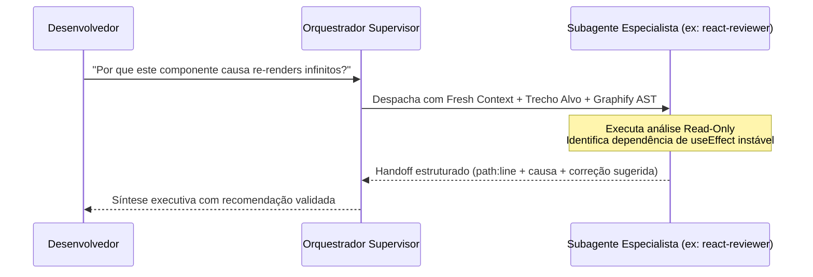
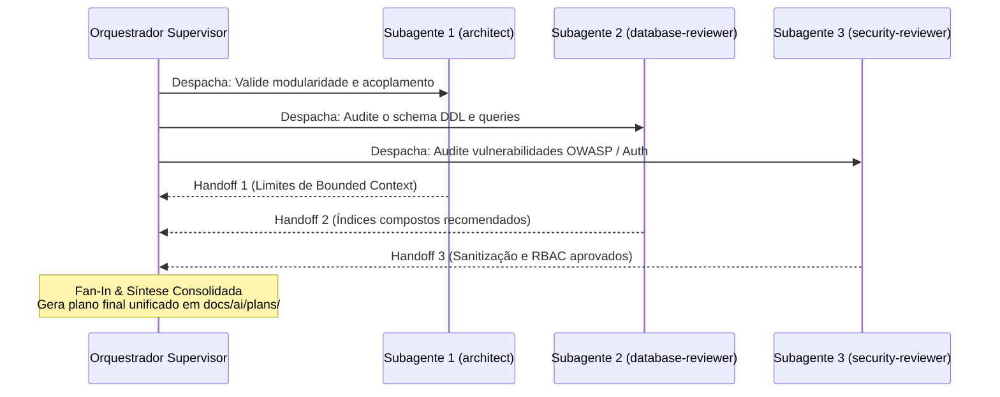

# 🤖 Guia Mestre de Orquestração do Ciclo de Vida: Do Zero ao Release com Agentes & Subagentes

**Data**: 04 de Novembro de 2026
**Versão**: 1.0.0 — Heurísticas Executáveis (slug `orquestracao-ciclo-de-vida-agentes`)
**Status**: Aprovado / Padrão Normativo
**Escopo**: Dual-Harness (Claude Code / OpenClaude `@subagente` & Google Antigravity `invoke_subagent`)
**Autor**: Equipe de Engenharia de IA & Arquitetura de Sistemas

---

## ⚙️ Heurísticas Executáveis

Bloco lido pelo `/setup` e por `skills/setup/scripts/verify_setup.py`. `when`/`verify` são shell (cwd = raiz do projeto, `AI_GUIDES_RUNTIME` aponta para `.agents/ai-guides`). Este guia é processual e normativo: ele padroniza o ciclo de vida, as fronteiras de isolamento e a matriz canônica de despacho dos 39 subagentes do repositório.

```yaml heuristics
guide: orquestracao-ciclo-de-vida-agentes
version: 1
requires:
  - harness-commit-memoria
  - orquestracao-ciclo-de-vida-skills
heuristics:
  - id: AGNT-01
    title: Template de Pull Request com o checklist canônico de governança de subagentes
    when: "! test -f .github/PULL_REQUEST_TEMPLATE.md && ! test -f .github/pull_request_template.md && ! test -f docs/pull_request_template.md"
    do: |
      mkdir -p .github
      cp "$AI_GUIDES_RUNTIME/templates/harness/PULL_REQUEST_TEMPLATE.md" .github/PULL_REQUEST_TEMPLATE.md
    verify: "grep -qs 'Subagentes' .github/PULL_REQUEST_TEMPLATE.md .github/pull_request_template.md docs/pull_request_template.md || test -f .github/PULL_REQUEST_TEMPLATE.md"
    optional: true

  - id: AGNT-02
    title: AGENTS.md declara a ordem canônica do ciclo de vida e a matriz de despacho de subagentes
    when: "! grep -q 'guia-orquestracao-ciclo-de-vida-agentes' AGENTS.md 2>/dev/null"
    do: |
      agent: Acrescente ao AGENTS.md, na seção de guias normativos, a linha:
      "- **Ciclo de Vida com Agentes & Subagentes:** siga a ordem canônica e a matriz de despacho de `.agents/ai-guides/guides/ai-engineering/guia-orquestracao-ciclo-de-vida-agentes.md`
      — Descoberta (consult.py) → Arqueologia/Legados (archeologist, legacy-archaeologist, spec-miner) → Planejamento & Arquitetura (planner, architect, adr-governor) →
      Design/UI/UX (ui-ux-auditor, motion-developer) → Construção & Review Polyglot (react-reviewer, mobile-developer, tdd-guide, code-reviewer) →
      Segurança & Pentest (security-reviewer, penetration-tester) → QA/Testes/DevOps (qa-automation-engineer, devops-reviewer) → Fechamento & Memória (doc-updater, token-economist)."
      Se AGENTS.md não existir, aplique antes o guia harness-commit-memoria.
    verify: "grep -q 'guia-orquestracao-ciclo-de-vida-agentes' AGENTS.md"
    optional: false
```

---

---

## 📚 Fundamentos

### 🎯 1. Visão Geral & Filosofia de Execução

No ecossistema corporativo de engenharia orientada a IA, **nenhum agente primário deve operar como um desenvolvedor monolítico sobrecarregado**. A tentativa de conduzir uma demanda completa — desde a engenharia reversa de um monolito legado até a auditoria de segurança OWASP, passando pela escrita de componentes visuais e testes E2E — em uma única janela de contexto contínua leva inevitavelmente ao fenômeno de **Context Rot** (degradação da atenção do modelo, alucinações arquiteturais, esquecimento de invariantes e consumo proibitivo de tokens).

A arquitetura do repositório resolve esse desafio através do **Catálogo de 39 Subagentes Especializados (`agents/*.md`)** operando sob o paradigma de **Fresh Context Dispatch** e isolamento determinístico.

```
┌────────────────────────────────────────────────────────────────────────┐
│                        ORQUESTRADOR SUPERVISOR                         │
│   (Contexto Enxuto • Regras Transversais • Coordenação de Entregáveis)  │
└───────┬────────────────────────┬───────────────────────────────┬───────┘
        │                        │                               │
        ▼                        ▼                               ▼
┌──────────────────┐   ┌──────────────────┐           ┌──────────────────┐
│  SUBAGENTE #1    │   │  SUBAGENTE #2    │           │  SUBAGENTE #3    │
│  (Fresh Context) │   │  (Fresh Context) │           │  (Fresh Context) │
│  Read-Only       │   │  Git Worktree    │           │  Read-Only SAST  │
│  archeologist    │   │  tdd-guide       │           │  security-reviewer│
└──────────────────┘   └──────────────────┘           └──────────────────┘
```

#### 🛡️ Por que Fresh Context e Isolamento são Inegociáveis?

1. **Eliminação do Context Rot**: Cada subagente despachado inicia com uma janela de contexto limpa (Fresh Context), contendo estritamente sua persona especializada, instruções normativas e os parâmetros cirúrgicos da tarefa.
2. **Separação Estrita de Privilégios (Read-Only vs Read-Write)**: Investigadores sistêmicos (`archeologist`, `legacy-archaeologist`, `ui-ux-auditor`, `security-reviewer`) possuem apenas ferramentas de leitura (`Read`, `Grep`, `Glob`, `Bash` não mutável), impossibilitando que auditorias modifiquem o código acidentalmente.
3. **Isolamento de Estado em Git Worktrees**: Refatorações estruturais de grande porte, testes pesados ou migrações de esquemas de banco são executados em árvores isoladas gerenciadas por `python3 scripts/worktree_manager.py create <nome>`, garantindo zero poluição do branch ativo do desenvolvedor.
4. **Graphify First Compulsório**: Todo subagente despachado tem como diretiva mandatória consultar o Grafo de Conhecimento (`graphify query`, `graphify path`, `graphify explain`) antes de qualquer busca textual com Grep/Glob, reduzindo em até 85% os tokens consumidos em explorações cegas.

#### ⚠️ Riscos da Execução Desordenada de Agentes

- **Despacho sem recomendador (`consult.py` ignorado)**: Despachar o subagente errado (ex: usar `planner` para auditoria de segurança) resulta em análises superficiais sem o ferramental adequado.
- **Despacho sem delimitação de fronteiras**: Subagentes exploratórios sem escopo explícito varrem o repositório indiscriminadamente, estourando orçamentos de sessão.
- **Execução mutável direta no branch de trabalho**: Modificações destrutivas sem validação prévia de `tdd-guide` ou worktree quebram a esteira de desenvolvimento do time.
- **Entrega sem evidência rastreável (`path:line` ausente)**: Pareceres opinativos sem citação exata de linha e arquivo impedem a verificação automatizada.

---

### 🗺️ 2. Mapa Geral do Ciclo de Vida dos Agentes

O ciclo de vida de orquestração de subagentes se divide em **5 Estados de Execução**, partindo da recomendação até a homologação final e consolidação de memória:

```mermaid
flowchart TD
    subgraph ESTADO0["0. Descoberta & Recomendação"]
        direction TB
        E0A["Desafio / Requisito do Desenvolvedor"]
        E0B["python3 scripts/consult.py '<desafio>'<br/><i>(Mapeamento de Domínio, Subagentes & Guias)</i>"]
        E0A --> E0B
    end

    subgraph ESTADO1["1. Preparação de Contexto & Isolamento"]
        direction TB
        E1A["Seleção do Padrão Topológico<br/><i>(Single, Hierarchical, Dual-Reviewer ou Worktree)</i>"]
        E1B{"A tarefa é mutável ou de alto risco?"}
        E1C["Worktree Manager<br/><i>python3 scripts/worktree_manager.py create</i>"]
        E1D["Fresh Context Payload<br/><i>(Injeção de Graphify AST + Escopo Cirúrgico)</i>"]
        E1A --> E1B
        E1B -- Sim --> E1C --> E1D
        E1B -- Não (Read-Only) --> E1D
    end

    subgraph ESTADO2["2. Despacho & Execução Especializada"]
        direction TB
        E2A["Despacho do Subagente (@<nome> / invoke_subagent)"]
        E2B["Prompt Defense Baseline Ativo<br/><i>(Sem vazamento de segredos, sem desvio de persona)</i>"]
        E2C["Graphify Before Grep Obrigatório<br/><i>(Navegação determinística por nós e dependências)</i>"]
        E2D["Execução de Tarefa Conforme Ferramentas Permitidas"]
        E2A --> E2B --> E2C --> E2D
    end

    subgraph ESTADO3["3. Verificação Baseada em Evidências"]
        direction TB
        E3A["Auditoria de Parecer: Evidências path:line"]
        E3B["Testes Automatizados AAA / SAST Zero-Vuln"]
        E3C["Blindagem com plan-criticize (Risk Score <= 15)"]
        E3A --> E3B --> E3C
    end

    subgraph ESTADO4["4. Handoff, Síntese & Gate de Homologação"]
        direction TB
        E4A["Relatório Estruturado de Handoff ao Supervisor"]
        E4B["Persistência de Artefato Formal (docs/ai/ ou docs/adrs/)"]
        E4C["Limpeza de Worktree (se aplicável) & Consolidação"]
        E4D{"Gate de Aprovação Explícita do Usuário"}
        E4A --> E4B --> E4C --> E4D
    end

    ESTADO0 --> ESTADO1
    ESTADO1 --> ESTADO2
    ESTADO2 --> ESTADO3
    ESTADO3 --> ESTADO4
```



---

### 📊 3. Matriz Canônica do Catálogo de Subagentes (39 Agentes)

O repositório mantém 39 subagentes especializados em `agents/*.md`. A tabela a seguir categoriza cada subagente por domínio funcional, modo de acesso, ferramentas autorizadas e artefato entregue:

| # | Subagente | Domínio Funcional | Modo | Ferramentas Autorizadas | Gatilho / Missão Típica | Artefato / Saída Esperada |
| :-: | :--- | :--- | :-: | :--- | :--- | :--- |
| **01** | [`archeologist`](../../agents/archeologist.md) | Arqueologia Sistêmica | 👁️ Read-Only | Read, Grep, Glob, Bash | _"Mapeie o fluxo do módulo X com evidências"_ | Mapeamento estrutural com citações `path:line` |
| **02** | [`legacy-archaeologist`](../../agents/legacy-archaeologist.md) | Arqueologia de Legados | 👁️ Read-Only | Read, Grep, Glob, Bash | _"Documente a regra de negócio do monolito Y"_ | Feature Map e documentação forense tríplice |
| **03** | [`spec-miner`](../../agents/spec-miner.md) | Mineração de Especificações | 👁️ Read-Only | Read, Grep, Glob, Bash | _"Extraia o contrato OpenAPI e DTOs deste endpoint"_ | Contratos de API (OpenAPI 3.1) e schemas DTO |
| **04** | [`planner`](../../agents/planner.md) | Planejamento Estratégico | ✏️ Read-Write | Read, Write, Edit, Bash, Grep, Glob | _"Planeje a implementação da feature Z"_ | Plano detalhado em `docs/ai/plans/` com `/plan-criticize` |
| **05** | [`architect`](../../agents/architect.md) | Arquitetura & System Design | ✏️ Read-Write | Read, Write, Edit, Bash, Grep, Glob | _"Defina a arquitetura de microsserviços / DDD"_ | Modelo C4, limites modulares e draft de ADRs |
| **06** | [`adr-governor`](../../agents/adr-governor.md) | Governança de Decisões | ✏️ Read-Write | Read, Write, Edit, Bash, Grep, Glob | _"Formalize a decisão técnica em ADR canônica"_ | ADR numerada em `docs/adrs/` padrão MADR v2.0 |
| **07** | [`ui-ux-auditor`](../../agents/ui-ux-auditor.md) | Auditoria de Design & WCAG | 👁️ Read-Only | Read, Grep, Glob, Bash | _"Audite a acessibilidade e micro-UX das telas"_ | Laudo WCAG 2.2 AAA, APCA $L_c$ e Anti-Slop |
| **08** | [`motion-developer`](../../agents/motion-developer.md) | Motion Design & Animação | ✏️ Read-Write | Read, Write, Edit, Bash, Grep, Glob | _"Implemente animações fluidas com GSAP / WebGL"_ | Componentes animados com `prefers-reduced-motion` |
| **09** | [`react-reviewer`](../../agents/react-reviewer.md) | Stack Frontend (React/Next) | 👁️ Read-Only | Read, Grep, Glob, Bash | _"Revise os componentes React e Server Actions"_ | Diagnóstico de waterfalls, bundle e re-renders |
| **10** | [`vue-reviewer`](../../agents/vue-reviewer.md) | Stack Frontend (Vue/Nuxt) | 👁️ Read-Only | Read, Grep, Glob, Bash | _"Audite a reatividade e composables do Nuxt 3"_ | Diagnóstico de Composition API, Pinia e SSR |
| **11** | [`mobile-developer`](../../agents/mobile-developer.md) | Engenharia Mobile Nativa | ✏️ Read-Write | Read, Write, Edit, Bash, Grep, Glob | _"Implemente a tela em Compose / SwiftUI / Flutter"_ | Código mobile reativo com arquitetura Offline-First |
| **12** | [`typescript-reviewer`](../../agents/typescript-reviewer.md) | Stack TypeScript / Node | 👁️ Read-Only | Read, Grep, Glob, Bash | _"Audite as tipagens genéricas e strict mode"_ | Diagnóstico de type safety, zero `any` e invariantes |
| **13** | [`python-reviewer`](../../agents/python-reviewer.md) | Stack Python / FastAPI | 👁️ Read-Only | Read, Grep, Glob, Bash | _"Revise os serviços assíncronos e modelos Pydantic"_ | Auditoria de PEP 8, concorrência async e tipos |
| **14** | [`go-reviewer`](../../agents/go-reviewer.md) | Stack Golang | 👁️ Read-Only | Read, Grep, Glob, Bash | _"Audite goroutines, channels e context cancellation"_ | Diagnóstico de race conditions, leaks e idiomatismos |
| **15** | [`java-reviewer`](../../agents/java-reviewer.md) | Stack Java / Spring Boot | 👁️ Read-Only | Read, Grep, Glob, Bash | _"Revise as anotações Spring e isolamento transacional"_ | Auditoria de beans, concorrência e JPA performance |
| **16** | [`csharp-reviewer`](../../agents/csharp-reviewer.md) | Stack .NET / C# | 👁️ Read-Only | Read, Grep, Glob, Bash | _"Revise os controllers, LINQ e injeção de dependência"_ | Diagnóstico de alocação de memória e async/await |
| **17** | [`mle-reviewer`](../../agents/mle-reviewer.md) | Engenharia de ML & Dados | 👁️ Read-Only | Read, Grep, Glob, Bash | _"Audite os pipelines de inferência e treinamento"_ | Relatório de data leakage, latência e batching |
| **18** | [`rag-pipeline-reviewer`](../../agents/rag-pipeline-reviewer.md) | Pipelines de RAG & Embeddings | 👁️ Read-Only | Read, Grep, Glob, Bash | _"Valide a estratégia de chunking e busca vetorial"_ | Laudo de precisão semântica, reranking e custos |
| **19** | [`security-reviewer`](../../agents/security-reviewer.md) | Segurança Estática (SAST) | 👁️ Read-Only | Read, Grep, Glob, Bash | _"Execute varredura de segurança contra OWASP Top 10"_ | Relatório de vulnerabilidades, segredos e LGPD |
| **20** | [`penetration-tester`](../../agents/penetration-tester.md) | Pentest Ofensivo Simulado | 👁️ Read-Only | Read, Grep, Glob, Bash | _"Teste vetores de IDOR, BOLA, SSRF e bypass de auth"_ | Relatório PTES com provas de conceito seguras |
| **21** | [`tdd-guide`](../../agents/tdd-guide.md) | Desenvolvimento Guiado por Testes | ✏️ Read-Write | Read, Write, Edit, Bash, Grep, Glob | _"Guie a implementação do módulo seguindo Red-Green"_ | Suíte de testes unitários AAA e código aprovado |
| **22** | [`qa-automation-engineer`](../../agents/qa-automation-engineer.md) | Automação de QA & Integração | ✏️ Read-Write | Read, Write, Edit, Bash, Grep, Glob | _"Estruture a esteira de testes integrados e E2E"_ | Pirâmide de testes implementada e scripts CI/CD |
| **23** | [`e2e-runner`](../../agents/e2e-runner.md) | Execução de E2E & Headless | ✏️ Read-Write | Read, Write, Edit, Bash, Grep, Glob | _"Rode a suíte de testes Playwright / Maestro"_ | Logs de execução, screenshots de erro e relatórios |
| **24** | [`silent-failure-hunter`](../../agents/silent-failure-hunter.md) | Caça a Falhas Silenciosas | 👁️ Read-Only | Read, Grep, Glob, Bash | _"Encontre swallow exceptions, promises não tratadas"_ | Mapeamento de `catch` vazios e falhas não logadas |
| **25** | [`build-error-resolver`](../../agents/build-error-resolver.md) | Resolução de Erros de Build | ✏️ Read-Write | Read, Write, Edit, Bash, Grep, Glob | _"Corrija os erros de compilação do TypeScript / Cargo"_ | Diff cirúrgico corrigindo dependências e tipagens |
| **26** | [`pr-test-analyzer`](../../agents/pr-test-analyzer.md) | Análise de Cobertura de PR | 👁️ Read-Only | Read, Grep, Glob, Bash | _"Analise a cobertura de testes do diff do Pull Request"_ | Relatório de linhas não cobertas e casos de borda |
| **27** | [`performance-optimizer`](../../agents/performance-optimizer.md) | Otimização de Performance | 👁️ Read-Only | Read, Grep, Glob, Bash | _"Identifique gargalos de CPU, memória e N+1 queries"_ | Profiling de CPU/Memória e recomendações de cache |
| **28** | [`type-design-analyzer`](../../agents/type-design-analyzer.md) | Design de Sistemas de Tipos | 👁️ Read-Only | Read, Grep, Glob, Bash | _"Refine a tipagem de domínio para tornar estados inválidos irrepresentáveis"_ | Álgebra de tipos, discriminators e Value Objects |
| **29** | [`code-reviewer`](../../agents/code-reviewer.md) | Revisão Geral de Código | 👁️ Read-Only | Read, Grep, Glob, Bash | _"Revise o PR contra Clean Code, SOLID e convenções"_ | Apontamentos acionáveis categorizados por severidade |
| **30** | [`code-simplifier`](../../agents/code-simplifier.md) | Simplificação & Anti-Overengineering | ✏️ Read-Write | Read, Write, Edit, Bash, Grep, Glob | _"Remova abstrações prematuras e simplifique o fluxo"_ | Refatoração YAGNI mantendo 100% dos testes verdes |
| **31** | [`refactor-cleaner`](../../agents/refactor-cleaner.md) | Limpeza & Eliminação de Débito | ✏️ Read-Write | Read, Write, Edit, Bash, Grep, Glob | _"Elimine código morto, variáveis não usadas e duplicatas"_ | Workspace limpo sem warnings de linter |
| **32** | [`database-reviewer`](../../agents/database-reviewer.md) | Revisão de Banco de Dados | 👁️ Read-Only | Read, Grep, Glob, Bash | _"Audite o schema DDL, índices compostos e locks"_ | Análise de plano de execução, índices e DDL seguro |
| **33** | [`doc-updater`](../../agents/doc-updater.md) | Sincronização Documental | ✏️ Read-Write | Read, Write, Edit, Bash, Grep, Glob | _"Atualize a documentação em docs/domains/ e README"_ | Sincronização documental sem poluição da raiz |
| **34** | [`docs-lookup`](../../agents/docs-lookup.md) | Consulta Rápida a Documentações | 👁️ Read-Only | Read, Grep, Glob, Bash | _"Localize a especificação oficial da RFC / biblioteca"_ | Síntese concisa de documentações oficiais indexadas |
| **35** | [`harness-optimizer`](../../agents/harness-optimizer.md) | Otimização de Harness & Hooks | ✏️ Read-Write | Read, Write, Edit, Bash, Grep, Glob | _"Audite os hooks de Claude Code e settings do Gemini"_ | Otimização dos guardrails de sessão e tempos de resposta |
| **36** | [`agent-evaluator`](../../agents/agent-evaluator.md) | Avaliação de Agentes & Evals | 👁️ Read-Only | Read, Grep, Glob, Bash | _"Avalie a aderência do agente às diretrizes corporativas"_ | Score de acurácia, fidelidade de contexto e evals |
| **37** | [`devops-reviewer`](../../agents/devops-reviewer.md) | Revisão de CI/CD & Infraestrutura | 👁️ Read-Only | Read, Grep, Glob, Bash | _"Audite os workflows do GitHub Actions e Dockerfiles"_ | Checklist de segurança em pipelines, cache e imagem |
| **38** | [`token-economist`](../../agents/token-economist.md) | Orçamento & Economia de Tokens | 👁️ Read-Only | Read, Grep, Glob, Bash | _"Analise a queima de tokens da sessão e ative podas"_ | Diagnóstico de consumo e recomendações de modo Stoneage |
| **39** | [`desktop-developer`](../../agents/desktop-developer.md) | Engenharia Desktop Multiplataforma | ✏️ Read-Write | Read, Write, Edit, Bash, Grep, Glob | _"Desenvolva o app Electron / Tauri 2 com IPC seguro"_ | Arquitetura multi-processo, IPC tipado e 60/120 FPS |

---

### 🔍 4. Detalhamento dos Padrões de Orquestração & Despacho

#### 4.1. Descoberta & Recomendação com `scripts/consult.py`

Antes de despachar manualmente subagentes baseando-se em suposições, o supervisor deve rodar a busca determinística de consultoria técnica:

```bash
python3 scripts/consult.py "<desafio ou tecnologia alvo>"
```

O script examina o catálogo de especialistas, analisa as keywords e retorna exatamente quais subagentes de `agents/*.md` estão instalados e habilitados, junto das skills e guias normativos aplicáveis.

#### 4.2. Padrões Topológicos de Orquestração

Dependendo da complexidade e do risco da demanda, o supervisor adota um dos quatro padrões topológicos:

##### Padrão A: Especialista Cirúrgico (Single Specialist Dispatch)

Utilizado para dúvidas pontuais, investigações de causa raiz ou auditorias de escopo restrito.



##### Padrão B: Hierarquia Supervisor-Worker (Fan-Out / Fan-In)

Utilizado para tarefas que exigem múltiplos pontos de vista independentes (ex: arquitetura, banco e segurança avaliando uma proposta concorrente).



##### Padrão C: Par Dialético (Red-Team vs Blue-Team)

Utilizado quando uma proposta de alto risco necessita de contestação implacável antes de ser aprovada:

- **Arquitetura**: `architect` propõe a solução $\longleftrightarrow$ `plan-criticize` atua como crítico hostil calculando o Risk Score.
- **Segurança**: `security-reviewer` define as defesas $\longleftrightarrow$ `penetration-tester` simula ataques de contorno (BOLA, IDOR, SSRF).
- **Código**: `tdd-guide` implementa $\longleftrightarrow$ `code-simplifier` remove complexidade acidental mantendo os testes passando.

##### Padrão D: Worker Isolado em Git Worktree

Utilizado para tarefas mutáveis de alto impacto (refatorações pesadas, migrações de framework ou testes destrutivos de migração):

```bash
# 1. Cria a worktree isolada para o subagente
python3 scripts/worktree_manager.py create refactor-auth-service

# 2. O subagente opera exclusivamente no diretório .worktrees/refactor-auth-service
# 3. O supervisor audita o diff gerado na worktree
# 4. Homologado o trabalho, o branch é mergeado e a worktree limpa:
python3 scripts/worktree_manager.py remove refactor-auth-service
```

---

### ⚡ 5. Governança de Contexto, Memória e Economia de Tokens

A gestão de subagentes é o pilar central para manter a longevidade e a precisão do agente no repositório.

#### 🧠 5.1. O Protocolo Fresh Context

```
❌ Sessão Monolítica Longa:
[Prompt 1] -> [Bash 100k logs] -> [Grep 50k] -> [Código] -> [Context Rot: Esquecimento de regras]

✅ Orquestração com Subagentes:
[Supervisor Enxuto: 10k tokens]
    ├── Invocação @archeologist ──> Executa em 15k tokens ──> Retorna resumo de 1k tokens
    ├── Invocação @tdd-guide    ──> Executa em 20k tokens ──> Retorna diff validado de 2k tokens
    └── Invocação @code-reviewer ──> Executa em 12k tokens ──> Retorna laudo aprovado de 500 tokens
Supervisor permanece com ~15k tokens limpos e precisos!
```

#### 🧭 5.2. Graphify First Obrigatório no Despacho

Ao instruir qualquer subagente para exploração ou análise de código, o supervisor **DEVE OBRIGATORIAMENTE** injetar a diretiva:

```markdown
"Consulte o Knowledge Graph do repositório via `graphify query '<termo>'` ou `graphify explain '<conceito>'` antes de qualquer busca textual com Grep ou Glob."
```

Isso garante que o subagente navegue pela AST estruturada (nós de classes, funções e arestas de chamada), sem poluir a janela de contexto com milhares de linhas de buscas de texto cegas.

#### 📋 5.3. Formato Canônico de Handoff (Retorno do Subagente)

Todo subagente despachado deve estruturar seu parecer de retorno no formato tríplice:

```markdown
### 🎯 Handoff: [Nome do Subagente] — [Tópico da Tarefa]

1. **Evidências Observadas (`path:line`)**:
   - `src/auth/jwt_service.py:42`: Validação de assinatura sem verificar claim de expiração (`exp`).
   - `src/controllers/user.py:118`: Consulta direta a banco sem uso de prepared statement.

2. **Diagnóstico & Causa Raiz**:
   - Falha de segurança CWE-347 permitindo bypass de expiração do token.

3. **Ação Executada / Recomendação**:
   - [Se Read-Only]: Recomendada inserção de `verify_exp=True` no payload do decode.
   - [Se Read-Write]: Teste de regressão criado em `tests/test_jwt.py:85` e código corrigido.
```

---

### 🚦 6. Cenários Práticos de Adoção e Orquestração Multi-Agente

#### Cenário A: Projeto Greenfield (Do Zero ao Release com Agentes)

> **Sequência Canônica de Despacho:**
> 1. `planner` ➔ Elabora o plano macro em `docs/ai/plans/` com suporte da skill `product-spec`.
> 2. `architect` ➔ Modela bounded contexts, diagramas C4 e padrões de resiliência.
> 3. `adr-governor` ➔ Formaliza as decisões estruturais em `docs/adrs/`.
> 4. `database-reviewer` ➔ Modela e audita o DDL e índices do banco de dados.
> 5. `ui-ux-auditor` ➔ Desenha tokens de design e assegura conformidade WCAG 2.2 AAA.
> 6. `tdd-guide` ➔ Implementa cada módulo guiado por testes unitários e de integração.
> 7. `code-reviewer` ➔ Audita qualidade, manutenibilidade e conformidade Clean Code.
> 8. `security-reviewer` ➔ Executa SAST rigoroso e validação Zero-Trust antes do release.
> 9. `doc-updater` ➔ Sincroniza `docs/domains/` e atualiza o `README.md`.

#### Cenário B: Brownfield / Nova Funcionalidade em Sistema Existente

> **Sequência Canônica de Despacho:**
> 1. `archeologist` ➔ Mapeia dependências e contratos existentes com `path:line`.
> 2. `planner` ➔ Elabora o plano da nova funcionalidade e submete ao `/plan-criticize`.
> 3. `database-reviewer` ➔ Avalia migrações de banco (se houver alteração de esquema).
> 4. `tdd-guide` ➔ Constrói os testes e a implementação da feature.
> 5. `silent-failure-hunter` ➔ Audita o código novo contra exceções engolidas e erros silenciados.
> 6. `security-reviewer` ➔ Gate de segurança final pré-merge.

#### Cenário C: Modernização de Sistema Legado & Arqueologia Profunda

> **Sequência Canônica de Despacho:**
> 1. `legacy-archaeologist` ➔ Varre o monolito legado, extrai o Feature Map e regras de negócio.
> 2. `spec-miner` ➔ Extrai contratos implícitos, DTOs e rotas legadas em OpenAPI 3.1.
> 3. `architect` ➔ Desenha a arquitetura alvo desacoplada e padrões de estrangulamento (Strangler Fig).
> 4. `worktree_manager.py create legacy-migration` ➔ Isola o workspace de migração.
> 5. Especialista da Stack alvo (`react-reviewer`, `python-reviewer`, etc.) ➔ Implementa a nova stack.
> 6. `qa-automation-engineer` ➔ Cria testes de paridade comportamental (Golden Master Tests).

#### Cenário D: Auditoria Crítica de Segurança & Pentest

> **Sequência Canônica de Despacho:**
> 1. `security-reviewer` ➔ Mapeia a superfície de ataque estática e vulnerabilidades OWASP Top 10.
> 2. `penetration-tester` ➔ Simula vetores de contorno (SSRF, BOLA, injection, CSRF) com testes seguros.
> 3. `build-error-resolver` / `refactor-cleaner` ➔ Aplica as correções nas bibliotecas e sanitização.
> 4. `security-reviewer` ➔ Validação confirmatória com laudo 100% verde.

#### Cenário E: Refatoração Estrutural de Alto Risco

> **Sequência Canônica de Despacho:**
> 1. `worktree_manager.py create refactor-core` ➔ Cria workspace isolado.
> 2. `architect` ➔ Delimita interfaces e contratos estáveis.
> 3. `refactor-cleaner` ➔ Realiza as alterações de código e remoção de código morto.
> 4. `code-simplifier` ➔ Remove abstrações prematuras.
> 5. `tdd-guide` + `e2e-runner` ➔ Roda a suíte completa de testes para garantir zero regressão.
> 6. Supervisor mergeia o branch e remove a worktree.

---

### ✅ 7. Checklist Canônico de Governança de Agentes (Para o PR)

Copie e preencha este checklist na descrição de Pull Requests que envolvam tarefas coordenadas por agentes ou subagentes:

```markdown
### 🤖 Checklist de Governança e Ciclo de Vida de Agentes

- [ ] **Descoberta**: Especialistas selecionados via `python3 scripts/consult.py` ou matriz canônica
- [ ] **Contexto & Graphify**: Todos os subagentes consultaram o Grafo (`graphify query`) antes de buscas cegas
- [ ] **Fronteiras de Acesso**: Agentes de auditoria (`archeologist`, `security-reviewer`, `ui-ux-auditor`) operaram em modo estritamente Read-Only
- [ ] **Isolamento de Risco**: Tarefas pesadas ou destrutivas executadas em Git Worktree (`worktree_manager.py`)
- [ ] **Evidências Rastreáveis**: Todos os achados citam expressamente arquivos e linhas (`path:line`)
- [ ] **Blindagem do Plano**: Planos e especificações validados pelo `/plan-criticize` com Risk Score $\le 15$
- [ ] **Qualidade & Testes**: Módulos implementados com testes automatizados no padrão AAA (`tdd-guide`)
- [ ] **Zero Vulnerabilidades**: Auditoria SAST aprovada sem apontamentos críticos (`security-reviewer`)
- [ ] **Consolidação Documental**: Artefatos salvos em `docs/ai/` ou `docs/adrs/` e memória atualizada
- [ ] **Economia de Contexto**: Janela mantida enxuta e sintetizada pelo supervisor sem Context Rot
```
