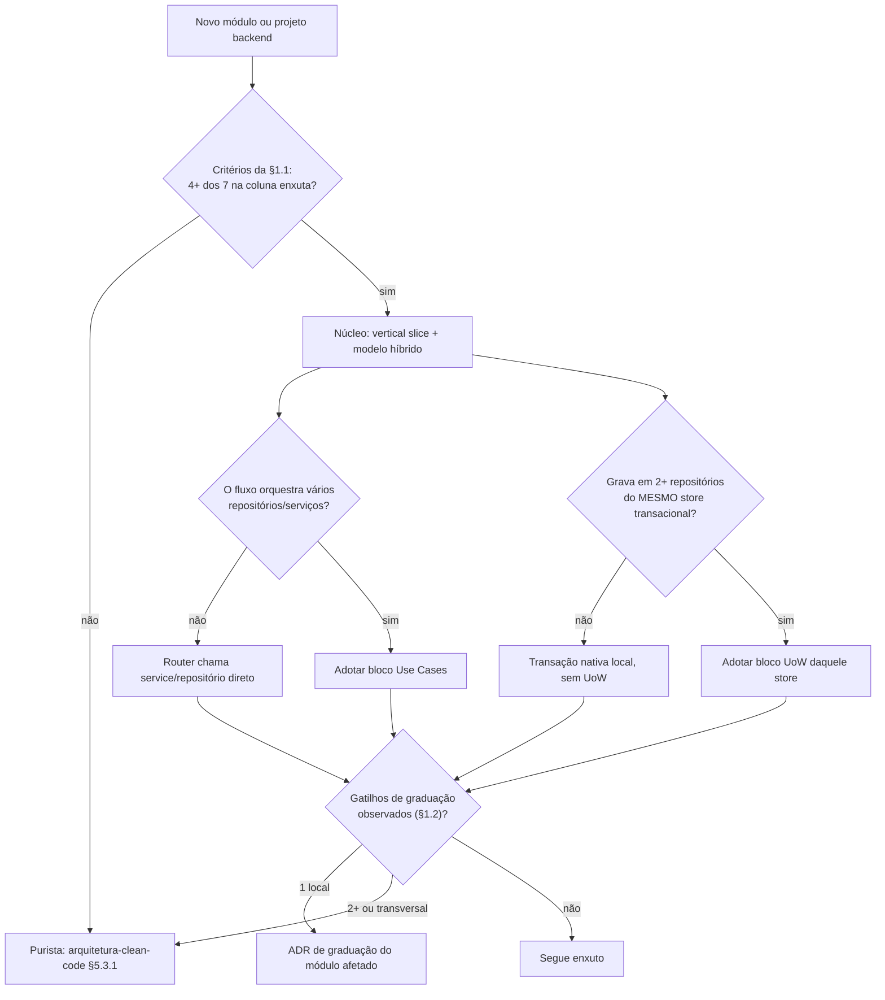
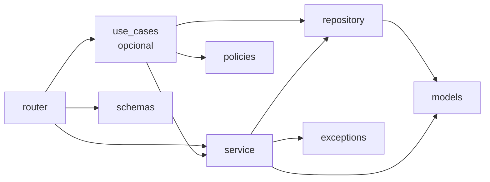
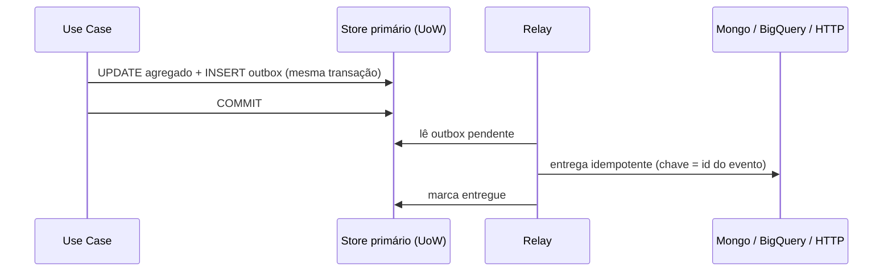

---

title: Guia de DDD Pragmático com Use Cases e Unit of Work Opcionais
description: Manual técnico para backends em DDD enxuto (vertical slice, modelo híbrido), com Use Cases e Unit of Work como blocos opcionais e independentes, critérios de fronteira transacional por store, persistência poliglota e fiscalização automatizada.
version: 1.0.0
date: 2026-10-28
author: Comitê Corporativo de Arquitetura & Engenharia de Software
---

<!-- markdownlint-disable MD022 MD025 MD031 MD032 MD040 MD026 -->

<!--
LOG DE MANUTENÇÃO E ALTERAÇÕES DO DOCUMENTO

| Data          | Autor                                                      | Descrição da Alteração                                                                 |
| ------------- | ---------------------------------------------------------- | -------------------------------------------------------------------------------------- |
| 2026-10-28    | Eduardo Batista                                            | v1.0.0 — Criação do guia: bloco de heurísticas DDDP-00..05 (declaração de estilo,      |
|               |                                                            | checklist em .agents/rules, ADR de adesão com escopo do UoW por store, script          |
|               |                                                            | check_ddd_pragmatico.py com pre-flight e referência no AGENTS.md) e as 11 seções de    |
|               |                                                            | Fundamentos (posicionamento, núcleo, blocos opcionais, UoW poliglota, referência).     |

=================================================================================
-->

> **Princípio:** *DDD pragmático é um núcleo mínimo que já é um projeto DDD válido, mais dois blocos opcionais e independentes (Use Cases e Unit of Work), adotados só onde o custo se paga. A aplicabilidade do guia é decidida por declaração do time (manifesto ou ADR), nunca inferida da mera presença de `UnitOfWork` ou de `use_cases` no código.*

---

## ⚙️ Heurísticas Executáveis

Bloco lido pelo `/setup` e por `skills/setup/scripts/verify_setup.py`. `when`/`verify` são shell (cwd = raiz do projeto, `AI_GUIDES_RUNTIME` aponta para `.agents/ai-guides`). `do` é shell ou começa com `agent:`. A aplicabilidade mora dentro de cada `when` (via `templates/architecture/ddd_detect.sh`): sem declaração de estilo enxuto, as heurísticas DDDP-01..05 dão ⏭️, nunca ❌.

```yaml heuristics
guide: ddd-pragmatico
version: 1
requires: [arquitetura-clean-code, padrao-criacao-adrs]
heuristics:
  - id: DDDP-00
    title: Estilo do backend declarado no manifesto (Chamada 1b do /setup)
    when: |
      ! sh "$AI_GUIDES_RUNTIME/templates/architecture/ddd_detect.sh" declarado
    do: |
      agent: O manifesto não declara `backend_style`. Detecte antes (sem perguntar nada por causa disso):
      `sh "$AI_GUIDES_RUNTIME/templates/architecture/ddd_detect.sh" adr-estilo` imprime `enxuto`, `purista` ou nada, e os modos
      `uow` e `use_cases` dizem se o código já tem Unit of Work e Use Cases; use o resultado só para pré-marcar as respostas
      (brownfield: o detectado; greenfield: enxuto, Use Cases só com orquestração, UoW só no relacional, stores dos
      manifests/README). Faça as perguntas com AskUserQuestion, em uma chamada:
      1. Estilo do backend (single): DDD enxuto · Clean/Hexagonal purista · Ainda não sei · Não se aplica (scripts, funções
         serverless, sem camada de domínio).
      2. Use Cases (single): em todos os módulos · só nos fluxos com orquestração · não usar.
      3. Unit of Work (single): só nos stores transacionais · não usar.
      4. Stores (multiSelect): relacional OLTP · documentos · analítico · cache/chave-valor.
      Adaptação: as perguntas 2 a 4 só valem quando a resposta 1 é "DDD enxuto". Se a detecção não indica estilo, faça a 1
      sozinha e as demais numa segunda chamada; com `adr-estilo` ou detecção apontando enxuto, as quatro vão juntas,
      pré-marcadas. Sem store transacional (só documentos/analítico), não faça a pergunta 3: registre UoW ausente com o motivo
      `sem store transacional`. Com Django detectado, a pergunta 3 cita a transação nativa (`transaction.atomic`) como
      alternativa ao UoW explícito. Sem AskUserQuestion (headless), use as respostas do prompt; sem elas, o `adr-estilo`; sem
      ADR, `indefinido`.
      Grave a declaração (no mesmo diretório do projeto) com:
      `uv run $SETUP/scripts/verify_setup.py set backend_style=<…> backend_blocks=<…> stores=<…>`
      onde `backend_style` é `enxuto`, `purista`, `indefinido` ou `nao-se-aplica`; `backend_blocks` é `use_cases,uow`,
      `use_cases`, `uow` ou `nenhum`; e `stores` é a lista de `relacional`, `documentos`, `analitico`, `cache` (separada por
      vírgula). Para estilo diferente de `enxuto`, grave só `backend_style`. As demais heurísticas ficam ⏸️ até esta passar.
    verify: |
      sh "$AI_GUIDES_RUNTIME/templates/architecture/ddd_detect.sh" declarado

  - id: DDDP-01
    title: Checklist de DDD pragmático em .agents/rules/ddd-pragmatico.md
    when: |
      sh "$AI_GUIDES_RUNTIME/templates/architecture/ddd_detect.sh" adotado && ! test -f .agents/rules/ddd-pragmatico.md
    do: |
      mkdir -p .agents/rules
      cp "$AI_GUIDES_RUNTIME/templates/rules/ddd-pragmatico.md" .agents/rules/ddd-pragmatico.md
    verify: "grep -q 'Núcleo DDD Pragmático' .agents/rules/ddd-pragmatico.md"
    depends_on: [DDDP-00]

  - id: DDDP-02
    title: ADR de adesão (estilo, blocos adotados e escopo do Unit of Work por store)
    when: |
      sh "$AI_GUIDES_RUNTIME/templates/architecture/ddd_detect.sh" adotado && ! ( for f in docs/adr/*.md docs/adrs/*.md; do test -f "$f" && grep -q 'ddd-pragmatico' "$f" && grep -q '^## Escopo do Unit of Work' "$f" && exit 0; done; exit 1 )
    do: |
      agent: Crie a ADR de adesão no diretório de ADRs do projeto (docs/adr/ se existir, senão docs/adrs/; próximo número;
      template de ADR do projeto; nome e estrutura do padrão do guia padrao-criacao-adrs — o
      python3 .agents/scripts/adr/validate_adrs.py tem de seguir passando) com título citando `ddd-pragmatico` e as seções Contexto, Decisão, `## Escopo do Unit of Work`
      e Consequências. Leia `project.backend_style`, `project.backend_blocks` e `project.stores` do manifesto
      docs/ai/setup-manifest.yaml (gravados pelo `verify_setup.py set` antes da Fase 4); nunca invente a decisão.
      - Contexto: por que o projeto usa DDD enxuto (vertical slice, modelo híbrido) e não o purista.
      - Decisão: o estilo (`backend_style`) e os blocos adotados (`backend_blocks`: Use Cases, Unit of Work, ambos ou nenhum),
        com o critério de adoção/dispensa de cada um.
      - `## Escopo do Unit of Work`: tabela com uma linha por store declarado em `stores`, colunas Store · UoW cobre? · Por quê ·
        Consistência entre stores. O UoW delimita a transação de um único recurso transacional (relacional OLTP: sim;
        documentos: só com invariante que exija transação multi-documento; analítico: não, query services/read models;
        cache: não). A coluna de consistência cita Outbox, evento, saga ou reconciliação idempotente para escrita que
        atravessa stores, nunca UoW. Sem o bloco Unit of Work, registre o escopo como "não adotado" com o motivo.
      - Consequências: custos e riscos assumidos (disciplina de transação curta, fiscalização por check_ddd_pragmatico.py,
        gatilhos de graduação para o estilo purista).
      Se já existir ADR do estilo (ex.: ADR-008), não a edite: a ADR nova é curta e a referencia ("complementa ADR-008").
      O guia `padrao-criacao-adrs` manda no formato.
    verify: |
      for f in docs/adr/*.md docs/adrs/*.md; do test -f "$f" && grep -q 'ddd-pragmatico' "$f" && grep -q '^## Escopo do Unit of Work' "$f" && exit 0; done; exit 1
    depends_on: [DDDP-00]

  - id: DDDP-03
    title: Instala .agents/scripts/architecture/check_ddd_pragmatico.py (fiscaliza commit, transação curta, stores e HTTP)
    when: |
      ! test -f .agents/scripts/architecture/check_ddd_pragmatico.py && sh "$AI_GUIDES_RUNTIME/templates/architecture/ddd_detect.sh" adotado && sh "$AI_GUIDES_RUNTIME/templates/in_each.sh" --any python "true" && { sh "$AI_GUIDES_RUNTIME/templates/architecture/ddd_detect.sh" uow || sh "$AI_GUIDES_RUNTIME/templates/architecture/ddd_detect.sh" use_cases; }
    do: |
      mkdir -p .agents/scripts/architecture
      cp "$AI_GUIDES_RUNTIME/templates/architecture/check_ddd_pragmatico.py" .agents/scripts/architecture/check_ddd_pragmatico.py
      chmod +x .agents/scripts/architecture/check_ddd_pragmatico.py
    verify: "test -f .agents/scripts/architecture/check_ddd_pragmatico.py && python3 .agents/scripts/architecture/check_ddd_pragmatico.py --self-test"
    optional: true
    depends_on: [DDDP-00]

  - id: DDDP-04
    title: check_ddd_pragmatico.py ligado ao lint/CI sem quebrar o CI (pre-flight)
    when: |
      test -f .agents/scripts/architecture/check_ddd_pragmatico.py && sh "$AI_GUIDES_RUNTIME/templates/architecture/ddd_detect.sh" adotado && ! { grep -rqs 'check_ddd_pragmatico' Makefile .pre-commit-config.yaml pyproject.toml .github/workflows || sh "$AI_GUIDES_RUNTIME/templates/in_each.sh" --any python "grep -qs 'check_ddd_pragmatico' Makefile .pre-commit-config.yaml pyproject.toml"; }
    do: |
      agent: Pre-flight antes de ligar: rode `python3 .agents/scripts/architecture/check_ddd_pragmatico.py` na raiz do projeto
      (saída `caminho:linha [DDDP-Rn] mensagem`; exit 0 sem violação, 1 com violação R, 2 erro interno do script). Avisos
      `[DDDP-W…]` não contam como violação.
      - Exit 0: ligue ao alvo de lint do projeto (alvo `lint` do Makefile, hook local no .pre-commit-config.yaml ou etapa do
        workflow de CI, o que o projeto já usa; em monorepo, o Makefile/pyproject.toml do subprojeto Python também
        conta), mantendo o lint existente.
      - Exit 1: não ligue ao lint/CI e não refatore o código do usuário para passar. Registre a dívida numa ADR
        NNNN-debito-ddd-pragmatico.md no diretório de ADRs do projeto (docs/adr/ se existir, senão docs/adrs/; próximo número,
        template de ADR do projeto; nome e estrutura do padrão do guia padrao-criacao-adrs — o
        python3 .agents/scripts/adr/validate_adrs.py tem de seguir passando) com as linhas `caminho:linha [DDDP-Rn] mensagem` das violações R1 a R4 copiadas da saída
        do pre-flight (sem a saída, não registre dívida). Enquanto a dívida existir, esta heurística fica ⚠️ (o script
        não está ligado) e o /setup refaz só o pre-flight: se a ADR já existe e ainda há violações, não mude nada; se
        passou limpo, ligue o script ao lint e marque a ADR como resolvida.
      - Exit 2: não ligue, reporte a saída do script e o id fica ⚠️.
      Supressão pontual só com ADR: comentário `# ddd-pragmatico: allow Rn ADR-NNNN` na linha.
    verify: |
      grep -rqs 'check_ddd_pragmatico' Makefile .pre-commit-config.yaml pyproject.toml .github/workflows || sh "$AI_GUIDES_RUNTIME/templates/in_each.sh" --any python "grep -qs 'check_ddd_pragmatico' Makefile .pre-commit-config.yaml pyproject.toml"
    optional: true
    depends_on: [DDDP-00, DDDP-03]

  - id: DDDP-05
    title: AGENTS.md referencia o guia
    when: |
      sh "$AI_GUIDES_RUNTIME/templates/architecture/ddd_detect.sh" adotado && ! grep -q 'guia-ddd-pragmatico-unit-of-work-use-cases' AGENTS.md 2>/dev/null
    do: |
      agent: Acrescente ao AGENTS.md, na seção de guias normativos, a linha:
      "- **DDD Pragmático (Use Cases e Unit of Work):** Siga `.agents/ai-guides/guides/architecture/guia-ddd-pragmatico-unit-of-work-use-cases.md` (núcleo vertical slice, Use Cases e Unit of Work opcionais, transação curta e um store por UoW; checklist em `.agents/rules/ddd-pragmatico.md`)." Se a linha da categoria de arquitetura já existir, complete-a com este guia em vez de duplicá-la.
      Se AGENTS.md não existir, aplique antes o guia harness-commit-memoria.
    verify: "grep -q 'guia-ddd-pragmatico-unit-of-work-use-cases' AGENTS.md"
    depends_on: [DDDP-00]
```

---

## 📚 Fundamentos

**🧭 Como ler este guia**

Este guia **não substitui** o `arquitetura-clean-code` ([§5.3](./guia-arquitetura-software-design-clean-code.md)): ele sanciona um **segundo caminho legítimo** para backends, com critérios objetivos de escolha e de saída. Os exemplos de código são **não-normativos**: ilustram a topologia e as fronteiras, não impõem biblioteca, nomes ou estrutura de pastas além do que as seções normativas dizem.

| Termo | Significado neste guia |
|---|---|
| **Núcleo** | *Vertical slice* + modelo híbrido: já é um projeto DDD válido, sem nenhum dos blocos abaixo. |
| **Bloco Use Cases** | Orquestradores `VerbNounUseCase`. **Opcional.** |
| **Bloco Unit of Work (UoW)** | Fronteira transacional explícita de **um** recurso transacional. **Opcional.** |
| **Enxuto** | Estilo declarado `backend_style: enxuto` (manifesto do `/setup` ou ADR `ddd-pragmatico`). Só ele ativa as heurísticas DDDP. |
| **Purista** | Clean/Hexagonal conforme `arquitetura-clean-code` §5.3.1. Continua válido e é o default quando nada é declarado. |

> **Declaração decide, detecção sugere.** Ter uma classe `UnitOfWork` ou um `use_cases.py` não prova estilo enxuto: projetos Hexagonais puristas também os têm. A aplicabilidade deste guia nasce de uma declaração do time, nunca de inferência sobre o código.

---

### 1. Posicionamento

O espectro tem três pontos de partida legítimos. Nenhum é "o certo" em abstrato: o custo de cada um se paga em contextos diferentes.

```text
 Service-centric            DDD enxuto                    Clean / Hexagonal purista
 (CRUD, scripts)      (vertical slice + ORM híbrido)       (domínio sem ORM + mappers)
 ───────────────────────────────────────────────────────────────────────────────────►
 menos cerimônia                                                    mais isolamento
 menos proteção contra mudança                       mais código, mais mappers, mais tempo
```

#### 1.1. Matriz de Escolha

| Critério | Favorece **DDD enxuto** | Favorece **purista** |
|---|---|---|
| Invariantes de negócio | Locais a uma entidade ou a um agregado pequeno | Cruzam entidades; regras ricas e mutáveis |
| *Bounded contexts* | Um ou poucos, mesmo repositório | Vários, com contratos entre eles |
| Probabilidade de trocar ORM/banco | Baixa (o banco é decisão estável) | Alta, ou há requisito explícito de portabilidade |
| Necessidade de testar o domínio sem banco | Baixa: o modelo ORM em memória basta | Alta: regras pesadas, cobertura sem I/O |
| Persistência | Um store transacional dominante | Múltiplos adaptadores de persistência |
| Tamanho e rotatividade do time | Pequeno/médio, onboarding rápido importa | Grande, vários times, ownership por contexto |
| Custo de cerimônia aceitável | Baixo: entrega incremental por módulo | Alto: governança forte já existe |

Regra de decisão: conte quantos dos 7 critérios caem na coluna enxuta (cada critério cai em uma das duas colunas; não há empate possível) e quantos gatilhos de graduação (§1.2) já ocorrem ou estão previstos. Todo gatilho observado abre uma ADR de graduação, independentemente da contagem. O resultado vai para uma ADR (`guia-padrao-criacao-adrs.md`) e para o manifesto (`backend_style`).

| Critérios na coluna enxuta | Gatilhos de graduação | Resultado |
|---|---|---|
| 4 a 7 | 0 | **Enxuto** |
| 4 a 7 | 1, local a um módulo | **Enxuto** + ADR de graduação **do módulo afetado** (esse módulo passa a purista; exceção registrada na ADR de adesão) |
| 4 a 7 | 2 ou mais, ou um gatilho que atravessa módulos (ex.: segundo adaptador de persistência) | ADR de graduação **do projeto**: **purista** (`set backend_style=purista`, §11.3) |
| 0 a 3 | qualquer | **Purista** |

#### 1.2. Gatilhos de Graduação para o Purista

O enxuto é um ponto de partida, não um destino. **Um** gatilho já basta para o time abrir uma ADR e **graduar** o módulo afetado; **dois ou mais**, ou um gatilho que atravessa módulos, graduam o projeto inteiro (tabela da §1.1):

| Gatilho | Sinal observável | Ação |
|---|---|---|
| Invariantes entre entidades | A mesma regra é reimplementada em 2+ services ou exige carregar vários agregados para validar | Extrair agregado/domain service puro (§7) |
| Regras que não cabem no modelo ORM | Métodos do modelo precisam de sessão, relacionamentos lazy ou ficam presos a detalhes de mapeamento | Entidade de domínio sem ORM + mapper no módulo |
| Domínio sem banco | Testar uma regra exige subir banco/fixtures pesadas e a suíte fica lenta | Isolar o domínio e testar em memória |
| Segundo adaptador de persistência | Mesmo agregado persiste em dois stores/ORMs, ou há migração de banco planejada | Portas + adaptadores por store |

#### 1.3. Combinações Possíveis

O núcleo é independente dos blocos, e os dois blocos são independentes entre si.

| Combinação | Quando faz sentido |
|---|---|
| **Só núcleo** | CRUD, módulos de leitura, serviços pequenos. O `service` (recebendo a sessão e o repositório) é dono do `commit`. |
| **Núcleo + Use Cases** | Há orquestração, mas a transação é simples (ou o framework já fornece, ex.: `transaction.atomic`). |
| **Núcleo + UoW** | Transação delimitada com vários repositórios, sem camada de casos de uso. O dono do `commit` é o **Application Service** (`service.py` atuando como camada de aplicação, instância com o UoW injetado, §7). |
| **Núcleo + ambos** | Fluxos com autorização + escrita + auditoria em vários repositórios (caso do CRM de referência). |

Ninguém é obrigado a subir de combinação; descer também é legítimo (§11.3).



---

### 2. Núcleo Mínimo: Vertical Slice

Cada módulo de negócio é uma fatia vertical autocontida (nome em inglês ou no idioma do domínio, mas consistente).

```text
src/app/<modulo>/
├── router.py        # HTTP: valida entrada, injeta dependências, devolve DTO
├── schemas.py       # DTOs Pydantic de entrada/saída (contrato público do módulo)
├── models.py        # Entidades (modelo ORM híbrido)
├── repository.py    # Acesso a dados: ABC (opcional) + Impl; só flush, nunca commit
├── service.py       # Regras de negócio coesas do módulo
├── policies.py      # Autorização/regras de acesso (puras, sem I/O)
├── exceptions.py    # Exceções de domínio
└── use_cases.py     # (Bloco Use Cases, se adotado; pacote use_cases/ ao crescer)
```

| Arquivo | Responsabilidade | Não pode |
|---|---|---|
| `router.py` | Contrato HTTP, status, injeção (`Depends`) | Regra de negócio, query, `commit` |
| `schemas.py` | Validação de formato; DTOs | Lógica de negócio |
| `models.py` | Estado, invariantes locais, comportamento da entidade | Sessão, query, HTTP |
| `repository.py` | Consultas e persistência de **um** agregado/entidade | `commit`, regra de negócio, chamar outro store |
| `service.py` | Regra de negócio reutilizável do módulo. Como **Application Service** (sem Use Cases) é uma instância com o UoW injetado e dona do `commit` | Conhecer HTTP. Quando atua como **Domain Service**, ou é estático/compartilhado entre fluxos, não recebe o UoW (§7, §11.1) |
| `policies.py` | Decidir "quem pode" a partir de dados já carregados | Acessar banco |
| `use_cases.py` | Orquestrar fluxo (ver §4) | Importar framework HTTP |

#### 2.1. Direção de Dependência



Regras: dependências apontam **para a direita**; `router` é a única camada que conhece HTTP; `models`/`exceptions`/`schemas` não importam camadas acima. No contrato de import-linter (`|`), irmãs (`|`) não se importam entre si: se `schemas` importa `models` (enums, tipos), declare `schemas` como camada própria acima de `models`, o que é ajuste às camadas reais, não dívida. `exceptions` é a camada mais baixa (não irmã de `models`), porque o modelo levanta as exceções de domínio do próprio módulo. Um módulo acessa outro apenas pelos `service`/`use_cases` públicos dele, nunca por `repository` ou `models` internos. Sem o bloco Use Cases, `router → service` direto.

---

### 3. Modelo Híbrido: ORM como Entidade de Domínio

No estilo enxuto, a classe mapeada pelo ORM **é** a entidade de domínio. Sem mappers, sem duplicar a estrutura.

| Pode morar no modelo | Não pode morar no modelo |
|---|---|
| Colunas, relacionamentos, constraints | `AsyncSession`, `select()`, qualquer query |
| Invariantes **locais** (`confirm()` exige estado `draft`) | Chamadas HTTP, e-mail, filas |
| Métodos de comportamento sobre o próprio estado | Importar `fastapi`, DTOs de `schemas` ou `policies` |
| Propriedades derivadas sem I/O | Regras que dependem de outros agregados (vão para o service) |

```python
# Exemplo conceitual (não-normativo): comportamento local no modelo híbrido.
class Order(Base):
    __tablename__ = "orders"
    id: Mapped[int] = mapped_column(primary_key=True)
    status: Mapped[OrderStatus] = mapped_column(default=OrderStatus.DRAFT)
    total_cents: Mapped[int]

    def __init__(self, **kwargs) -> None:
        kwargs.setdefault("status", OrderStatus.DRAFT)   # default em Python: vale também em memória
        super().__init__(**kwargs)

    def confirm(self) -> None:
        if self.status is not OrderStatus.DRAFT:
            raise OrderNotConfirmableError(self.id, self.status)
        if self.total_cents <= 0:
            raise EmptyOrderError(self.id)
        self.status = OrderStatus.CONFIRMED
```

**Armadilha do `default=`.** `mapped_column(default=...)` é aplicado pelo ORM apenas no `INSERT`: em memória, antes do `flush`, `Order(total_cents=500).status` é `None` e `confirm()` falharia. Como o domínio precisa funcionar sem banco (testes unitários, `FakeUnitOfWork`), garanta o valor inicial em Python (`__init__`, `MappedAsDataclass` com `default=` ou fábrica da entidade) além do `default=` da coluna.

**Nuance do *Anemic Domain Model* (`arquitetura-clean-code` §10.6).** Modelos só com dados e regra no `service` são aceitáveis neste estilo **enquanto** a regra vive num service coeso e testável (pequeno, nomeado pelo conceito, coberto por testes unitários). Vira dívida quando surge um *God Service*: um service que concentra regras de vários conceitos, cresce sem dono e arrasta dependências de tudo. O sinal de graduação correspondente é o gatilho "invariantes entre entidades" (§1.2).

---

### 4. Bloco Opcional: Use Cases

Um Use Case é um **orquestrador de um fluxo da aplicação**: autoriza, carrega, chama regras, persiste, registra auditoria. Uma classe `VerbNounUseCase` com um único método `execute()`.

```python
class ConfirmOrderUseCase:
    def __init__(self, uow: OrderUnitOfWork) -> None: ...  # auditoria via uow.audit (§5)
    async def execute(self, order_id: int, actor: Actor) -> OrderResponse: ...
```

| Aspecto | Regra |
|---|---|
| Entrada/saída | DTOs (`schemas`), nunca entidade ORM exposta ao HTTP |
| Autorização | `Policy` **antes** da escrita, sobre dados já carregados |
| `commit` | Do Use Case quando o UoW também é adotado; do `service` quando não é |
| HTTP | Não importa `fastapi`/`starlette`/`flask`/`django.http` (fiscalizado: DDDP-R4) |
| Tamanho | `use_cases.py` acima de ~400 linhas vira pacote `use_cases/` com um arquivo por fluxo (aviso W1) |
| Reuso | Composição (ports/services injetados), não herança de uma `BaseUseCase` com helpers |

| | **Adota quando** | **Dispensa quando** | **Custo** |
|---|---|---|---|
| **Use Cases** | O fluxo orquestra múltiplos repositórios/services; combina autorização + escrita + auditoria; o router estava inchando | CRUD trivial; módulo de leitura/relatório (router chama service/repositório direto); fluxo de um passo só | Uma classe e um arquivo por fluxo; indireção a mais para ler; risco de `use_cases.py` virar depósito |

Uma "camada de Use Cases" é `use_cases.py` ou `*.py` sob `use_cases/` (é isso que o `check_ddd_pragmatico.py` entende como bloco adotado).

---

### 5. Bloco Opcional: Unit of Work

O UoW **delimita a transação de um recurso transacional**: abre no `__aenter__`, expõe os repositórios que compartilham a mesma sessão, e garante que a gravação é tudo-ou-nada.

| Aspecto | Regra |
|---|---|
| Contrato | ABC (`commit`, `rollback`, repositórios como atributos tipados) + Impl com `AsyncSession`. O ABC permite o `FakeUnitOfWork` nos testes |
| Escopo | Um UoW por request/caso de uso, vida curta; **por módulo** por padrão (§6.5) |
| `async with` | `__aexit__` faz `rollback` de segurança: o que não foi `commit` é descartado |
| `flush` × `commit` | `flush` envia SQL e obtém PKs **dentro** da transação; só `commit` a encerra e torna visível. Repositório faz `flush`; **dono do commit** faz `commit` |
| Re-fetch pós-commit | `commit` expira atributos por padrão (`expire_on_commit=True`); em async o acesso posterior causa `MissingGreenlet`. Use `expire_on_commit=False` na factory ou recarregue explicitamente, e só quando a resposta precisa de dados gerados no banco |
| Injeção | `Depends(get_uow)` (ou equivalente do framework); o router nunca instancia a sessão |
| Auditoria | Entra por uma **porta do próprio UoW** (`uow.audit`, um `AuditPort` ligado à **mesma sessão/transação**), de modo que o registro de auditoria é commitado ou revertido junto com a mudança. Nunca por `uow.session` e nunca por uma dependência separada com sessão própria |

**Quem é o dono do `commit`:** no módulo com Use Cases, o Use Case; no módulo sem eles, o **Application Service** (`service.py` ou `services.py`, Django, como camada de aplicação, instância por request com o UoW injetado pelo construtor). Nunca o `repository`, nunca o `router`, nunca um Domain Service nem um service estático/compartilhado que receba o UoW. A regra é fiscalizada por R1, módulo a módulo: a adoção mista (Use Cases só nos fluxos com orquestração) é válida, e o `service` de um módulo sem Use Cases segue dono do `commit`.

| | **Adota quando** | **Dispensa quando** | **Custo** |
|---|---|---|---|
| **Unit of Work** | Uma operação grava em 2+ repositórios do **mesmo** store e precisa de atomicidade; o dono do `commit` precisa ser explícito e testável | CRUD de um repositório; módulo de leitura; store sem transação útil (analítico, cache); framework que já entrega transação por request (`transaction.atomic`) e basta | Classe a mais por módulo; disciplina de transação curta; risco de virar "super-objeto" com todos os repositórios |

---

### 6. UoW com Critério: Fronteira Transacional, Persistência Poliglota e Performance

**O UoW não é o jeito padrão de gravar; é uma ferramenta de um store.** Aplicá-lo indiscriminadamente é o erro mais caro deste estilo.

> **Princípio:** o UoW delimita a transação de **um** recurso transacional. Ele **nunca atravessa stores**. Em persistência poliglota (ex.: MySQL + Mongo + BigQuery), a **performance e a natureza de cada store prevalecem** sobre o uso do UoW.

#### 6.1. Cada Store no Seu Papel

| Store | UoW? | Tratamento correto |
|---|---|---|
| **Relacional OLTP** (MySQL/Postgres) | **Sim**, é onde o UoW rende | Transação ACID curta; repositórios compartilham a sessão |
| **Documentos** (Mongo) | **Só com ADR** | Atomicidade de **documento/agregado** já é nativa (embutir o que muda junto). Transação multi-documento exige replica set, custa latência e tem limite de tempo; usar só quando uma invariante realmente cruza documentos, registrado em ADR |
| **Analítico** (BigQuery) | **Não** | *Query services*/read models diretos (lado de leitura do CQRS); cargas em lote ou *streaming*. Transações multi-statement existem só em script/sessão, com latência de segundos e limites de DML concorrente por tabela: incompatíveis com fluxo de request |
| **Cache/chave-valor** (Redis) | **Não** | Operação atômica do próprio comando; cache é derivado, invalidado por evento/TTL |

#### 6.2. Matriz de Decisão: Operação × Store

| Operação | Relacional | Documentos | Analítico | Cache |
|---|---|---|---|---|
| Escrita multi-repositório com atomicidade | **UoW** | Agregado único; senão transação nativa + ADR | — | — |
| Escrita de uma entidade/agregado | Transação nativa local (ou UoW se já adotado no módulo) | Escrita atômica de documento | — | Comando atômico |
| Leitura de tela/relatório | **Sem transação** (sessão read-only ou direto) | **Sem transação** | **Query service**, sem UoW | `GET` |
| Carga em lote / ETL | Bulk fora do *identity map* (§6.4), transação por lote | `bulk_write` por lote | **Carga em lote/streaming** | — |
| Escrita que atravessa stores | **Outbox** + efeito idempotente no outro store | **Outbox** | Evento → carga | Invalidação por evento |

#### 6.3. Consistência Entre Stores

Não existe transação distribuída barata aqui. A consistência entre stores é **eventual e explícita**, com um destes mecanismos (o Outbox está detalhado em [`guia-padroes-resiliencia-defensiva.md`](./guia-padroes-resiliencia-defensiva.md); a saga e a reconciliação idempotente são descritas aqui, neste guia):

| Mecanismo | Quando |
|---|---|
| **Transactional Outbox** | A mudança de estado e a intenção de publicar vão na **mesma** transação do store primário; um relay entrega ao destino |
| **Eventos + consumidor idempotente** | Read models, projeções para analítico, notificações |
| **Saga** | Fluxo de longa duração com compensação |
| **Reconciliação idempotente** | Jobs periódicos que comparam e corrigem divergência |

Nunca: um UoW abrindo transações em dois stores ("commit duplo"). O segundo `commit` pode falhar depois do primeiro e deixa o sistema inconsistente sem rastro. O script sinaliza o sintoma estrutural em R3.

#### 6.4. Performance do Próprio UoW

| Sintoma | Causa | Correção |
|---|---|---|
| Conexões esgotadas sob carga (`QueuePool limit reached`) | A conexão é retida da primeira instrução até `commit`/`rollback`/fechamento; transações longas ocupam o *pool* | **Transação curta**: carregar, decidir, gravar, `commit`. Dimensionar o pool apenas depois de encurtar |
| Latência P99 explode, *timeouts* intermitentes | HTTP externo, e-mail, fila ou chamada lenta **dentro** do `async with uow` | Mover o I/O para fora (antes ou depois do `commit`); efeito pós-commit via Outbox (R2) |
| *Lock contention*, deadlocks | Linhas travadas durante trabalho que não precisa do lock | Escrever no fim do bloco, ordem consistente de acesso, escopo mínimo |
| Overhead em endpoints de leitura | UoW (e `rollback` de segurança) em `GET` | **Leitura sem UoW** ou sessão read-only |
| `flush` repetido, N+1 de escritas | `flush` por entidade em laço; autoflush acionado por query no meio da escrita | Um `flush` por unidade lógica; carregar o necessário antes de começar a gravar |
| Memória e CPU altas em importação | Milhares de objetos no *identity map* | **Bulk fora do identity map**: `insert()`/`update()` do Core em lote, `bulk_write`, `COPY`, carga por job |

```text
 Errado:  [BEGIN]──SELECT──UPDATE──► HTTP gateway (800 ms) ──► e-mail ──[COMMIT]   conexão presa ~1 s
 Certo:   [BEGIN]──SELECT──UPDATE──[COMMIT]          depois:  Outbox/relay ──► HTTP, e-mail   conexão presa ~10 ms
```

Medida prática: se o `async with uow` contém algo cuja latência você não controla, a transação está longa demais.

#### 6.5. UoW Por Módulo ou Global

| Modelo | Quando é aceitável | Quando vira acoplamento |
|---|---|---|
| **Por módulo** (`OrderUnitOfWork` com os repositórios do módulo) | Default. Dependência explícita, testes leves | — |
| **Global** (um UoW com todos os repositórios do sistema) | Monólito single-store, time único, poucas dezenas de módulos pequenos: aceitável (foi o caso do CRM de referência) | Quando cresce além de ~10 repositórios, quando passa a servir **stores distintos**, ou quando módulos ganham ciclo de deploy próprio. Cada módulo importa todos os outros e nenhum teste sobe sem todos |

Se um fluxo precisa de repositório de outro módulo **na mesma transação**, não existem "dois UoW atômicos": dois UoW sobre o mesmo store são duas sessões e duas transações independentes. Use **um** UoW que exponha a porta/repositório estritamente necessário do outro módulo (a dependência fica explícita no contrato, e o outro módulo não vê o UoW inteiro). Se isso se repete e os módulos são de fato transversais, evolua para um UoW global ou composto sobre **uma única sessão**, registrado em ADR. Nunca importe o `repository` interno do outro módulo (§2.1).

---

### 7. Domain Services vs Application Services

| | **Domain Service** | **Application Service / Use Case** |
|---|---|---|
| Responsabilidade | Regra de negócio que não cabe numa entidade (envolve 2+ entidades) | Orquestrar um fluxo: autorizar, carregar, chamar regras, persistir, auditar |
| Pureza | Sem I/O; recebe dados já carregados | Faz I/O através de repositórios/portas |
| Conhece UoW/sessão | Nunca | Sim (dono do `commit` quando há UoW) |
| Exemplo | `calculate_installments(order, plan)` | `ConfirmOrderUseCase` |
| Testado com | Unit puro, sem fakes | `FakeUnitOfWork` em memória |

Sem o bloco Use Cases, o `service.py` do módulo pode ser o **Application Service**: instância criada por request, com o UoW injetado pelo construtor, e dono do `commit` (combinação "Núcleo + UoW", §1.3). Essa é a única forma legítima de um `service` receber o UoW.

Validação que exige consulta (ex.: unicidade de e-mail) **não é** domain service puro: ou fica no Application Service/Use Case, ou o Domain Service recebe **o repositório por porta** (`UserRepository`), nunca o UoW inteiro. Receber o UoW inteiro dá a um Domain Service (ou a um service estático/compartilhado entre fluxos) o poder de abrir transações, commitar e acessar qualquer repositório, e destrói o teste isolado.

---

### 8. Erros, Transações e Consistência Entre Stores

| Tema | Regra |
|---|---|
| Exceções de domínio | Sobem como tipos próprios (`OrderNotConfirmableError`); `router`/handler global mapeia para HTTP |
| Formato de erro | RFC 7807 (`application/problem+json`): `type`, `title`, `status`, `detail`, `instance` |
| Rollback | Exceção dentro do `async with uow` descarta tudo; o Use Case não captura para "engolir" |
| Atomicidade cross-domain | Só no **mesmo store**, no mesmo UoW; um fluxo que cruza módulos compõe repositórios sob uma única transação |
| Efeitos fora do store | Fora da transação, via Outbox (§6.3) |

Fluxo do Outbox no estilo enxuto: o Use Case grava o estado **e** a linha de outbox na mesma transação do store primário; o relay entrega depois.



```python
# Exemplo conceitual (não-normativo): mapeamento central de exceção de domínio para RFC 7807.
@app.exception_handler(DomainError)
async def domain_error_handler(request: Request, exc: DomainError) -> JSONResponse:
    return JSONResponse(
        status_code=exc.http_status,
        media_type="application/problem+json",
        content={"type": exc.type_uri, "title": exc.title, "status": exc.http_status,
                 "detail": str(exc), "instance": str(request.url.path)},
    )
```

---

### 9. Testes

| Nível | Núcleo (sem blocos) | Com Use Cases | Com UoW |
|---|---|---|---|
| **Unit** | `service` e `policies` com repositório fake; modelo com regra local sem banco | Use Case com **`FakeUnitOfWork` em memória**, sem banco; verifica `committed` e o rollback | O próprio fake substitui o UoW real |
| **Integração** | Repositório contra banco real (ou container) | Idem; valida transação de fato (`rollback` ao falhar) | UoW real contra o banco: atomicidade, `rollback` de segurança |
| **E2E (router)** | `TestClient` sobre o app com `dependency_overrides` | Idem; valida HTTP, status, RFC 7807 | Idem com banco isolado por teste |

Padrões AAA, pirâmide e meta de cobertura estão em [`guides/testing/backend/README.md`](../testing/backend/README.md) e [`test-writing-standards.md`](../testing/backend/test-writing-standards.md). Dois cuidados específicos:

- O `FakeUnitOfWork` **não** prova atomicidade: ele só prova a orquestração. A atomicidade é testada na integração, contra o banco real.
- `FakeUnitOfWork` em `tests/` não conta como adoção do bloco UoW para o `/setup`.

---

### 10. Implementação de Referência

> **Nota de neutralidade:** os trechos abaixo usam Python/FastAPI/SQLAlchemy 2.0 async de forma **não-normativa**, para demonstrar fronteiras e direção de dependência. A topologia vale para qualquer linguagem.

#### 10.1. Combinação "Só Núcleo" (Router → Service → Repository)

`service` é dono do `commit`; o repositório só faz `flush`.

```python
# app/orders/repository.py
class OrderRepository:
    def __init__(self, session: AsyncSession) -> None:
        self._session = session

    async def get(self, order_id: int) -> Order | None:
        return await self._session.get(Order, order_id)

    async def add(self, order: Order) -> Order:
        self._session.add(order)
        await self._session.flush()          # obtém PK; NÃO encerra a transação
        return order

# app/orders/service.py
class OrderService:
    def __init__(self, session: AsyncSession, orders: OrderRepository) -> None:
        self._session, self._orders = session, orders

    async def create(self, dto: OrderCreate) -> Order:
        order = await self._orders.add(Order(total_cents=dto.total_cents))
        await self._session.commit()          # service é o dono do commit (sem Use Cases/UoW)
        return order

# app/orders/router.py
@router.post("/orders", response_model=OrderResponse, status_code=201)
async def create_order(dto: OrderCreate, service: OrderService = Depends(get_order_service)):
    return await service.create(dto)
```

#### 10.2. Combinação "Núcleo + Use Cases + UoW"

UoW **por módulo**, auditoria por **porta do UoW** (`uow.audit`, mesma sessão), `commit` no Use Case.

```python
# app/orders/uow.py — contrato (ABC) + implementação
class OrderUnitOfWork(ABC):
    orders: OrderRepository
    items: OrderItemRepository
    audit: AuditPort                          # porta ligada à MESMA sessão do UoW

    async def __aenter__(self) -> "OrderUnitOfWork":
        return self

    async def __aexit__(self, exc_type, exc, tb) -> None:
        await self.rollback()                 # rollback de segurança: o que não foi commitado se perde

    @abstractmethod
    async def commit(self) -> None: ...
    @abstractmethod
    async def rollback(self) -> None: ...


class SqlAlchemyOrderUnitOfWork(OrderUnitOfWork):
    def __init__(self, session_factory: async_sessionmaker[AsyncSession]) -> None:
        self._factory = session_factory

    async def __aenter__(self) -> "SqlAlchemyOrderUnitOfWork":
        self._session = self._factory()       # sessão nasce aqui, vida = bloco async with
        self.orders = OrderRepository(self._session)
        self.items = OrderItemRepository(self._session)
        self.audit = SqlAlchemyAuditLog(self._session)   # insere na mesma transação
        return self

    async def __aexit__(self, exc_type, exc, tb) -> None:
        await super().__aexit__(exc_type, exc, tb)
        await self._session.close()           # devolve a conexão ao pool

    async def commit(self) -> None:
        await self._session.commit()

    async def rollback(self) -> None:
        await self._session.rollback()


# app/orders/use_cases.py
class ConfirmOrderUseCase:
    def __init__(self, uow: OrderUnitOfWork, notifier: Notifier) -> None:
        self._uow, self._notifier = uow, notifier

    async def execute(self, order_id: int, actor: Actor) -> OrderResponse:
        async with self._uow as uow:
            order = await uow.orders.get(order_id)
            if order is None:
                raise OrderNotFoundError(order_id)
            OrderPolicy(actor).authorize_confirm(order)    # Policy antes da escrita
            order.confirm()                                 # invariante local no modelo
            await uow.audit.record("order.confirmed", order.id, actor.id)  # porta do UoW: mesma transação
            await uow.commit()                              # commita estado + auditoria juntos; Use Case é o dono
            result = OrderResponse.model_validate(order)    # com expire_on_commit=False
        await self._notifier.order_confirmed(order_id)      # I/O externo FORA do async with (R2)
        return result


# app/core/deps.py
def get_uow() -> OrderUnitOfWork:
    return SqlAlchemyOrderUnitOfWork(session_factory)      # factory com expire_on_commit=False

# app/orders/router.py
@router.post("/orders/{order_id}/confirm", response_model=OrderResponse)
async def confirm_order(order_id: int, uow: OrderUnitOfWork = Depends(get_uow),
                        notifier: Notifier = Depends(get_notifier), actor: Actor = Depends(current_actor)):
    return await ConfirmOrderUseCase(uow, notifier).execute(order_id, actor)


# tests/fakes.py — FakeUnitOfWork em memória (substitui o banco nos testes unitários)
class FakeUnitOfWork(OrderUnitOfWork):
    def __init__(self) -> None:
        self.orders, self.items = FakeOrderRepository(), FakeOrderItemRepository()
        self.audit = FakeAudit()               # grava em memória (o fake não modela rollback)
        self.committed = False

    async def commit(self) -> None:
        self.committed = True

    async def rollback(self) -> None:
        pass
```

Teste unitário (AAA) com o fake:

```python
async def test_confirm_order_commits_once():
    uow = FakeUnitOfWork(); uow.orders.seed(Order(id=1, total_cents=500))      # Arrange (status nasce DRAFT, ver §3)
    out = await ConfirmOrderUseCase(uow, FakeNotifier()).execute(1, admin_actor)  # Act
    assert uow.committed and out.status == OrderStatus.CONFIRMED                # Assert
    assert uow.audit.events == [("order.confirmed", 1, admin_actor.id)]         # auditoria no mesmo commit
```

#### 10.3. Equivalências TypeScript/NestJS

| Conceito | NestJS / TS |
|---|---|
| Use Case | `@Injectable()` com `execute()`, um por fluxo |
| UoW (ORM Prisma) | `prisma.$transaction(async (tx) => { ... })`; `tx` vai aos repositórios daquele bloco |
| UoW (TypeORM) | `QueryRunner` (`startTransaction` / `commitTransaction` / `rollbackTransaction`) ou `dataSource.transaction` |
| `get_uow` | Provider com escopo de request (`Scope.REQUEST`) ou um `TransactionRunner` injetável |
| `FakeUnitOfWork` | Fake em memória implementando a interface do UoW, via `Test.createTestingModule` |
| Fronteira do store | Mesma regra: `$transaction`/`QueryRunner` é de **um** datasource; Mongo via Mongoose `session.withTransaction` só com ADR |

---

### 11. Armadilhas, Checklist e Referências

#### 11.1. Armadilhas e Limiar de Correção

Os desvios abaixo foram observados num projeto real da CPB que adota o estilo. Todos são evitáveis; cada um tem um **limiar** a partir do qual deixa de ser trade-off e vira dívida a corrigir.

| Armadilha | Por que dói | Limiar de correção |
|---|---|---|
| **UoW global com todos os repositórios** | Cada módulo depende de todos; difícil testar; acopla stores e ciclos de deploy | Passar de ~10 repositórios, ou aparecer 2º store, ou módulo com deploy próprio → UoW por módulo |
| **Domain Service ou service estático/compartilhado recebendo o UoW inteiro** | Ganha poder de abrir transação/`commit` e de acessar qualquer repositório; impossível isolar. (Application Service instanciado por request com o UoW injetado, §7, é o uso legítimo) | Qualquer ocorrência nova; corrigir ao tocar: receber o repositório ou porta necessária |
| **Use Case acessando `uow.session`** | Burla a abstração, vaza SQLAlchemy para a camada de aplicação, não funciona no fake | Qualquer ocorrência: criar método no repositório ou porta **do UoW** (ex.: `uow.audit`, mesma sessão) |
| **`use_cases.py` gigante** (e `BaseUseCase` herdada) | Conflitos de merge, acoplamento por herança, módulo ilegível | `use_cases.py` > ~400 linhas (W1) → pacote `use_cases/`, um fluxo por arquivo; troque herança por composição |
| **I/O externo dentro de `async with uow`** | Transação aberta durante rede: pool esgotado, locks longos | Imediato (R2): mover para fora/Outbox |
| **UoW atravessando stores** | "Commit duplo" sem atomicidade real | Imediato (R3): UoW só de um store; ADR para exceção justificada |
| **`commit` no repositório ou no router** | Dono da transação difuso; nada é atômico | Imediato (R1): `commit` só no dono (Use Case/service) |
| **Use Case importando framework HTTP** | Aplicação presa ao transporte | Imediato (R4): HTTP fica no router |
| **UoW em leituras e relatórios** | Overhead e retenção de conexão sem ganho | Leitura sem UoW ao tocar o endpoint |
| **Dual write sem Outbox** | Divergência entre stores sem rastro | Qualquer escrita em 2 stores: Outbox/evento idempotente |
| **God Service** (Anemic sem dono) | Regras de vários conceitos num service | Service > ~400 linhas ou 2+ conceitos: dividir ou graduar (§1.2) |

#### 11.2. Checklist de Adoção e Revisão

**Decisão**
- [ ] O estilo (`backend_style`) está declarado no manifesto e numa ADR; o manifesto prevalece sobre a ADR em caso de divergência e **só `enxuto` ativa** as heurísticas DDDP.
- [ ] Os gatilhos de graduação (§1.2) foram revisados na adoção e a cada grande mudança.
- [ ] Cada bloco (Use Cases, UoW) foi adotado **ou dispensado** de forma explícita, com o motivo na ADR.

**Núcleo e modelo**
- [ ] Cada módulo é uma fatia vertical com `router`, `schemas`, `models`, `repository`, `service`, `policies`, `exceptions`.
- [ ] Modelos não importam sessão, query nem HTTP; invariantes locais ficam no modelo.

**Use Cases (se adotado)**
- [ ] `VerbNounUseCase` com um `execute()`, DTO na entrada e saída, `Policy` antes da escrita.
- [ ] Nenhum import de framework HTTP (R4); `use_cases.py` ≤ ~400 linhas ou pacote (W1).

**Unit of Work (se adotado)**
- [ ] UoW de **um** store; nenhuma importação de cliente de outro store (R3).
- [ ] Escopo do UoW por store registrado na ADR (`## Escopo do Unit of Work`).
- [ ] `commit` só no dono (Use Case/service) (R1); repositórios só fazem `flush`.
- [ ] Nenhuma chamada de rede/e-mail dentro de `async with uow` (R2); efeitos pós-commit via Outbox.
- [ ] Leituras e relatórios sem UoW; analítico sem UoW; Mongo com transação só sob ADR.
- [ ] Consistência entre stores resolvida por Outbox/evento/saga/reconciliação idempotente.
- [ ] Auditoria por porta do UoW (`uow.audit`, mesma sessão/transação), nunca por `uow.session` nem por dependência com sessão própria; UoW por módulo (ou global justificado).

**Automação**
- [ ] `check_ddd_pragmatico.py` instalado e ligado ao lint/CI (DDDP-03/04), ou dívida registrada em `NNNN-debito-ddd-pragmatico.md`.
- [ ] Supressões `# ddd-pragmatico: allow Rn ADR-NNNN` sempre com ADR.

#### 11.3. Como Desligar ou Remover

Todos os artefatos instalados pelas heurísticas são **aditivos e reversíveis**.

**Trocar para o estilo purista** (decisão que prevalece sobre tudo): `uv run $SETUP/scripts/verify_setup.py set backend_style=purista` (as heurísticas DDDP passam a ⏭️) e marque a ADR de adesão como `Substituída`. O manifesto tem precedência sobre ADRs: enquanto o `backend_style` não for `enxuto`, nada deste guia dispara.

| Artefato | Como remover |
|---|---|
| `.agents/rules/ddd-pragmatico.md` | Apagar o arquivo |
| `.agents/scripts/architecture/check_ddd_pragmatico.py` e a linha no alvo de lint/CI | Apagar o script e a linha (único efeito em CI) |
| ADR de adesão / ADR de dívida (`NNNN-debito-ddd-pragmatico.md`) | Marcar como `Substituída` ou `Rejeitada`; **nunca apagar** |
| Linha no `AGENTS.md` | Remover a linha |
| Chaves `backend_*`/`stores` no manifesto | Inofensivas; ficam (ou `set backend_style=purista` para desligar os gates) |

Falso positivo do script em produção: suprimir a linha com ADR (`# ddd-pragmatico: allow Rn ADR-NNNN`) ou desligar a linha do lint (reversível) até haver patch. O DDDP-04 permanece ⚠️ enquanto houver violações pré-existentes e o script não estiver ligado ao lint.

#### 11.4. Referências

| Fonte | Relevância |
|---|---|
| [`guia-arquitetura-software-design-clean-code.md`](./guia-arquitetura-software-design-clean-code.md) | Clean/Hexagonal purista; §5.3.1, §10.6 e §12 apontam para este guia nos pontos de conflito |
| [`guia-padroes-resiliencia-defensiva.md`](./guia-padroes-resiliencia-defensiva.md) | Transactional Outbox, idempotência, timeouts |
| [`domain-documentation-standards.md`](./domain-documentation-standards.md) | Documentação de bounded contexts e regras de negócio |
| [`guia-padrao-criacao-adrs.md`](../essentials/guia-padrao-criacao-adrs.md) | ADR de adesão, de dívida e de exceção a R1..R4 |
| [`guides/testing/backend/README.md`](../testing/backend/README.md) | Pirâmide, AAA, fixtures em memória |
| Eric Evans, *Domain-Driven Design* (2003) | Agregados, repositórios, linguagem ubíqua |
| Vaughn Vernon, *Implementing Domain-Driven Design* (2013) | Agregados pequenos, consistência eventual |
| Martin Fowler, *Patterns of Enterprise Application Architecture* (2002) | *Unit of Work*, *Repository*, *Service Layer* |
| Harry Percival & Bob Gregory, *Architecture Patterns with Python* (2020) | UoW, Repository e Service Layer em Python |
