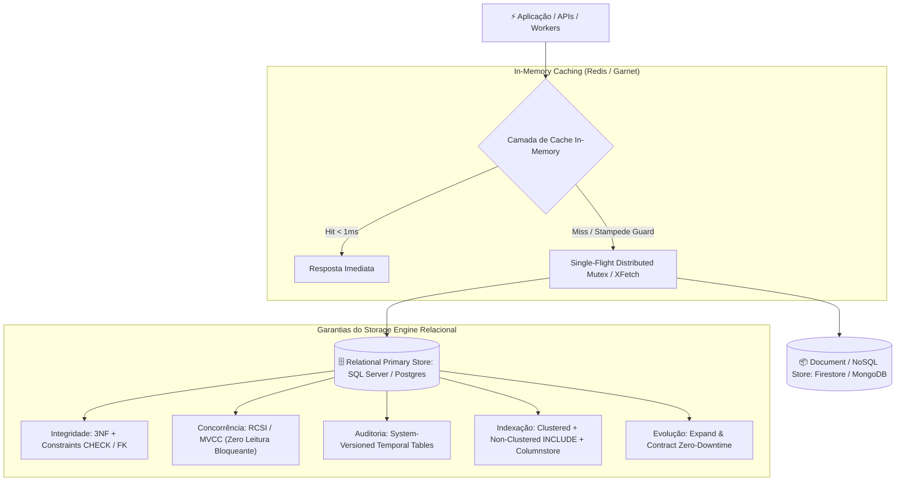

# 🗄️ Guia de Engenharia de Banco de Dados, Schemas Resilientes e Caching

  <b>Diretriz canônica corporativa para modelagem relacional e NoSQL, integridade soberana no storage engine, concorrência não bloqueante (RCSI), migrações seguras sem downtime (*Expand and Contract*), rastreabilidade temporal e arquitetura de cache in-memory de alta performance (Redis / Microsoft Garnet).</b>

---

## 🏛️ Visão Geral e Filosofia do Pilar

Na arquitetura de software corporativa, **o banco de dados não é mero depósito de bytes — ele é a fundação de integridade de todo o sistema**. Aplicações nascem, são refatoradas e mudam de framework; os dados, contudo, persistem por décadas.

Este pilar estabelece a paridade entre a velocidade de desenvolvimento e a **resiliência da camada de persistência**, sintetizando os melhores padrões da indústria, as trilhas técnicas do [roadmap.sh/sql](https://roadmap.sh/sql) e [roadmap.sh/redis](https://roadmap.sh/redis), e os requisitos de alta volumetria do ecossistema corporativo:

---

## 📊 Matriz Comparativa e Seleção de Tecnologias

| Engine / Tecnologia | Perfil de Carga & Casos Ideais | Mecanismos de Concorrência & Isolamento | Vantagens Corporativas | Cuidados e Anti-Padrões a Evitar |
| :--- | :--- | :--- | :--- | :--- |
| **SQL Server (T-SQL)** *(Padrão Primário)* | Sistemas transacionais OLTP corporativos, ERPs, sistemas de gestão e missão crítica. | **RCSI (`READ_COMMITTED_SNAPSHOT ON`)** e Snapshot Isolation via version store no `tempdb`. | Suporte nativo a Temporal Tables, In-Memory OLTP, Índices Columnstore analíticos e alta integração com ecossistema corporativo. | Não rodar em `READ COMMITTED` legado com lock compartilhado; nunca usar UUIDv4 como PK Clustered; monitorar contenção de `tempdb`. |
| **PostgreSQL** | Aplicações web modernas, microsserviços, cargas analíticas mistas e busca vetorial de IA. | MVCC (Multi-Version Concurrency Control) nativo em nível de linha. | Suporte nativo a `JSONB` com índices GIN, extensões ricas (`pgvector`, PostGIS) e connection pooling eficiente. | Write amplification em tabelas com muitos updates (HOT tuples); requer PgBouncer sob conexões massivas. |
| **MySQL (InnoDB)** | Aplicações web tradicionais, leitura massiva e estruturas simples. | MVCC com InnoDB Undo Logs e Next-Key Locks. | Simplicidade operacional, ampla adoção de mercado e suporte a particionamento. | Clustering compulsório na chave primária; cuidado com collation `utf8mb4` e locks de gap em leituras repetíveis. |
| **Firebase Firestore** *(NoSQL)* | Aplicações mobile em tempo real, sincronização offline-first e catálogo flexível. | Consistência forte por documento, ACID em transações multi-documento com limite estrito de escrita. | Escalabilidade global automática, SDKs reativos em tempo real e offline out-of-the-box. | Modelo de custo por leitura/escrita exige desnormalização deliberada; falta de joins nativos e agregações complexas. |
| **Redis / Valkey / Garnet** *(Cache/In-Memory)* | Cache de baixa latência (<1ms), controle de sessão, distributed lock, rate limiting e filas reativas. | Single-threaded event loop (Redis/Valkey) ou multi-threaded concorrente nativo (**Garnet**). | Estruturas de dados ricas (Hashes, Sorted Sets, Streams, HyperLogLog, Bitmaps) e altíssimo throughput. | Nunca usar comandos $\mathcal{O}(N)$ bloqueantes (`KEYS *`); proibido `DEL` em estruturas gigantes (usar `UNLINK`); proteger contra Cache Stampede. |

---

## 🧭 Guias e Documentos Normativos Integrados

1. **[Guia Corporativo de Engenharia de Banco de Dados e Schemas Resilientes](guia-engenharia-banco-dados-schemas-resilientes.md)**:
   - Diretriz normativa mestre (10 capítulos completos).
   - Heurísticas executáveis integradas ao orquestrador `/setup` (`DBENG-01..06`).
   - Padrão **Expand and Contract** detalhado com snippets T-SQL e migrações seguras.
   - Padrões de caching in-memory com defesa contra Cache Stampede (Single-Flight Mutex e XFetch).
2. **[ADR 0010: Institucionalização do Acervo Normativo de Banco de Dados](../../docs/adrs/0010-acervo-normativo-engenharia-banco-dados-caching.md)**:
   - Registro arquitetural formal da decisão corporativa.
3. **Subagentes Especialistas de Banco de Dados**:
   - `agents/database-architect.md` (`@database-architect`): Construtor e desenhista ativo de schemas, índices, migrações e caching.
   - `agents/database-reviewer.md` (`@database-reviewer`): Auditor estático e revisor independente de DDL, ORM e migrações.

