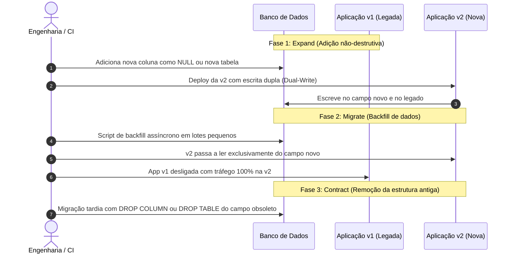

<!-- markdownlint-disable MD022 MD025 MD031 MD032 MD040 MD026 -->

<!--
LOG DE MANUTENÇÃO E ALTERAÇÕES DO DOCUMENTO

| Data          | Autor                                                      | Descrição da Alteração                                                                 |
| ------------- | ---------------------------------------------------------- | -------------------------------------------------------------------------------------- |
| 2026-11-05    | Matheus Diniz                                              | Criação do Guia Técnico Oficial de Engenharia de Banco de Dados, Schemas Resilientes    |
|               |                                                            | e Caching In-Memory (v1.0.0) sob ADR 0010, contemplando SQL Server, Redis, Garnet,     |
|               |                                                            | Postgres, MySQL, Firestore e integração com roadmaps da indústria (roadmap.sh).       |

=================================================================================
-->

# 🗄️ Guia Corporativo de Engenharia de Banco de Dados, Schemas Resilientes e Caching

> **Manifesto de Engenharia de Dados:** _Aplicações nascem, são refatoradas e mudam de framework; os dados, contudo, persistem por décadas. A integridade dos dados nunca é negociável: ela reside primariamente no storage engine, e não apenas no código da aplicação._

Este guia estabelece o padrão canônico corporativo para modelagem de dados, concorrência transacional, indexação de alta performance, migrações seguras sem downtime (*Zero-Downtime Schema Evolution*) e camadas de cache in-memory de baixa latência.

---

## ⚙️ Heurísticas Executáveis

Bloco lido pelo orquestrador `/setup` e validado por `skills/setup/scripts/verify_setup.py`.

```yaml heuristics
guide: engenharia-banco-dados
version: 1
requires: []
heuristics:
  - id: DBENG-01
    title: Checklist de engenharia de banco de dados e anti-padrões em .agents/rules/engenharia-banco-dados.md
    when: "! test -f .agents/rules/engenharia-banco-dados.md"
    do: |
      mkdir -p .agents/rules
      cp "$AI_GUIDES_RUNTIME/templates/rules/engenharia-banco-dados.md" .agents/rules/engenharia-banco-dados.md
    verify: "grep -q 'Expand and Contract' .agents/rules/engenharia-banco-dados.md"

  - id: DBENG-02
    title: Verificação de migrações sem downtime com o padrão Expand and Contract (§7)
    when: |
      git grep -i -E "drop column|drop table" -- "migrations/**" "**/migrations/**" "db/**" 2>/dev/null | grep -v -E "down|rollback|test" >/dev/null 2>&1
    do: |
      agent: Conforme §7 deste guia, migrações destrutivas com DROP COLUMN ou DROP TABLE não devem ser executadas em etapa única em ambientes com tráfego contínuo.
      Adote o padrão Expand and Contract:
      1. Adicione a nova estrutura como opcional (Expand);
      2. Mantenha suporte a leitura/escrita dupla na aplicação e execute o backfill de dados;
      3. Apenas após a desconexão completa do código legado, execute a limpeza (Contract) em migração tardia separada.
    verify: "! git grep -i -E 'drop column|drop table' -- 'migrations/**' '**/migrations/**' 'db/**' 2>/dev/null | grep -v -E 'down|rollback|test'"
    optional: true

  - id: DBENG-03
    title: Índices criados com flag não bloqueante em produção (ONLINE = ON ou CONCURRENTLY) (§4)
    when: |
      git grep -i -E "create (unique )?index" -- "migrations/**" "**/migrations/**" "db/**" 2>/dev/null | grep -v -i -E "online\s*=\s*on|concurrently|algorithm" >/dev/null 2>&1
    do: |
      agent: Conforme §4 deste guia, a criação de índices em tabelas de produção deve utilizar opções online não bloqueantes:
      - SQL Server: CREATE INDEX ... WITH (ONLINE = ON);
      - PostgreSQL: CREATE INDEX CONCURRENTLY ...;
      - MySQL (InnoDB): CREATE INDEX ... ALGORITHM=INPLACE, LOCK=NONE;
      Ajuste os scripts de migração para incluir a respectiva flag conforme a engine adotada.
    verify: |
      ! git grep -i -E 'create (unique )?index' -- 'migrations/**' '**/migrations/**' 'db/**' 2>/dev/null | grep -v -i -E 'online[[:space:]]*=[[:space:]]*on|concurrently|algorithm'
    optional: true

  - id: DBENG-04
    title: Defesa contra Cache Stampede em rotas e serviços com caching in-memory (§8)
    when: |
      sh "$AI_GUIDES_RUNTIME/templates/detect_stack.sh" backend && git grep -i -E "redis\.(get|set)|cache\.get" -- ":!node_modules" ":!vendor" ":!tests" ":!.agents" 2>/dev/null | grep -v -i -E "singleflight|xfetch|lock|mutex" >/dev/null 2>&1
    do: |
      agent: Conforme §8 deste guia, operações de cache de alto volume devem implementar defesas ativas contra Cache Stampede (Thundering Herd):
      1. Utilize Distributed Mutex (Single-Flight Pattern via SET lock_key token NX EX 5) para que apenas uma requisição consulte o banco relacional e popule o cache no miss;
      2. Ou aplique o algoritmo probabilístico XFetch para reaquecer chaves quentes em background antes da expiração física do TTL.
    verify: |
      ! git grep -i -E 'redis\.(get|set)|cache\.get' -- ':!node_modules' ':!vendor' ':!tests' ':!.agents' 2>/dev/null | grep -v -i -E 'singleflight|xfetch|lock|mutex'
    optional: true

  - id: DBENG-05
    title: AGENTS.md referencia o guia de engenharia de banco de dados
    when: "! grep -q 'guia-engenharia-banco-dados-schemas-resilientes' AGENTS.md 2>/dev/null"
    do: |
      agent: Acrescente ao AGENTS.md, na seção de guias normativos corporativos, a linha:
      "- **Engenharia de Banco de Dados & Caching:** Siga `.agents/ai-guides/guides/database/guia-engenharia-banco-dados-schemas-resilientes.md` (3NF base, UUIDv7 vs BIGINT, RCSI em SQL Server, Temporal Tables, migrações Expand-and-Contract sem downtime, índices com INCLUDE e mitigação de Cache Stampede via Single-Flight/XFetch no Redis; checklist em `.agents/rules/engenharia-banco-dados.md`)."
    verify: "grep -q 'guia-engenharia-banco-dados-schemas-resilientes' AGENTS.md"

  - id: DBENG-06
    title: Habilitação de concorrência não bloqueante (RCSI em SQL Server ou MVCC) (§5)
    when: |
      test -f appsettings.json && grep -q -i "sqlserver" appsettings.json 2>/dev/null && ! grep -q -i "Snapshot" appsettings.json 2>/dev/null
    do: |
      agent: Em aplicações que utilizam SQL Server, garanta que a base de dados opere com Read Committed Snapshot Isolation (RCSI):
      ALTER DATABASE [SeuBanco] SET READ_COMMITTED_SNAPSHOT ON WITH ROLLBACK IMMEDIATE;
      Isso elimina bloqueios entre leituras e escritas sem a necessidade de hints destrutivos como NOLOCK.
    verify: "test ! -f appsettings.json || ! grep -q -i 'sqlserver' appsettings.json 2>/dev/null || grep -q -i 'Snapshot' appsettings.json 2>/dev/null"
    optional: true
```

---

## 1. 🏛️ Filosofia de Dados & Integridade Soberana no Storage Engine

A camada de banco de dados é a única fronteira perene de um sistema. Mudanças de bibliotecas de validação, migração de microsserviços ou reescritas de API nunca devem colocar em risco a consistência e a veracidade das informações corporativas.

### 1.1 Os Quatro Princípios Fundamentais
1. **A Integridade Mora no Engine:** Toda regra de formato, unicidade e relacionamento deve ser validada por constraints no banco de dados (`FOREIGN KEY`, `CHECK`, `UNIQUE`, `NOT NULL`, constraints de domínio). A validação em código de aplicação (Zod, Pydantic, FluentValidation) existe para fornecer mensagens amigáveis de UX, mas não é garantia de persistência.
2. **3ª Forma Normal (3NF) como Ponto de Partida Obrigatório:** Todo modelo de dados nasce na 3NF (cada atributo depende da chave, de toda a chave e nada mais que a chave). A desnormalização é uma decisão técnica de exceção, só admitida quando métricas reais de profiling apontarem gargalos insuperáveis de leitura.
3. **Imutabilidade e Rastreabilidade por Design:** Dados corporativos críticos (transações financeiras, auditoria, pedidos, status de workflow) não devem ser sobrescritos sem registro histórico. Utilizamos tabelas temporais nativas ou eventos com carimbo de tempo rigoroso.
4. **Respeito ao Custo de Escrita e I/O:** Cada coluna, índice adicional e constraint tem impacto físico no log de transações (LDF no SQL Server, WAL no Postgres). Schemas enxutos garantem alta densidade em memória (Buffer Pool) e baixa latência de I/O.

---

## 2. 🔑 Estratégias de Chaves e Identificadores Primários

A escolha do identificador primário de uma entidade define a topologia física da árvore B-Tree no armazenamento em disco. A má escolha gera fragmentação extrema, page splits frequentes e degradação de inserções.

### 2.1 Comparativo Arquitetural: BIGINT vs UUIDv4 vs UUIDv7

| Característica | `BIGINT IDENTITY` / `BIGSERIAL` | `UUIDv4` (Randômico) | `UUIDv7` (Time-Ordered RFC 9562) |
| :--- | :--- | :--- | :--- |
| **Tamanho Físico** | 8 bytes (Compacto) | 16 bytes (128 bits) | 16 bytes (128 bits) |
| **Ordenação Física** | Monotônica sequencial estrita | Totalmente caótica / randômica | Monotônica temporal nos 48 bits iniciais |
| **Impacto no Clustered B-Tree** | Mínimo: inserções sempre no final da página (Zero Page Splits) | **Catastrófico:** inserções no meio da árvore geram Page Splits contínuos e fragmentação > 90% | **Excelente:** inserções sequenciais no tempo preservam a localidade de referência do B-Tree |
| **Geração Distribuída** | Requer coordenação central no banco | Segura sem coordenação no cliente/serviço | Segura sem coordenação no cliente/serviço |
| **Exposição de Volume de Negócio** | Expõe métricas de volume (enumeração simples) | Não expõe volume | Não expõe volume (apenas instante aproximado) |
| **Recomendação Canônica** | **OLTP sequencial enxuto em monólitos ou tabelas filhas internas** | ❌ **Categoricamente banido em Clustered Indexes** | **Padrão mandatário para sistemas distribuídos, microsserviços e clientes** |

### 2.2 Implementação Recomendada de UUIDv7
No SQL Server e em bancos relacionais modernos, garanta a geração de UUIDv7 utilizando bibliotecas que respeitem o padrão IETF (prefixo timestamp em milissegundos). No SQL Server, ao usar `UNIQUEIDENTIFIER` como chave primária clustered, priorize `UUIDv7` ou chave substituta sequencial (`NEWSEQUENTIALID()`).

---

## 3. 🛡️ Modelagem e Tipagem Defensiva

### 3.1 Proibição de Tipos Genéricos e Cegos
- ❌ **Banido:** `NVARCHAR(MAX)` ou `TEXT` para campos com tamanho semântico conhecido (ex: nomes, códigos, status).
- ✅ **Correto:** Defina limites intencionais: `NVARCHAR(150)`, `VARCHAR(50)`, `CHAR(2)` para UFs, `DECIMAL(18, 4)` para moedas e taxas financeiras.

### 3.2 Uso Rigoroso de Constraints Semânticas
Constraints `CHECK` custam quase zero em CPU e protegem o banco contra anomalias catastróficas:

```sql
-- Exemplo T-SQL (SQL Server) de Modelagem Defensiva
CREATE TABLE dbo.Pedidos (
    PedidoId BIGINT IDENTITY(1,1) NOT NULL,
    PublicId UNIQUEIDENTIFIER NOT NULL DEFAULT NEWID(), -- ou UUIDv7
    ClienteId INT NOT NULL,
    ValorTotal DECIMAL(18,2) NOT NULL,
    Desconto DECIMAL(18,2) NOT NULL CONSTRAINT DF_Pedidos_Desconto DEFAULT (0.00),
    StatusPedido VARCHAR(20) NOT NULL,
    DataCriacao DATETIME2(7) NOT NULL CONSTRAINT DF_Pedidos_DataCriacao DEFAULT SYSUTCDATETIME(),

    -- Constraints de integridade soberana
    CONSTRAINT PK_Pedidos PRIMARY KEY CLUSTERED (PedidoId),
    CONSTRAINT UQ_Pedidos_PublicId UNIQUE (PublicId),
    CONSTRAINT FK_Pedidos_Cliente FOREIGN KEY (ClienteId) REFERENCES dbo.Clientes(ClienteId) ON DELETE NO ACTION,
    CONSTRAINT CK_Pedidos_ValorPositivo CHECK (ValorTotal >= 0),
    CONSTRAINT CK_Pedidos_DescontoValido CHECK (Desconto >= 0 AND Desconto <= ValorTotal),
    CONSTRAINT CK_Pedidos_StatusValido CHECK (StatusPedido IN ('Pendente', 'Pago', 'Enviado', 'Cancelado'))
);
```

---

## 4. ⚡ Engenharia de Índices e Otimização de Consultas

Índices são estruturas fundamentais de leitura, mas representam débito e sobrecarga direta na escrita (*Write Amplification*). Projetar índices requer compreender o plano de execução e o acesso físico às páginas de dados.

### 4.1 Anatomia de um Índice B-Tree de Alta Performance
1. **Clustered Index (Físico):** Define a ordem física das linhas na tabela. Deve ser **estreito, único e monotônico** para evitar fragmentação de páginas (*page splits*).
2. **Non-Clustered Index (Lógico):** Ponteiro lógico contendo as colunas indexadas mais a chave do Clustered Index (Bookmark).

### 4.2 Regra de Ouro para Índices Compostos
Ao criar um índice composto para consultas com múltiplos predicados, respeite rigorosamente a ordem:
$$\text{Coluna de Igualdade (=)} \longrightarrow \text{Coluna de Faixa / Ordenação (BETWEEN, >, <, ORDER BY)} \longrightarrow \text{Colunas em INCLUDE}$$

```sql
-- Consulta alvo:
-- SELECT Nome, Email, Saldo FROM dbo.Usuarios WHERE TenantId = 42 AND Status = 'Ativo' ORDER BY DataCadastro DESC;

-- Índice Perfeito (Covering Index):
CREATE NONCLUSTERED INDEX IX_Usuarios_Tenant_Status_Data
ON dbo.Usuarios (TenantId, Status, DataCadastro DESC)
INCLUDE (Nome, Email, Saldo)
WITH (ONLINE = ON);
```

> [!IMPORTANT]
> A cláusula **`INCLUDE`** armazena as colunas complementares apenas no nível folha do índice. Isso evita que o engine execute operações caras de **Key Lookup** no Clustered Index, atendendo 100% da consulta diretamente da memória do índice (*Covering Index*).

### 4.3 Índices Filtrados (Partial Indexes)
Reduza o tamanho de árvores B-Tree criando índices restritos apenas aos subconjuntos de linhas que participam de fluxos ativos:

```sql
-- Indexa apenas pedidos que demandam processamento urgente
CREATE NONCLUSTERED INDEX IX_Pedidos_FilaProcessamento
ON dbo.Pedidos (DataCriacao)
INCLUDE (ClienteId, ValorTotal)
WHERE StatusPedido = 'Pendente'
WITH (ONLINE = ON);
```

### 4.4 SARGability: Consultas Otimizáveis
Consultas com funções aplicadas nas colunas do predicado desabilitam o uso de índices (Index Scan em vez de Index Seek):
- ❌ **Não SARGable:** `WHERE YEAR(DataCriacao) = 2026 AND MONTH(DataCriacao) = 11` (Força leitura completa de toda a tabela).
- ✅ **SARGable:** `WHERE DataCriacao >= '2026-11-01' AND DataCriacao < '2026-12-01'` (Executa Index Seek direto e instantâneo).

---

## 5. 🔄 Concorrência, Isolamento e Transações

Em sistemas corporativos concorrentes, conflitos de concorrência geram lentidão, contenção de recursos e travamentos de banco de dados (*deadlocks*).

### 5.1 O Fim das Leituras Bloqueantes: RCSI no SQL Server
No modo padrão legado do SQL Server, leituras geram Shared Locks (`S-Lock`) que bloqueiam escritas (`X-Lock`), levando desenvolvedores inexperientes a disseminar hints destrutivos (`WITH (NOLOCK)`), provocando leituras sujas e dados inconsistentes.

A solução canônica definitiva é a ativação do **Read Committed Snapshot Isolation (RCSI)**:
```sql
ALTER DATABASE [SeuBancoCorporativo]
SET READ_COMMITTED_SNAPSHOT ON
WITH ROLLBACK IMMEDIATE;
```
- **Como funciona:** Leituras não colocam locks nas páginas. Quando uma escrita atualiza uma linha, o estado anterior é gravado no *version store* dentro do **`tempdb`**. Leituras concorrentes lêem a versão estável da linha sem qualquer bloqueio mútuo.
- **Cuidados Obrigatórios com o `tempdb`:** Provisione o `tempdb` com múltiplos arquivos de dados de tamanho idêntico (1 arquivo por núcleo de CPU até 8) em armazenamento NVMe de altíssima velocidade para prevenir contenção de alocação de páginas (`PAGELATCH_UP`).

### 5.2 Concorrência Otimista com `RowVersion`
Para proteger contra atualizações concorrentes que sobrescrevem dados (*Lost Updates*) sem recorrer a locks pessimistas pesados:
```sql
ALTER TABLE dbo.Contratos ADD VersaoLinha ROWVERSION NOT NULL;

-- Na atualização pela aplicação:
UPDATE dbo.Contratos
SET Saldo = @NovoSaldo
WHERE ContratoId = @Id AND VersaoLinha = @VersaoOriginal;

-- Se @@ROWCOUNT == 0 -> Dispara conflito de concorrência na aplicação para reprocessamento seguro.
```

---

## 6. ⏱️ Rastreabilidade com Temporal Tables (SQL Server)

Em vez de triggers de auditoria lentos ou tabelas manuais de histórico com inconsistências, o SQL Server oferece tabelas temporais nativas com controle de versão pelo próprio storage engine (*System-Versioned Temporal Tables*).

```sql
CREATE TABLE dbo.ContratosFinanceiros (
    ContratoId INT IDENTITY(1,1) NOT NULL PRIMARY KEY CLUSTERED,
    ClienteId INT NOT NULL,
    ValorLimite DECIMAL(18,2) NOT NULL,
    TaxaJuros DECIMAL(5,4) NOT NULL,

    -- Períodos de validade mantidos pelo sistema
    SysStartTime DATETIME2(7) GENERATED ALWAYS AS ROW START NOT NULL,
    SysEndTime DATETIME2(7) GENERATED ALWAYS AS ROW END NOT NULL,
    PERIOD FOR SYSTEM_TIME (SysStartTime, SysEndTime)
)
WITH (
    SYSTEM_VERSIONING = ON (
        HISTORY_TABLE = dbo.ContratosFinanceirosHistory,
        DATA_CONSISTENCY_CHECK = ON
    )
);

-- Ativação de retenção automática de dados históricos para evitar saturação de disco
ALTER TABLE dbo.ContratosFinanceiros
SET (SYSTEM_VERSIONING = ON (HISTORY_RETENTION_PERIOD = 2 YEARS));
```

---

## 7. 🚀 Migrações Seguras Zero-Downtime (*Expand and Contract*)

Nenhuma alteração estrutural em banco de dados em produção deve provocar indisponibilidade da aplicação ou bloqueio massivo de tabelas. Toda alteração destrutiva ou de alteração de tipo deve ser conduzida pelo padrão **Expand and Contract**:



### Regras Mandatórias de Zero-Downtime:
1. **Adição de Colunas:** Sempre adicione colunas novas com valor default sem lock exclusivo: no SQL Server 2012+ e PostgreSQL 11+, `ALTER TABLE ADD Coluna INT NOT NULL CONSTRAINT DF_Nome DEFAULT (0)` é uma operação puramente de metadados (tempo instantâneo).
2. **Backfill em Lotes:** Nunca execute `UPDATE Tabela SET ColunaNova = ColunaAntiga` em uma tabela de milhões de linhas de uma só vez (isso estoura o log de transações e derruba o banco). Divida a atualização em lotes controlados (`WHILE @@ROWCOUNT > 0 UPDATE TOP (5000)...`).
3. **Criação de Índices Online:** Use obrigatoriamente a cláusula `WITH (ONLINE = ON)` no SQL Server para permitir operações DML concorrentes durante a indexação.

---

## 8. ⚡ Engenharia de Caching In-Memory (Redis, Valkey e Garnet)

A camada de cache in-memory reduz a latência para menos de 1 milissegundo e desacopla picos de leitura da camada de armazenamento persistente.

### 8.1 Padrão Canônico Cache-Aside com Blindagem contra Cache Stampede
O fenômeno do **Cache Stampede** (ou *Thundering Herd*) ocorre quando uma chave de altíssimo acesso expira e milhares de requisições concorrentes recebem um cache miss simultâneo, bombardeando o banco de dados e derrubando a infraestrutura.

#### Padrão de Resolução: Single-Flight Distributed Mutex
Apenas a primeira requisição adquire a trava de recálculo; todas as outras aguardam ou reutilizam o dado anterior:

```typescript
// Exemplo canônico de Cache-Aside com Single-Flight Mutex
async function getWithSingleFlight<T>(
  key: string,
  fetchFromDb: () => Promise<T>,
  ttlSeconds: number
): Promise<T> {
  // 1. Tenta leitura do cache
  const cached = await redis.get(key);
  if (cached) return JSON.parse(cached);

  const lockKey = `lock:${key}`;
  // 2. Tenta adquirir trava distribuída atômica (NX = Not Exists, EX = TTL 5s)
  const lockAcquired = await redis.set(lockKey, "1", "NX", "EX", 5);

  if (!lockAcquired) {
    // Outra thread está reaquecendo o cache. Aguarda 50ms com jitter e tenta novamente
    await new Promise((resolve) => setTimeout(resolve, 50 + Math.random() * 20));
    return getWithSingleFlight(key, fetchFromDb, ttlSeconds);
  }

  try {
    // 3. Esta thread venceu a trava: busca do banco relacional
    const freshData = await fetchFromDb();
    // 4. Salva no cache com TTL acrescido de Jitter aleatório para evitar Cache Avalanche
    const jitteredTtl = ttlSeconds + Math.floor(Math.random() * (ttlSeconds * 0.1));
    await redis.set(key, JSON.stringify(freshData), "EX", jitteredTtl);
    return freshData;
  } finally {
    // 5. Libera a trava atômica
    await redis.del(lockKey);
  }
}
```

> [!TIP]
> **Liberação Segura de Distributed Lock via Script Lua (Anti-Lease Expiry Race):**
> Em cenários de alta concorrência em produção, se a execução de `fetchFromDb()` ultrapassar a duração do lease (ex: 5 segundos sob pico de I/O no banco), o lock expirará e poderá ser concedido a outra requisição. Nesse caso, um `redis.del(lockKey)` incondicional no `finally` apagaria indevidamente o lock da outra requisição.
> **Padrão Defensivo:** Armazene um token exclusivo (`const lockToken = crypto.randomUUID()`) como valor do lock (`SET lockKey lockToken NX EX 5`) e libere-o via script Lua atômico que valida se o token ainda pertence à thread atual antes de deletar:
> ```lua
> if redis.call("get", KEYS[1]) == ARGV[1] then
>   return redis.call("del", KEYS[1])
> else
>   return 0
> end
> ```

### 8.2 Higiene Operacional de Memória no Redis
- **Proibição de `DEL` em Chaves Grandes:** A deleção síncrona de um Hash ou Set com 500 mil elementos trava a thread principal do Redis por centenas de milissegundos. Utilize estritamente **`UNLINK`**, que remove a chave dos metadados imediatamente e libera a memória de forma assíncrona em background.
- **Proibição de `KEYS *`:** O comando `KEYS` bloqueia todo o servidor até escanear todo o espaço de chaves. Em produção, use exclusivamente comandos baseados em cursor iterativo: **`SCAN`**, **`HSCAN`**, **`SSCAN`**, **`ZSCAN`**.
- **Política de Eviction Mandatória:** Configure `maxmemory` e estabeleça `maxmemory-policy allkeys-lru` ou `allkeys-lfu` para evitar falhas de OOM (*Out of Memory*).

### 8.3 Inovação com Microsoft Garnet
Para stacks em .NET ou ambientes de altíssima concorrência com servidores multi-core, o **Microsoft Garnet** (pesquisa da Microsoft) oferece compatibilidade 100% com o protocolo RESP do Redis, executando em arquitetura **multi-threaded nativa** com tiering híbrido de memória RAM e SSD (FLASH), eliminando o gargalo de thread única do Redis tradicional.

---

## 9. 🌐 Adaptação Multi-Engine (Postgres, MySQL e Firebase Firestore)

Embora o SQL Server e o Redis representem o padrão primário da organização, as mesmas regras de integridade aplicam-se com adaptações idiomáticas:

### 9.1 PostgreSQL
- Utilize colunas **`JSONB`** para dados semi-estruturados, sempre associadas a constraints de validação ou índices GIN (`CREATE INDEX ... USING GIN (dados jsonb_path_ops);`).
- Para buscas vetoriais com IA generativa, utilize a extensão oficial **`pgvector`** com índices HNSW para vizinhos mais próximos aproximados.

### 9.2 MySQL (InnoDB)
- Toda tabela InnoDB é obrigatoriamente um Clustered Index baseado na Chave Primária. Se nenhuma PK for definida, o MySQL criará um identificador oculto de 6 bytes (`GEN_CLUST_INDEX`). Defina sempre chaves primárias explícitas.
- Garanta sempre o charset `utf8mb4` com collation `utf8mb4_0900_ai_ci` ou `utf8mb4_unicode_ci` para suporte a emojis e caracteres multibyte universais.

### 9.3 Firebase Firestore (NoSQL Documental)
- O custo do Firestore é tarifado por leitura de documento. A regra de ouro é **desnormalizar deliberadamente para leitura**: se uma tela precisa exibir o nome do autor junto com o post, armazene `autorNome` duplicado dentro do documento do post.
- Toda consulta que combina múltiplos filtros de desigualdade ou `ORDER BY` em campos distintos requer a criação de **Composite Indexes** no console do Firebase ou no `firestore.indexes.json`.

---

## 10. ⚠️ Anti-Padrões Fatais e Checklist de Auditoria Técnica

### ❌ Anti-Padrões Fatais
1. ❌ **`SELECT *` em Produção:** Destrói a performance ao forçar I/O de colunas desnecessárias e impedir o uso de Covering Indexes.
2. ❌ **`WITH (NOLOCK)` como Solução de Contenção:** Gera leituras sujas, linhas duplicadas e dados fantasmas. A solução correta é RCSI.
3. ❌ **UUIDv4 em Clustered Index:** Gera desfragmentação contínua de disco e degradação de inserções. Use UUIDv7 ou BIGINT.
4. ❌ **Migrações Destrutivas Diretas (`DROP COLUMN` em passo único):** Derruba aplicações que ainda mantêm queries apontando para o campo.
5. ❌ **`KEYS *` ou `DEL` massivo no Redis:** Congela o servidor de cache inteiro e derruba todas as aplicações dependentes.
6. ❌ **Consultas N+1 via ORMs:** Ocorre quando uma entidade é listada e o código busca seus relacionamentos em queries individuais dentro de um loop. Exija `JOIN` explícito ou `Include`/eager loading.

### ✅ Checklist de Auditoria Técnica de Banco de Dados
- [ ] Todas as tabelas possuem Chave Primária explícita e adequada (`BIGINT IDENTITY` ou `UUIDv7`).
- [ ] Relacionamentos possuem `FOREIGN KEY` explícitas com regras claras de exclusão (`ON DELETE NO ACTION / RESTRICT`).
- [ ] Campos de status, valores e datas possuem constraints `CHECK` garantindo a sanidade dos dados.
- [ ] Índices compostos seguem a ordem **Igualdade $\to$ Faixa $\to$ INCLUDE**.
- [ ] O banco opera sob **RCSI (`READ_COMMITTED_SNAPSHOT ON`)** no SQL Server ou MVCC.
- [ ] Tabelas críticas possuem histórico versionado via **Temporal Tables** ou trilha de auditoria append-only.
- [ ] Scripts DDL de criação de índices utilizam opções online (`WITH (ONLINE = ON)` / `CONCURRENTLY`).
- [ ] Migrações estruturais seguem o padrão **Expand and Contract**.
- [ ] A camada de cache implementa proteção contra **Cache Stampede** (Single-Flight Distributed Mutex ou XFetch).
- [ ] As deleções de estruturas massivas no Redis utilizam exclusivamente **`UNLINK`**.
