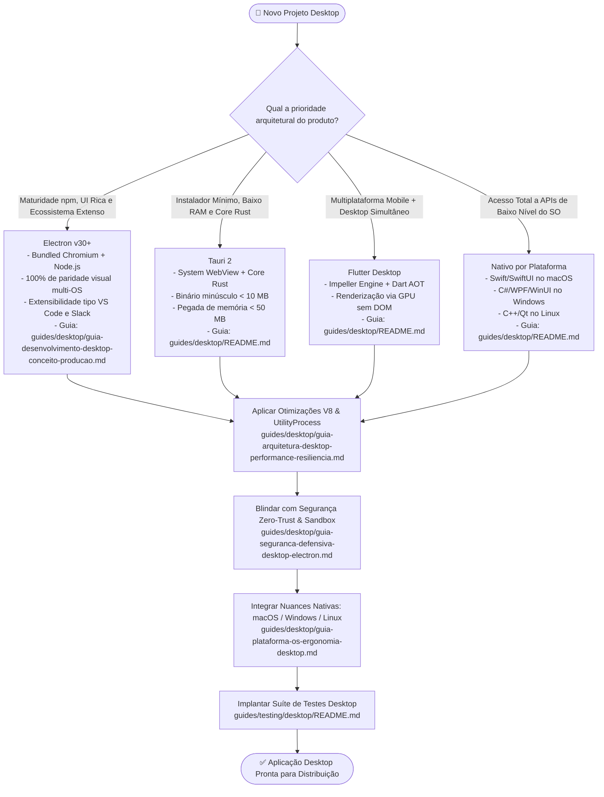

# 🖥️ Acervo Normativo de Desenvolvimento Desktop Multiplataforma

<div align="center">

[](../../README.md)
[](../../README.md)
[](../../README.md)

<p align="center">
  <b>Biblioteca canônica corporativa de engenharia de software desktop: arquitetura multi-processo, IPC tipado seguro, otimização de CPU/RAM, segurança defensiva zero-trust e integração com macOS, Windows e Linux.</b>
</p>

</div>

---

## 📂 Guias Disponíveis nesta Categoria

```text
guides/desktop/
├── README.md                                               ──> Portal, taxonomia e matriz de decisão entre stacks
├── guia-desenvolvimento-desktop-conceito-producao.md       ──> ⭐ Guia Mestre: ciclo de vida, IPC tipado, utilityProcess e release
├── guia-arquitetura-desktop-performance-resiliencia.md     ──> V8 Snapshots, better-sqlite3 em worker, offline sync e mitigação de leaks
├── guia-seguranca-defensiva-desktop-electron.md            ──> Tríade Zero-Trust (Sandbox, ContextIsolation), CSP e blindagem de Deep Links
└── guia-plataforma-os-ergonomia-desktop.md                 ──> Nuances de SO: macOS Traffic Lights/Dock, Windows Mica/AppUserModelID, Linux DEs
```

---

## 🗺️ Matriz de Decisão entre Stacks Tecnológicas Desktop



---

## 📋 Resumo dos Guias da Categoria

| Guia                                                                                                         | Foco Temático                         | Tópicos Principais                                                                                                                                                                                                                                                                                                                        |
| :----------------------------------------------------------------------------------------------------------- | :------------------------------------ | :---------------------------------------------------------------------------------------------------------------------------------------------------------------------------------------------------------------------------------------------------------------------------------------------------------------------------------------- |
| [`guia-desenvolvimento-desktop-conceito-producao.md`](guia-desenvolvimento-desktop-conceito-producao.md)     | **Guia Mestre (Conceito à Produção)** | Arquitetura multi-processo (Main, Preload, Renderer, UtilityProcess), IPC tipado bidirecional, ciclo de vida de janelas, `requestSingleInstanceLock`, deep linking, empacotamento com `electron-builder` e checklist de release.                                                                                                          |
| [`guia-arquitetura-desktop-performance-resiliencia.md`](guia-arquitetura-desktop-performance-resiliencia.md) | **Arquitetura & Resiliência**         | Eliminação do white flash (`ready-to-show`), V8 Snapshots e Code Caching, isolamento de banco local SQLite (`better-sqlite3`) em `utilityProcess`, combate a vazamento de memória em SPAs long-running, crash reporting com Sentry/Crashpad e RFC 9457 Problem Details.                                                                   |
| [`guia-seguranca-defensiva-desktop-electron.md`](guia-seguranca-defensiva-desktop-electron.md)               | **Segurança Defensiva Zero-Trust**    | A tríade mandatória (`nodeIntegration: false`, `contextIsolation: true`, `sandbox: true`), Content Security Policy (CSP), bloqueio de `<webview>`, controle estrito de novas janelas (`setWindowOpenHandler`), integridade de ASAR e proteção contra RCE via deep links maliciosos.                                                       |
| [`guia-plataforma-os-ergonomia-desktop.md`](guia-plataforma-os-ergonomia-desktop.md)                         | **Ergonomia & Nuances por SO**        | macOS (Dock lifecycle, Traffic Lights nativos, template images no menu bar, notarização com `notarytool`), Windows 11 (Mica/Acrylic, `AppUserModelID`, NSIS delta updates) e Linux (GNOME/KDE, Wayland vs X11, AppIndicator, D-Bus e AppImage/Flatpak). Acessibilidade vestibular (`prefers-reduced-motion`) e contraste perceptual APCA. |

---

## 🧪 Suíte de Testes Desktop Complementar

Para a estratégia e implementação prática da pirâmide de testes desktop (Testes Unitários de Main/Utility, Testes de Componentes Renderer e Testes E2E com Playwright Electron em runners multi-OS), consulte:  
👉 **[`guides/testing/desktop/README.md`](../testing/desktop/README.md)**
