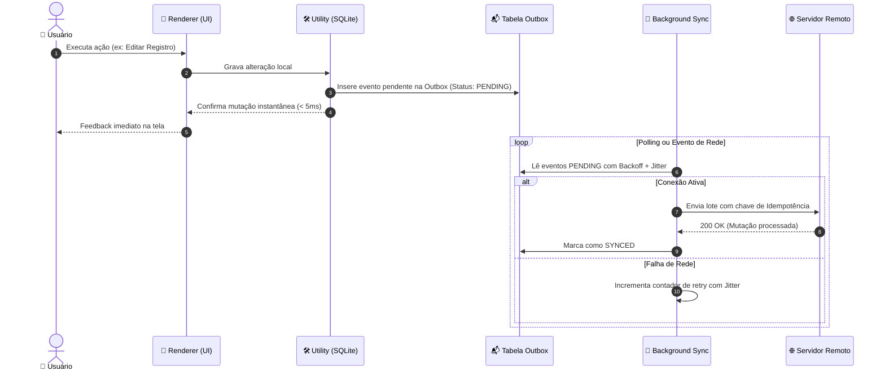

# ⚡ Guia de Arquitetura Desktop: Performance, Resiliência e Offline-First

<div align="center">

[](../../README.md)
[](../../README.md)
[](../../README.md)

<p align="center">
  <b>Diretrizes avançadas de otimização de CPU/RAM, serialização V8, banco SQLite isolado, gestão de memória e resiliência offline para aplicações desktop.</b>
</p>

</div>

---

## 📚 Sumário Executivo

1. **Orçamento de Performance Desktop (Cold Start < 1.5s, 60/120 FPS)**
2. **Aceleração de Inicialização com V8 Snapshots e Code Caching**
3. **Isolamento de Banco SQLite (`better-sqlite3`) em `utilityProcess`**
4. **Combate Rigoroso a Vazamento de Memória em SPAs Long-Running**
5. **Arquitetura Offline-First & Local Outbox Pattern**
6. **Contrato de Erros Padronizado (RFC 9457 Problem Details)**
7. **Crash Reporting e Telemetria com Sentry / Crashpad**

---

## 1. Orçamento de Performance Desktop

Aplicações desktop não podem se comportar como "um site encapsulado em um navegador pesado". Devem operar sob restrições rigorosas:

| Dimensão | Limite Máximo Recomendado | Meta de Alta Performance |
| :--- | :--- | :--- |
| **Cold Start (Boot frio até 1º frame)** | $\le 2{,}0\text{ s}$ | $< 1{,}0\text{ s}$ |
| **Warm Start (Restauração da bandeja/foco)** | $\le 200\text{ ms}$ | $< 50\text{ ms}$ |
| **Consumo de Memória Base (Idle)** | $\le 250\text{ MB}$ | $< 120\text{ MB}$ |
| **Taxa de Quadros da Interface (UI)** | $60\text{ FPS}$ sustentado | $120\text{ FPS}$ em telas ProMotion/Gaming |
| **Bloqueio do Loop do Main Process** | $\le 16\text{ ms}$ | $0\text{ ms}$ (operações síncronas banidas) |

---

## 2. Aceleração de Inicialização: V8 Snapshots & Code Caching

Grande parte da lentidão na inicialização do Electron decorre do tempo gasto pelo V8 lendo, parseando e compilando dezenas de megabytes de código JavaScript no disco.

### 2.1 V8 Code Caching
O Chromium compila o código JS para bytecode e pode armazená-lo em cache para inicializações subsequentes:
- Mantenha a ordem de carregamento de scripts previsível entre execuções.
- Evite gerar código dinâmico via `eval` ou funções instanciadas em runtime no boot.
- Configure o bundler (`electron-vite`) para gerar chunks estáveis com nomes determinísticos.

### 2.2 V8 Snapshots Ahead-of-Time (`mksnapshot`)
Para aplicações massivas (como editores ou ferramentas complexas), utilize `mksnapshot` no pipeline de build:
- Executa o código estático no momento do build e serializa o heap do V8 em um arquivo `snapshot_blob.bin`.
- No runtime, o Electron restaura o heap instantaneamente em C++, eliminando o tempo de execução do `require()` inicial.

---

## 3. Isolamento de Banco SQLite (`better-sqlite3`) em `utilityProcess`

O **`better-sqlite3`** é o driver SQLite mais veloz para Node.js por sua interface síncrona C++. Contudo, **nunca execute operações de banco no Main Process nem no Renderer**:
- Se executado no Main Process: trava a criação de janelas e menus do sistema.
- Se executado no Renderer: trava as animações e a digitação do usuário.

### 3.1 Arquitetura com `utilityProcess`
O `utilityProcess` roda como um processo de serviço Chromium com Node.js completo e isolamento total de falhas:

```typescript
// src/main/database-service.ts
import { utilityProcess, MessageChannelMain } from 'electron';
import path from 'path';

export class DatabaseService {
  private childProcess = utilityProcess.fork(
    path.join(__dirname, '../utility/db-worker.js'),
    [],
    { serviceName: 'sqlite-worker' }
  );

  async query<T>(sql: string, params: unknown[] = []): Promise<T> {
    const { port1, port2 } = new MessageChannelMain();

    return new Promise((resolve, reject) => {
      port1.on('message', (event) => {
        const { data, error } = event.data;
        if (error) reject(new Error(error));
        else resolve(data as T);
        port1.close();
      });
      port1.start();

      this.childProcess.postMessage({ sql, params }, [port2]);
    });
  }
}
```

Implementação dentro do Worker:
```javascript
// src/utility/db-worker.js
const Database = require('better-sqlite3');
const path = require('path');

const db = new Database(path.join(process.env.USER_DATA_DIR, 'app.db'));
// Habilita Write-Ahead Logging para leitura e escrita concorrentes sem lock
db.pragma('journal_mode = WAL');
db.pragma('synchronous = NORMAL');

process.parentPort.on('message', (event) => {
  const [port] = event.ports;
  const { sql, params } = event.data;

  try {
    const stmt = db.prepare(sql);
    const data = sql.trim().toUpperCase().startsWith('SELECT') 
      ? stmt.all(...params) 
      : stmt.run(...params);
    port.postMessage({ data });
  } catch (err) {
    port.postMessage({ error: err.message });
  }
});
```

---

## 4. Combate Rigoroso a Vazamento de Memória em SPAs Long-Running

Como aplicativos desktop rodam continuamente por dias, vazamentos de memória (Memory Leaks) resultam em congelamento do sistema.

### 4.1 Principais Fontes de Vazamento & Soluções:

1. **Listeners de IPC sem Desinscrição no Frontend:**
   ```typescript
   // ❌ ERRADO: Toda vez que o componente monta, registra um novo listener
   useEffect(() => {
     window.desktopAPI.onDataUpdate((data) => setData(data));
   }, []);

   // ✅ CORRETO: Retorna função explícita de cleanup
   useEffect(() => {
     const unsubscribe = window.desktopAPI.onDataUpdate((data) => setData(data));
     return () => unsubscribe();
   }, []);
   ```

2. **Janelas Fechadas sem Descarte de Referência (`null`):**
   ```typescript
   // No Main Process:
   win.on('closed', () => {
     win = null; // Libera a referência para coleta de lixo pelo V8
   });
   ```

3. **Timers e Intervalos Globais Ativos:**
   - Intervalos de polling devem pausar quando a janela estiver minimizada ou em background (`win.on('minimize')` ou `document.visibilityState === 'hidden'`).

---

## 5. Arquitetura Offline-First & Local Outbox Pattern

O aplicativo desktop corporativo deve ser plenamente operacional sem conexão à internet.



---

## 6. Contrato de Erros Padronizado (RFC 9457 Problem Details)

Toda comunicação entre o processo Main, Utility e Renderer que retorne falha deve aderir estritamente ao padrão **RFC 9457** (`application/problem+json`), evitando strings genéricas de erro:

```typescript
// src/common/problem-details.ts
export interface ProblemDetails {
  type: string;     // URI identificando a categoria do erro
  title: string;    // Resumo legível em inglês
  status: number;   // Código HTTP ou status semântico equivalente
  detail: string;   // Descrição detalhada do erro em português
  instance: string; // Identificador da ocorrência (ex: IPC /api/sync/outbox#123)
  invalidParams?: Array<{ name: string; reason: string }>;
}
```

Exemplo de retorno estruturado via IPC:
```json
{
  "type": "https://api.empresa.com/errors/database-disk-full",
  "title": "Insufficient Disk Space",
  "status": 507,
  "detail": "O disco local atingiu a capacidade máxima. Não foi possível gravar o arquivo SQLite.",
  "instance": "ipc://storage/write-record#db90812"
}
```

---

## 7. Crash Reporting e Telemetria com Sentry / Crashpad

Falhas no nível nativo de C++ (Chromium ou Node) geram *Minidumps* que não passam pelos blocos `try/catch` do JavaScript.

- Utilize **`crashReporter`** oficial do Electron inicializado antes do `app.whenReady()`:
```typescript
import { crashReporter } from 'electron';

crashReporter.start({
  submitURL: 'https://sentry.io/api/minidump/endpoint',
  uploadToServer: true,
  compress: true,
  extra: {
    appVersion: app.getVersion(),
    platform: process.platform
  }
});
```
- Capture exceções não tratadas no Main Process com `process.on('uncaughtException')` e `process.on('unhandledRejection')` enviando telemetria assíncrona antes de encerrar o processo com segurança.
