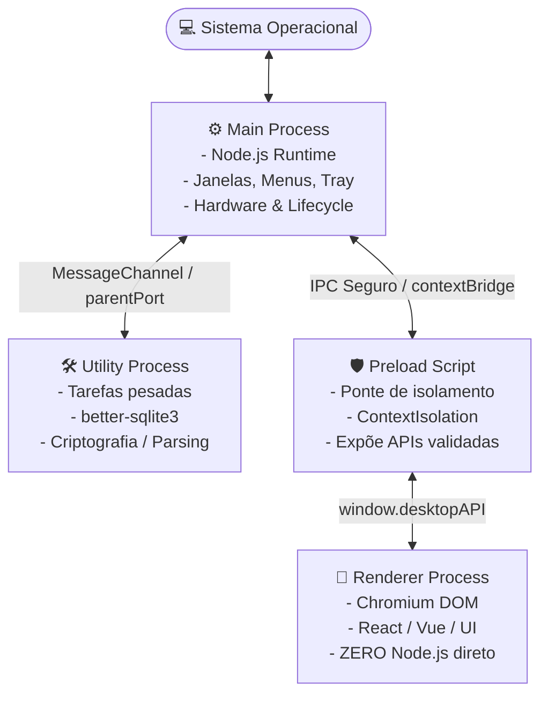

# 🖥️ Guia Mestre: Desenvolvimento Desktop — Do Conceito à Produção

<div align="center">

[](../../README.md)
[](../../README.md)
[](../../README.md)

<p align="center">
  <b>Manual canônico e arquitetural para engenharia de software desktop com Electron, Tauri 2 e ecossistema multiplataforma moderno.</b>
</p>

</div>

---

```yaml heuristics
guide: desenvolvimento-desktop
version: 1
requires: [padrao-criacao-adrs]
heuristics:
  - id: DSK-01
    title: Checklist de engenharia desktop em .agents/rules/desenvolvimento-desktop.md
    when: 'sh "$AI_GUIDES_RUNTIME/templates/detect_stack.sh" desktop && ! test -f .agents/rules/desenvolvimento-desktop.md'
    do: |
      mkdir -p .agents/rules
      cp "$AI_GUIDES_RUNTIME/templates/rules/desenvolvimento-desktop.md" .agents/rules/desenvolvimento-desktop.md
    verify: "grep -q 'Checklist Canônico de Engenharia Desktop' .agents/rules/desenvolvimento-desktop.md"

  - id: DSK-02
    title: Blindagem de segurança Electron (zero nodeIntegration no renderer)
    when: |
      sh "$AI_GUIDES_RUNTIME/templates/detect_stack.sh" desktop && git grep -q --untracked -iE "nodeIntegration[[:space:]]*:[[:space:]]*true" -- '*.ts' '*.js' '*.tsx' '*.jsx' ':(exclude,glob)**/test*/**' ':(exclude,glob)**/__tests__/**' ':(exclude,glob)**/*test*' ':!.agents' ':!docs'
    do: "agent: Desative nodeIntegration no webPreferences do BrowserWindow, forçando contextIsolation: true e isolamento seguro via preload."
    verify: |
      ! sh "$AI_GUIDES_RUNTIME/templates/detect_stack.sh" desktop || ! git grep -q --untracked -iE "nodeIntegration[[:space:]]*:[[:space:]]*true" -- '*.ts' '*.js' '*.tsx' '*.jsx' ':(exclude,glob)**/test*/**' ':(exclude,glob)**/__tests__/**' ':(exclude,glob)**/*test*' ':!.agents' ':!docs'

  - id: DSK-03
    title: Referência canônica do guia de desenvolvimento desktop no AGENTS.md
    when: 'sh "$AI_GUIDES_RUNTIME/templates/detect_stack.sh" desktop && ! grep -q ''desenvolvimento-desktop'' AGENTS.md'
    do: "agent: Adicione a referência ao guia-desenvolvimento-desktop-conceito-producao.md na seção de governança do AGENTS.md."
    verify: "grep -q 'desenvolvimento-desktop' AGENTS.md"
```

---

## 📚 Sumário Executivo

1. **Princípios Fundamentais da Engenharia Desktop**
2. **Arquitetura Multi-Processo (Main, Preload, Renderer, UtilityProcess)**
3. **Comunicação Inter-Processos (IPC) Tipada e Segura**
4. **Ciclo de Vida da Aplicação e das Janelas**
5. **Controle de Instância Única e Deep Linking**
6. **Tooling Moderno (electron-vite, TypeScript e Módulos Nativos)**
7. **Empacotamento e Distribuição com electron-builder**
8. **Checklist Canônico de Lançamento (Release Readiness)**

---

## 1. Princípios Fundamentais da Engenharia Desktop

Desenvolver para desktop impõe responsabilidades de sistema:

- **Residência Contínua:** Diferente de uma aba de navegador que fecha após a tarefa, o app desktop roda por dias ou semanas. Vazamentos acumulativos de memória degradam a máquina do usuário.
- **Isolamento de Privilégios (Mínimo Privilégio):** O código que renderiza a interface Web nunca deve ter permissões irrestritas de ler o disco ou disparar comandos de shell sem validação expressa do processo pai.
- **Respeito às Convenções Nativas:** Aplicações desktop corporativas devem parecer e se comportar como cidadãos nativos de primeira classe em cada sistema operacional (macOS, Windows e Linux), respeitando menus, atalhos de teclado, bandeja e temas visuais do sistema.

---

## 2. Arquitetura Multi-Processo

O Electron é estruturado na separação de processos herdada do Chromium:



### 2.1 Responsabilidades por Processo:

1. **Main Process (`main.ts`):** Orquestrador central. Gerencia o ciclo de vida do aplicativo (`app`), cria janelas (`BrowserWindow`), monta menus nativos e trata eventos do SO. Deve permanecer leve para não travar o loop de eventos global.
2. **Utility Process (`utilityProcess`):** Introduzido para desacoplar tarefas computacionalmente intensivas (I/O em disco, compressão, sincronização pesada de rede, consultas síncronas a banco de dados). Possui acesso a Node.js, mas não possui janela associada, consumindo fração mínima de RAM.
3. **Preload Script (`preload.ts`):** O firewall da aplicação. Executa em um contexto intermediário com acesso ao `contextBridge` e métodos controlados de `ipcRenderer`.
4. **Renderer Process (`renderer/`):** A camada pura de apresentação visual (React, Vue, Svelte, Tailwind CSS). Operando sob sandbox estrito, desconhece APIs de sistema operacional.

---

## 3. Comunicação Inter-Processos (IPC) Tipada e Segura

### 3.1 Padrão Request-Response (Invoke / Handle)

Nunca exponha `ipcRenderer.send` de forma aberta no frontend. Utilize funções assíncronas tipadas através do `contextBridge`:

```typescript
// src/common/ipc-contracts.ts
export interface UserPreferences {
  theme: "light" | "dark" | "system";
  autoLaunch: boolean;
}

export interface DesktopAPI {
  getAppVersion: () => Promise<string>;
  loadPreferences: () => Promise<UserPreferences>;
  savePreferences: (prefs: UserPreferences) => Promise<{ success: boolean }>;
}
```

Implementação no **Preload Script**:

```typescript
// src/preload/index.ts
import { contextBridge, ipcRenderer } from "electron";
import type { DesktopAPI, UserPreferences } from "../common/ipc-contracts";

const api: DesktopAPI = {
  getAppVersion: () => ipcRenderer.invoke("app:get-version"),
  loadPreferences: () => ipcRenderer.invoke("settings:load"),
  savePreferences: (prefs: UserPreferences) => {
    // Sanitização e validação preliminar antes de enviar
    if (!prefs || typeof prefs.theme !== "string") {
      return Promise.reject(new Error("Payload de preferências inválido."));
    }
    return ipcRenderer.invoke("settings:save", prefs);
  },
};

contextBridge.exposeInMainWorld("desktopAPI", api);
```

Registro no **Main Process**:

```typescript
// src/main/ipc-handlers.ts
import { ipcMain, app } from "electron";
import type { UserPreferences } from "../common/ipc-contracts";

export function registerIPCHandlers(): void {
  ipcMain.handle("app:get-version", () => app.getVersion());

  ipcMain.handle("settings:load", async (): Promise<UserPreferences> => {
    // Busca no repositório / store local seguro
    return { theme: "system", autoLaunch: true };
  });

  ipcMain.handle("settings:save", async (_event, prefs: UserPreferences) => {
    // Salvar em banco ou arquivo local com tratamento de erro
    return { success: true };
  });
}
```

---

## 4. Ciclo de Vida da Aplicação e das Janelas

### 4.1 Inicialização em Fases e Eliminação de White Flash

O surgimento de tela branca ("white flash") ocorre quando o Chromium exibe a janela antes de compilar o primeiro frame da interface. A inicialização canônica resolve isso:

```typescript
// src/main/window.ts
import { BrowserWindow, shell } from "electron";
import path from "path";

export function createMainWindow(): BrowserWindow {
  const mainWindow = new BrowserWindow({
    width: 1200,
    height: 800,
    show: false, // 1. Inicia oculta
    backgroundColor: "#111827", // 2. Cor de fundo combinando com o tema escuro
    webPreferences: {
      preload: path.join(__dirname, "../preload/index.js"),
      sandbox: true,
      contextIsolation: true,
      nodeIntegration: false,
    },
  });

  // 3. Exibe somente quando o primeiro frame for renderizado
  mainWindow.once("ready-to-show", () => {
    mainWindow.show();
  });

  // 4. Bloqueia aberturas acidentais de links externos em novas janelas do app
  mainWindow.webContents.setWindowOpenHandler(({ url }) => {
    if (url.startsWith("https://")) {
      shell.openExternal(url); // Abre no navegador padrão do SO
    }
    return { action: "deny" };
  });

  return mainWindow;
}
```

### 4.2 Gerenciamento de Fechamento por Plataforma (macOS vs Windows/Linux)

No macOS, aplicações residem no Dock mesmo após todas as janelas serem fechadas. No Windows e Linux, fechar a última janela geralmente encerra o processo:

```typescript
// src/main/index.ts
import { app, BrowserWindow } from "electron";
import { createMainWindow } from "./window";

let mainWindow: BrowserWindow | null = null;

app.whenReady().then(() => {
  mainWindow = createMainWindow();

  app.on("activate", () => {
    // macOS: reabre a janela se clicada no dock e nenhuma janela estiver aberta
    if (BrowserWindow.getAllWindows().length === 0) {
      mainWindow = createMainWindow();
    }
  });
});

app.on("window-all-closed", () => {
  // Encerra imediatamente no Windows e Linux; mantém vivo no macOS
  if (process.platform !== "darwin") {
    app.quit();
  }
});
```

---

## 5. Controle de Instância Única e Deep Linking

### 5.1 Bloqueio de Múltiplas Instâncias (`requestSingleInstanceLock`)

Evita corrupção de arquivos de banco SQLite causados por duas instâncias do app escrevendo no mesmo diretório de dados:

```typescript
// src/main/single-instance.ts
import { app } from "electron";

export function setupSingleInstance(
  onSecondInstance: (url?: string) => void,
): boolean {
  const hasLock = app.requestSingleInstanceLock();

  if (!hasLock) {
    app.quit();
    return false;
  }

  app.on("second-instance", (_event, commandLine) => {
    // Extrai parâmetros e URL schemes enviados no Windows/Linux
    const deepLinkUrl = commandLine.find((arg) => arg.startsWith("meuapp://"));
    onSecondInstance(deepLinkUrl);
  });

  return true;
}
```

---

## 6. Tooling Moderno: electron-vite & TypeScript

A configuração padrão recomendada adota **`electron-vite`**, que provê build ultra-rápido para os 3 alvos (`main`, `preload`, `renderer`):

```typescript
// electron.vite.config.ts
import { defineConfig, externalizeDepsPlugin } from "electron-vite";
import react from "@vitejs/plugin-react";

export default defineConfig({
  main: {
    plugins: [externalizeDepsPlugin()],
  },
  preload: {
    plugins: [externalizeDepsPlugin()],
  },
  renderer: {
    plugins: [react()],
  },
});
```

---

## 7. Empacotamento e Distribuição com electron-builder

### 7.1 Configuração Canônica (`electron-builder.yml`)

```yaml
appId: com.empresa.desktopapp
productName: DesktopApp
directories:
  output: dist
  buildResources: build

files:
  - out/**/*
  - package.json

mac:
  category: public.app-category.productivity
  target:
    - target: dmg
      arch: [x64, arm64, universal]
  hardenedRuntime: true
  gatekeeperAssess: false
  entitlements: build/entitlements.mac.plist
  entitlementsInherit: build/entitlements.mac.plist

win:
  target:
    - target: nsis
      arch: [x64]

linux:
  target:
    - target: AppImage
    - target: deb
  category: Utility

nsis:
  oneClick: false
  allowToChangeInstallationDirectory: true
  createDesktopShortcut: always
```

---

## 8. Checklist Canônico de Lançamento (Release Readiness)

| Item                | Verificação                                                                  | Status |
| :------------------ | :--------------------------------------------------------------------------- | :----: |
| **Segurança**       | `nodeIntegration: false`, `contextIsolation: true` e `sandbox: true` ativos. |  [ ]   |
| **CSP**             | Content Security Policy declarada impedindo scripts inline e `eval()`.       |  [ ]   |
| **Navegação**       | `setWindowOpenHandler` bloqueia links externos não autorizados.              |  [ ]   |
| **Inicialização**   | Janela oculta com `show: false` até o evento `ready-to-show`.                |  [ ]   |
| **Instância Única** | `requestSingleInstanceLock()` ativo com foco na janela existente.            |  [ ]   |
| **macOS**           | Binários assinados com Apple Developer ID e notarizados via `notarytool`.    |  [ ]   |
| **Windows**         | `app.setAppUserModelId()` definido para notificações estáveis.               |  [ ]   |
| **Linux**           | Ícones empacotados em múltiplos tamanhos para AppImage e pacotes `.deb`.     |  [ ]   |
