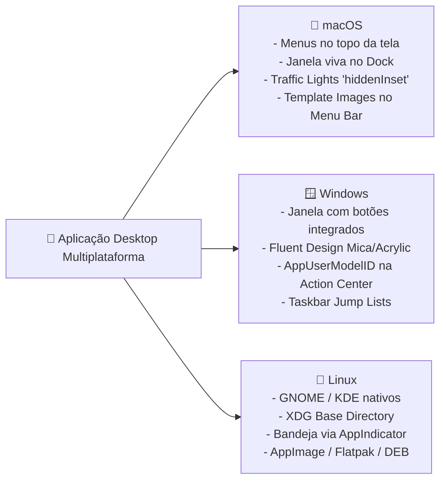

# 🖥️ Guia de Plataforma, OS e Ergonomia Desktop (macOS, Windows, Linux)

<div align="center">

[](../../README.md)
[](../../README.md)
[](../../README.md)

<p align="center">
  <b>Manual de integração com subsistemas operacionais nativos, ergonomia de janelas, bandejas de sistema, design adaptativo e acessibilidade universal no desktop.</b>
</p>

</div>

---

## 📚 Sumário Executivo

1. **A Tríade dos Sistemas Operacionais: Filosofias de Interface**
2. **Integração Profunda com macOS (Darwin / Apple Silicon)**
3. **Integração Profunda com Microsoft Windows (Windows 11 / Fluent Design)**
4. **Integração Profunda com Linux (GNOME, KDE, Wayland vs X11)**
5. **Acessibilidade Vestibular e Visual (Reduced Motion e APCA)**
6. **Ergonomia de Teclado, Atalhos e Foco Visível**

---

## 1. A Tríade dos Sistemas Operacionais

Uma aplicação multiplataforma de sucesso não tenta forçar uma interface única genérica em todos os ambientes. Ela se adapta às expectativas comportamentais de cada usuário:



---

## 2. Integração Profunda com macOS

### 2.1 Decorações de Janela e Traffic Lights
O visual moderno no macOS elimina a barra de título tradicional e posiciona os botões "semáforo" (fechar, minimizar, maximizar) integrados ao cabeçalho da UI:

```typescript
// Configuração no BrowserWindow para macOS
const macWindow = new BrowserWindow({
  titleBarStyle: 'hiddenInset', // Insere os botões nativos com padding elegante
  trafficLightPosition: { x: 16, y: 16 },
  vibrancy: 'under-window', // Efeito translúcido nativo do macOS
  visualEffectState: 'active'
});
```

### 2.2 Ícones de Menu Bar / Tray com Suporte Automático a Dark/Light Mode
No macOS, os ícones da barra de menus superior devem ser **Template Images** monocromáticas para que o sistema alterne automaticamente a cor (preto/branco) conforme o tema ou wallpaper do usuário:
- Nomeie os arquivos como `trayTemplate.png` ($16\times16$) e `trayTemplate@2x.png` ($32\times32$).
- O Electron reconhece a convenção `Template` automaticamente e aplica a máscara correta.

```typescript
import { Tray, nativeImage } from 'electron';
import path from 'path';

const icon = nativeImage.createFromPath(path.join(__dirname, 'assets/trayTemplate.png'));
icon.setTemplateImage(true); // Força marcação de template
const tray = new Tray(icon);
```

### 2.3 Universal Binaries para Apple Silicon
Gere sempre pacotes universais (`x64` + `arm64`) para que a aplicação execute com máxima performance nos chips Apple Silicon (M1/M2/M3/M4) sem depender da tradução do Rosetta 2.

---

## 3. Integração Profunda com Microsoft Windows

### 3.1 Materiais Fluent Design: Mica e Acrylic
No Windows 11, aplicações modernas utilizam materiais dinâmicos de fundo que capturam sutilmente as cores da área de trabalho:

```typescript
const winWindow = new BrowserWindow({
  backgroundMaterial: 'mica', // 'mica' | 'acrylic' | 'tabbed' (Windows 11)
  titleBarOverlay: {
    color: '#0f172a',
    symbolColor: '#f8fafc',
    height: 38
  }
});
```

### 3.2 Notificações do Action Center (`app.setAppUserModelId`)
No Windows, se a aplicação disparar uma notificação nativa sem configurar o identificador de modelo do usuário, a notificação será silenciosa ou não exibirá o ícone e nome corretos:

```typescript
// Deve ser executado antes de app.whenReady()
if (process.platform === 'win32') {
  app.setAppUserModelId('com.empresa.desktopapp');
}
```

### 3.3 Taskbar Jump Lists e Thumbnails
Permite que o usuário clique com o botão direito no ícone da barra de tarefas do Windows e acione ações rápidas:
```typescript
app.setUserTasks([
  {
    program: process.execPath,
    arguments: '--new-document',
    title: 'Novo Documento',
    description: 'Cria um novo documento imediatamente'
  }
]);
```

---

## 4. Integração Profunda com Linux

### 4.1 Diversidade de Ambientes e Gerenciadores de Janela
No ecossistema Linux, o aplicativo convive com **GNOME (Mutter)**, **KDE Plasma (KWin)**, **XFCE** e compositores **Wayland**:
- Não force botões customizados de janela do Windows no Linux. Utilize decorações nativas do servidor (`frame: true`) ou respeite o tema GTK do usuário.
- Para ícones de bandeja em distribuições modernas, garanta a dependência `libappindicator3-1` documentada no pacote `.deb`.

### 4.2 Armazenamento Seguro de Segredos com `safeStorage`
Em vez de gravar tokens em texto plano no disco, utilize a API nativa `safeStorage` do Electron:
- No Linux, ela se integra automaticamente ao **Secret Service API** (GNOME Keyring / KWallet).
- No macOS, integra-se ao **Keychain**.
- No Windows, integra-se ao **DPAPI** (Data Protection API).

```typescript
import { safeStorage } from 'electron';

export function encryptSecret(plainText: string): Buffer {
  if (safeStorage.isEncryptionAvailable()) {
    return safeStorage.encryptString(plainText);
  }
  throw new Error('Criptografia nativa de hardware indisponível.');
}
```

---

## 5. Acessibilidade Vestibular e Visual

### 5.1 Salvaguarda Vestibular (`prefers-reduced-motion`)
Usuários com sensibilidade vestibular ou distúrbios de labirinto podem sofrer náuseas com transições e animações rápidas.
- O CSS da interface deve desativar ou simplificar todo movimento decorativo:

```css
@media (prefers-reduced-motion: reduce) {
  *,
  *::before,
  *::after {
    animation-duration: 0.01ms !important;
    animation-iteration-count: 1 !important;
    transition-duration: 0.01ms !important;
    scroll-behavior: auto !important;
  }
}
```

### 5.2 Redução de Transparência (`prefers-reduced-transparency`)
Quando o usuário ativa no SO a preferência de alto contraste ou redução de transparência:
- Efeitos como Mica, Acrylic e Vibrancy devem degradar imediatamente para planos de fundo sólidos (`#1e293b`), garantindo legibilidade perfeita.

### 5.3 Contraste Perceptual APCA & Estados de Interface
- **Contraste Mínimo APCA:** Texto padrão com $L_c \ge 60$ e títulos com $L_c \ge 75$.
- **4 Estados de Tela Mandatórios:** Toda tela de dados deve possuir interfaces desenhadas para:
  1. **Loading State:** Skeleton screens fluidos sem saltos de layout.
  2. **Empty State:** Ilustração ou mensagem clara com botão de ação prioritário.
  3. **Error State:** Descrição amigável do problema com código rastreável e botão de tentar novamente (Retry).
  4. **Success / Partial State:** Apresentação clara dos dados.

---

## 6. Ergonomia de Teclado, Atalhos e Foco Visível

Aplicações desktop corporativas são operadas primordialmente por usuários avançados de teclado:
- **Atalhos Mapeados por Plataforma:** Use `CommandOrControl` nos aceleradores de menu (`CommandOrControl+S` mapeia para `Cmd+S` no macOS e `Ctrl+S` no Windows/Linux).
- **Indicador de Foco Visível:** Nunca utilize `outline: none` sem prover alternativa visual clara (`:focus-visible`).
- **Navegação com Tab:** O fluxo de foco por `Tab` e `Shift+Tab` deve ser contínuo e nunca ficar preso em armadilhas de teclado (Keyboard Traps).
