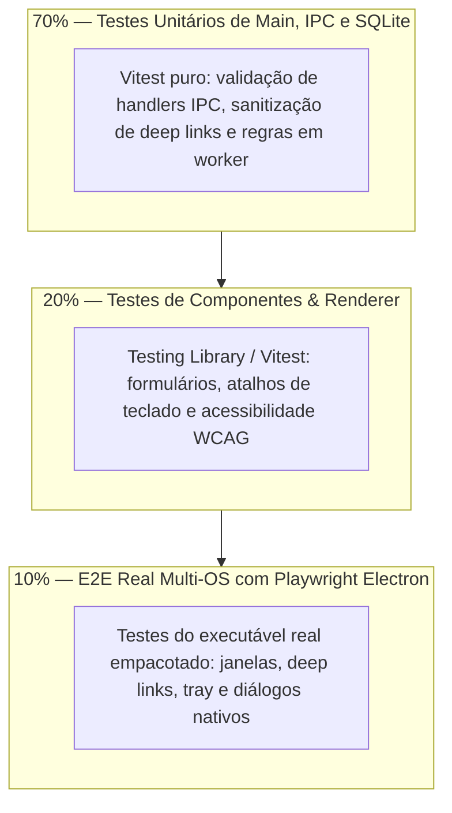

# 🖥️ Suíte Canônica de Testes Desktop

<div align="center">

[](../../../README.md)
[](README.md)
[](README.md)

<p align="center">
  <b>Diretrizes canônicas para testes automatizados em aplicações desktop: testes unitários de IPC e Main Process com Vitest, testes de componentes de interface e testes ponta a ponta (E2E) com Playwright Electron em runners multi-OS.</b>
</p>

</div>

---

## ⚙️ Heurísticas Executáveis

Bloco lido pelo `/setup` e por `skills/setup/scripts/verify_setup.py`. `when`/`verify` são comandos shell executados a partir da raiz do projeto desktop (`AI_GUIDES_RUNTIME` aponta para `.agents/ai-guides`). Heurísticas ativam quando artefatos de aplicações desktop são detectados (`electron-builder.yml`, `electron.vite.config.*`, `tauri.conf.json`, `package.json` com `electron`).

```yaml heuristics
guide: testing-desktop
version: 1
requires: [desenvolvimento-desktop]
heuristics:
  - id: TDSK-01
    title: Script de teste desktop configurado no package.json
    when: |
      sh "$AI_GUIDES_RUNTIME/templates/in_each.sh" --any desktop "test -f package.json && ! python3 \"$AI_GUIDES_RUNTIME/templates/testing/npm_script.py\" test"
    do: |
      agent: Adicione o script "test" no package.json do projeto desktop apontando para o test runner (ex.: "vitest" ou "jest").
    verify: |
      ! sh "$AI_GUIDES_RUNTIME/templates/detect_stack.sh" desktop || sh "$AI_GUIDES_RUNTIME/templates/in_each.sh" --all desktop "! test -f package.json || python3 \"$AI_GUIDES_RUNTIME/templates/testing/npm_script.py\" test"

  - id: TDSK-02
    title: Estrutura segregada de testes desktop (unitários IPC/Main e E2E)
    when: |
      sh "$AI_GUIDES_RUNTIME/templates/in_each.sh" --any desktop "! test -d test && ! test -d tests && ! test -d __tests__ && ! test -d e2e"
    do: |
      agent: Crie a estrutura canônica de testes desktop (ex.: test/unit para Main/IPC e test/e2e para Playwright Electron).
    verify: |
      ! sh "$AI_GUIDES_RUNTIME/templates/detect_stack.sh" desktop || sh "$AI_GUIDES_RUNTIME/templates/in_each.sh" --all desktop "test -d test || test -d tests || test -d __tests__ || test -d e2e"

  - id: TDSK-03
    title: Padrão AAA e mock de chamadas nativas de hardware/SO
    when: |
      sh "$AI_GUIDES_RUNTIME/templates/detect_stack.sh" desktop && { git grep -h --untracked -iE -e 'http:[/]/|https:[/]/api\.' -- '*__tests__*' '*.test.*' '*.spec.*' ':(glob)**/test*/**' ':(glob)**/__tests__/**' ':!.agents' ':!docs' ':!*.md' 2>/dev/null | grep -qvE 'https?://(localhost|127\.0\.0\.1|0\.0\.0\.0)'; }
    do: "agent: Substitua URLs e chamadas de rede externas nos testes desktop por mocks determinísticos (ex.: msw, vi.fn() ou contratos locais)."
    verify: |
      ! sh "$AI_GUIDES_RUNTIME/templates/detect_stack.sh" desktop || ! { git grep -h --untracked -iE -e 'http:[/]/|https:[/]/api\.' -- '*__tests__*' '*.test.*' '*.spec.*' ':(glob)**/test*/**' ':(glob)**/__tests__/**' ':!.agents' ':!docs' ':!*.md' 2>/dev/null | grep -qvE 'https?://(localhost|127\.0\.0\.1|0\.0\.0\.0)'; }
```

---

## 📚 Documentos Normativos da Suíte de Testes Desktop

A suíte divide-se em 4 guias canônicos de engenharia:

1. **[`test-writing-standards.md`](test-writing-standards.md):** Padrão AAA (*Arrange, Act, Assert*), testes unitários para Main Process e IPC, banco SQLite em memória e testes E2E com Playwright Electron.
2. **[`test-execution-guide.md`](test-execution-guide.md):** Execução local rápida, modo headless no Linux com Xvfb, otimização de cache de dependências C++ e matriz CI Multi-OS.
3. **[`troubleshooting.md`](troubleshooting.md):** Diagnóstico de testes instáveis (*flaky tests*), mismatch de ABI em módulos nativos C++, fechamento de timers e concorrência IPC.
4. **[`test-modernization-plan.md`](test-modernization-plan.md):** Roteiro estratégico de 4 fases para modernização de aplicações desktop legadas sem testes ou presas a Spectron.

---

## 🏛️ A Pirâmide de Testes Desktop Corporativa

Diferente de aplicações web tradicionais, testar aplicações desktop exige cobrir a fronteira entre JavaScript e o sistema operacional:



---

## 1. Testes Unitários de IPC e Main Process (70%)

Testam a lógica de negócios e contratos sem instanciar janelas do Chromium.

```typescript
// test/unit/ipc-handlers.test.ts
import { describe, it, expect, vi, beforeEach } from 'vitest';
import { handleSavePreferences } from '../../src/main/ipc-handlers';

describe('IPC Handlers: Preferences', () => {
  it('deve rejeitar payload com tema inválido retornando erro semântico (AAA)', async () => {
    // Arrange
    const invalidPayload = { theme: 'neon-invalid' } as any;

    // Act & Assert
    await expect(handleSavePreferences(null as any, invalidPayload))
      .rejects
      .toThrowError('Tema inválido');
  });
});
```

---

## 2. Testes de Componentes Renderer (20%)

Validam o comportamento de tela, foco por teclado e feedback visual sem depender do processo Main:

```typescript
// test/renderer/SettingsView.test.tsx
import { render, screen, fireEvent } from '@testing-library/react';
import { describe, it, expect, vi } from 'vitest';
import { SettingsView } from '../../src/renderer/SettingsView';

describe('SettingsView Component', () => {
  it('deve invocar o desktopAPI ao alterar a preferência de tema', async () => {
    // Arrange
    const saveMock = vi.fn().mockResolvedValue({ success: true });
    window.desktopAPI = { savePreferences: saveMock } as any;

    render(<SettingsView />);

    // Act
    const themeSelect = screen.getByLabelText(/Tema do Aplicativo/i);
    fireEvent.change(themeSelect, { target: { value: 'dark' } });

    // Assert
    expect(saveMock).toHaveBeenCalledWith(expect.objectContaining({ theme: 'dark' }));
  });
});
```

---

## 3. Testes End-to-End (E2E) com Playwright Electron (10%)

Iniciam o binário do Electron real e interagem com a janela nativa:

```typescript
// test/e2e/app-launch.spec.ts
import { test, expect, _electron as electron } from '@playwright/test';
import path from 'path';

test.describe('Desktop E2E Lifecycle', () => {
  test('deve iniciar a aplicação sem erros de console e exibir a tela principal', async () => {
    // Arrange: Lança o processo Electron
    const electronApp = await electron.launch({
      args: [path.join(__dirname, '../../out/main/index.js')]
    });

    // Act: Obtém a primeira janela BrowserWindow aberta
    const window = await electronApp.firstWindow();
    await window.waitForLoadState('domcontentloaded');

    // Assert: Valida título da janela e presença de elemento chave
    const title = await window.title();
    expect(title).toBe('DesktopApp');

    const heading = window.locator('h1');
    await expect(heading).toContainText('Bem-vindo');

    // Teardown: Encerra o app de forma graciosa
    await electronApp.close();
  });
});
```

---

## 4. Matriz de Execução Multi-OS em CI/CD (GitHub Actions)

A esteira de integração contínua deve validar a suíte em runners reais de cada sistema operacional:

```yaml
# .github/workflows/desktop-ci.yml
name: Desktop Multi-OS Test Matrix

on: [push, pull_request]

jobs:
  test:
    strategy:
      matrix:
        os: [macos-latest, windows-latest, ubuntu-latest]
    runs-on: ${{ matrix.os }}
    steps:
      - uses: actions/checkout@v4
      - uses: actions/setup-node@v4
        with:
          node-version: 20
          cache: 'npm'
      - run: npm ci
      - run: npm run test:unit
      - name: E2E Playwright (Headless Display no Linux)
        run: |
          if [ "$RUNNER_OS" == "Linux" ]; then
            xvfb-run --auto-servernum -- npm run test:e2e
          else
            npm run test:e2e
          fi
```
