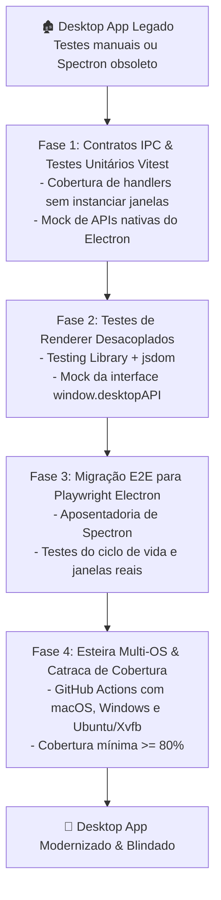

# 🔄 Plano de Modernização de Testes Desktop

> **Fonte Normativa:** `guides/testing/desktop/test-modernization-plan.md`  
> **Objetivo:** Roteiro prático para modernizar aplicações desktop legadas sem testes ou presas a ferramentas obsoletas (Spectron, WebdriverIO legado).

---

## 1. Diagnóstico do Débito Técnico em Testes Desktop Legados

Aplicações desktop que nasceram em versões antigas do Electron (v12 a v20) costumam sofrer de quatro problemas críticos:
1. **Ferramental Obsoleto:** Uso do **Spectron** (descontinuado oficialmente pelo time do Electron em 2022) ou automação frágil via Selenium tradicional.
2. **Dependência de `nodeIntegration: true` nos Testes:** Testes antigos que manipulavam diretamente APIs de Node dentro da tela de teste, impedindo a modernização de segurança.
3. **Ausência de Camada Unitária Rápida:** Dependência de testes E2E lentos e instáveis para validar regras simples de negócio.
4. **Falta de Execução em Runners Multi-OS:** Testes executados apenas em ambiente macOS ou Windows local, sem prova contínua no CI.

---

## 2. O Roteiro de Modernização em 4 Fases

---

### Fase 1: Isolamento de Contratos IPC e Testes Unitários Rápidos
- **Ação:** Extraia todos os handlers de `ipcMain.handle` em funções puras testáveis que recebem dependências injetadas (repositórios, stores locais).
- **Meta:** Implementar testes unitários com **Vitest** rodando em microssegundos para 100% dos canais IPC críticos.
- **Resultado:** Validação imediata de regras de validação de payload sem precisar abrir uma única janela.

### Fase 2: Testes de Renderer Desacoplados
- **Ação:** Isole a interface de usuário (React, Vue, Svelte) de chamadas diretas de Electron. Toda interação com o sistema deve ocorrer através de `window.desktopAPI`.
- **Meta:** Instalar `@testing-library/react` com `vitest-environment-jsdom`.
- **Resultado:** Testes de formulários, botões, estados de carregamento (Skeleton/Error) e navegação por teclado executando na esteira padrão de frontend.

### Fase 3: Migração E2E para Playwright Electron
- **Ação:** Desinstale completamente pacotes obsoletos como `spectron`.
- **Meta:** Instalar `@playwright/test` e estruturar testes ponta a ponta em `test/e2e/` utilizando `_electron.launch`.
- **Cobertura Mínima E2E:**
  1. Boot do aplicativo e ausência de erros graves no console.
  2. Fluxo crítico principal (ex: login, criação de documento, sincronização offline).
  3. Fechamento gracioso e controle de instâncias com `requestSingleInstanceLock`.

### Fase 4: Esteira Multi-OS & Governança Contínua
- **Ação:** Provisionar a matriz de testes no CI/CD (`.github/workflows/desktop-tests.yml`).
- **Garantias:**
  - Instalação de `xvfb-run` no runner Linux.
  - Bloqueio de merge em PRs caso a cobertura de linhas caia abaixo de $80\%$.
  - Execução semanal agendada para detectar quebras por atualizações upstream do Electron.
