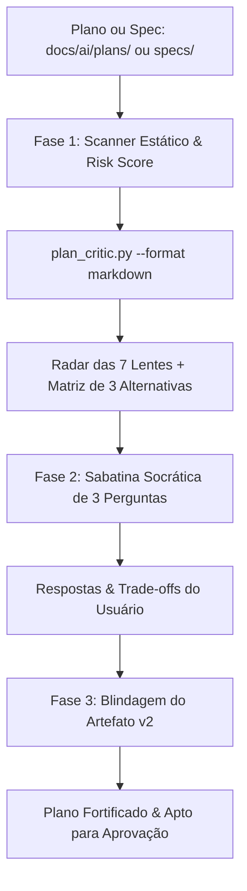

# 🛡️ Plan & Spec Critic (`plan-criticize`)
> **Red Team de Planejamento, Advogado do Diabo Socrático & Auditor de Conformidade Normativa**

Esta skill atua no momento mais decisivo do ciclo de vida de software: **o teste de estresse e a blindagem de planos técnicos (`docs/ai/plans/`) ou especificações de produto (`docs/ai/specs/`) ANTES que qualquer linha de código seja implementada**.

Seu objetivo é destruir premissas ingênuas, expor complexidade acidental, mapear casos de borda ocultos, calcular o blast radius de falha e garantir conformidade com os **guias normativos da Casa Publicadora Brasileira**.

---

## 🧭 Fluxo Operacional Híbrido (As 3 Fases)



---

## 🥊 1. O Questionário Canônico Obrigatório

Em qualquer invocação desta skill, o agente deve instanciar e responder ou provocar diretamente os 10 eixos canônicos:

1. **O que você está tentando construir?** *(Clareza do core path vs ruído de escopo).*
2. **Quais são as restrições?** *(Prazos, custos, latência, throughput, limites de memória, contratos legados).*
3. **Quais são os casos de borda?** *(Falhas de rede, payloads anômalos, concorrência, timeouts, transações parciais).*
4. **Quais são duas ou três formas possíveis de resolver isso?** *(Exploração ativa de alternativas viáveis).*
5. **Qual delas você escolheria e por quê?** *(Defesa explícita do trade-off pelo autor).*
6. **Peça para criticar seu plano:** *(Onde há otimismo excessivo e complexidade acidental).*
7. **Pergunte o que você deixou passar:** *(Blind spots, variáveis de ambiente, dependências cíclicas).*
8. **Pergunte quais alternativas existem:** *(Contraste com solução lean/minimalista).*
9. **Pergunte onde o projeto pode falhar:** *(Análise Pre-Mortem: "Assuma que quebrou em produção às 3h da manhã").*
10. **Peça para comparar sua abordagem com outra:** *(Trade-offs explícitos de manutenibilidade e reversibilidade).*

---

## 🔍 2. As 7 Lentes Críticas de Avaliação

Toda análise aplica rigorosamente as seguintes 7 lentes:

| Lente | Foco de Investigação | Pergunta Provocativa |
|---|---|---|
| **1. Navalha de Ockham & Escopo Acidental** | Eliminação de overengineering e abstrações prematuras. | *Qual é a solução de 20 linhas que resolve 80% do problema sem criar novas tabelas ou microserviços?* |
| **2. Pre-Mortem & Blast Radius** | Modos de falha catastróficos e raio de destruição. | *Se este deployment for revertido na madrugada, qual foi o gatilho da falha e quantos usuários foram impactados?* |
| **3. Casos de Borda & Invariantes** | Concorrência, idempotência e limites numéricos. | *O que ocorre em condições de corrida extremas ou quando um payload chega com valores nulos/duplicados?* |
| **4. Viabilidade & Reversibilidade (Rollback)** | Procedimento de contingência e desacoplamento. | *Como é feito o rollback em caso de falha no meio de uma migração sem perda de integridade?* |
| **5. Matriz de 3 Alternativas** | Contraste sistemático de soluções. | *Como o plano atual se compara a uma solução Lean (mínimo esforço) e a uma solução Enterprise (resiliente)?* |
| **6. Testabilidade & Pirâmide** | Estratégia empírica de validação. | *Como você prova que funciona antes de produção (Unit > Integration > E2E)? Quais são os critérios mensuráveis?* |
| **7. Conformidade com Guias Normativos** | Aderência aos padrões institucionais da CPB. | *O plano respeita as regras de Zero-Trust, Governança de ADRs, Harness `docs/ai/` e Acessibilidade WCAG?* |

---

## 🏛️ 3. Checklist de Conformidade com os Guias Normativos da CPB

O agente deve auditar o plano contra os guias de engenharia da Casa Publicadora Brasileira:

1. **Harness & Estrutura de Artefatos (`guia-completo-harness-commit-memoria.md`)**:
   - O artefato reside em `docs/ai/plans/`, `docs/ai/specs/` ou `{task-slug}.md`?
   - O plano respeita a regra de aprovação explícita antes de qualquer execução de código?
2. **Segurança Defensiva Zero-Trust (`guia-seguranca-defensiva-zero-trust.md`)**:
   - Há validação estrita em todas as bordas (APIs, inputs, mensagens)?
   - Segredos são obtidos via variáveis de ambiente/1Password CLI e nunca commitados?
3. **Padrão de Criação de ADRs (`guia-padrao-criacao-adrs.md`)**:
   - A mudança altera banco, introduz biblioteca pesada, altera segurança ou quebra contratos? Se sim, prevê emissão de ADR em `docs/adrs/`?
4. **Estratégia & Pirâmide de Testes (`testing/README.md`)**:
   - Segue o padrão AAA (Arrange, Act, Assert)? Há testes de regressão e cenários de falha previstos?
5. **Design UI/UX & Acessibilidade (`design-ui-ux/README.md`)** *(quando aplicável)*:
   - Respeita WCAG 2.2 AA/AAA, Design Tokens e proteção Anti-Slop?

---

## ⚡ 4. Execução Prática Passo a Passo

### Passo 1: Execução do Scanner CLI
Ao ser invocado com um arquivo ou ao receber um plano, rode:
```bash
python3 skills/software-engineering/plan-criticize/scripts/plan_critic.py <caminho-do-plano> --format markdown
```
Ou use `--format json` se estiver orquestrando com subagentes.

### Passo 2: Apresentação da Matriz de 3 Alternativas
Apresente uma tabela comparativa com:
- **Abordagem A (Status Quo do Plano):** A solução conforme proposta no documento.
- **Abordagem B (Lean / Mínima Intervenção):** A forma mais simples possível (mínimo de arquivos, zero dependências novas).
- **Abordagem C (Robusta / Enterprise):** Abordagem totalmente desacoplada, orientada a eventos ou com isolamento de falhas.

### Passo 3: Sabatina Socrática (3 Perguntas Bloqueantes)
Dispare apenas **3 perguntas cirúrgicas e contundentes** geradas para o contexto específico do usuário, exigindo resposta sobre as maiores vulnerabilidades do documento.

### Passo 4: Blindagem e Atualização do Plano
Após a resposta do usuário:
1. Atualize o plano adicionando as seções de **Casos de Borda Blindados**, **Procedimento de Rollback** e **Plano de Contingência**.
2. Salve o plano fortificado no mesmo arquivo ou em `docs/ai/plans/<nome>-v2.md`.
3. Notifique o usuário que o plano está agora blindado e pronto para a **Aprovação Explícita** antes da codificação.
