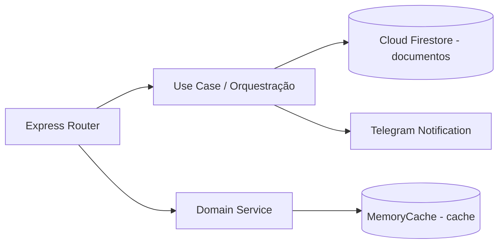

<!--
================================================================================
LOG DE MANUTENÇÃO DE DOCUMENTAÇÃO
--------------------------------------------------------------------------------
Data       | Autor         | Descrição
--------------------------------------------------------------------------------
2026-11-09 | Matheus Diniz | Criação da ADR 0002 registrando adesão ao estilo ddd-pragmatico.
================================================================================
-->

# ADR 0002: Adotar estilo enxuto ddd-pragmatico no backend com Use Cases sob demanda

| Metadado | Detalhe |
| :--- | :--- |
| **Status** | **Implementada** (2026-11-09) |
| **Decisores** | Matheus Diniz |
| **Tags** | `architecture`, `ddd-pragmatico`, `backend`, `functions` |
| **Impacto Sistêmico** | Médio (Cloud Functions em `functions/src/`) |
| **ADRs Relacionadas** | Complementa ADR-0001 |

## Contexto

O backend em `functions/` (Firebase Cloud Functions v2 + Express em TypeScript) atende fluxos focados de integração e persistência leve: consulta e cache de catálogo/live do YouTube e recepção de formulários comunitários (pedidos de oração e contato) com persistência no Cloud Firestore e notificação assíncrona no Telegram. Adotar uma arquitetura Hexagonal/Clean purista com múltiplas camadas de mapeamento, interfaces abstratas para repositórios únicos e agregados complexos introduziria boilerplate desproporcional ao domínio atual.

### Riscos Identificados e Problemas a Resolver

1. **Over-engineering em funções serverless**: camadas puristas excessivas aumentam a fricção de manutenção sem ganho real de isolamento em fluxos enxutos.
2. **Acoplamento acidental em rotas HTTP**: sem um padrão claro para fluxos com múltiplos efeitos colaterais (persistência + notificação externa), os routers Express tendem a acumular lógica de orquestração.
3. **Falsa abstração transacional**: tentar encapsular stores não-relacionais heterogêneos (Firestore e cache em memória) sob um único `UnitOfWork` mascara falhas parciais de rede.

## 1. Fundamentação Jurídica & Fontes Normativas Diretas

Não aplicável diretamente como obrigação legal, mas alinhado ao princípio de minimização e rastreabilidade técnica no tratamento de formulários submetidos pelos usuários.

## 2. Decisão de Arquitetura

Adotamos o estilo **`enxuto` (`ddd-pragmatico`)** conforme declarado em `docs/ai/setup-manifest.yaml`:

- **`backend_style`**: `enxuto` (vertical slice / modelo híbrido enxuto).
- **`backend_blocks`**: `use_cases` (adotado apenas nos fluxos com orquestração multi-etapa; `uow` dispensado pelo motivo `sem store transacional`).
- **`stores`**: `documentos,cache` (Cloud Firestore para documentos e `MemoryCache` com deduplicação *single-flight* para cache em memória).

### Critérios de Adoção e Dispensa dos Blocos

- **Use Cases (`use_cases`)**: adotados exclusivamente quando um fluxo coordena mais de um serviço ou efeito colateral (ex.: validação + persistência no Firestore + envio de alerta ao Telegram), mantendo leituras simples e repasses diretos nos serviços de domínio.
- **Unit of Work (`uow`)**: **não adotado** (`sem store transacional`). O projeto não possui banco relacional OLTP; as escritas no Firestore são atômicas por documento único.

### Matriz de Avaliação de Alternativas

| Critério | Clean/Hexagonal Purista | DDD Pragmático Enxuto (eleito) | Script Procedural nas Rotas |
| :--- | :--- | :--- | :--- |
| **Custo / Esforço** | Alto | Baixo | Baixo |
| **Clareza de Orquestração** | Alta | Alta | Baixa |
| **Complexidade Operacional** | Média | Baixa | Baixa |
| **Testabilidade Unitária** | Alta | Alta | Baixa |

## Escopo do Unit of Work

Escopo geral do bloco `Unit of Work`: **não adotado** (`sem store transacional` — o projeto utiliza apenas documentos no Firestore e cache em memória).

| Store | UoW cobre? | Por quê | Consistência entre stores |
| :--- | :--- | :--- | :--- |
| `documentos` (Cloud Firestore) | Não (não adotado) | Escritas ocorrem em documento único por submissão (`prayer_requests`, `contacts`), sem invariante multi-documento que exija transação explícita. | Reconciliação idempotente e disparo assíncrono tolerante a falhas (`Promise.allSettled`) para efeitos externos (Telegram). |
| `cache` (`MemoryCache` in-memory) | Não | Cache volátil de leitura com TTL e coalescência *single-flight*; não participa de transações de escrita. | Expiração por TTL e invalidação explícita (`clear`), nunca transação distribuída. |

## 3. Matriz de Implementação Técnica (*IN-CODE*)

### 3.1. Backend / API Gateway

- `functions/src/routes/`: routers Express responsáveis apenas por contrato HTTP, validação de entrada (Zod) e delegação.
- `functions/src/services/`: serviços coesos (`forms.service.ts`, `youtube.service.ts`, `telegram.service.ts`, `cache.service.ts`) seguindo o núcleo enxuto.

### 3.2. Frontend / Client

- O frontend Angular (`frontend/src/app/`) consome os contratos HTTP sem acoplamento à topologia interna dos stores do backend.

### 3.3. Persistência e Banco de Dados

- Persistência em coleções de documentos no Cloud Firestore (`prayer_requests`, `contacts`, `_health`) e cache em memória com proteção *single-flight*.

## 4. Matriz de Governança & Ações Institucionais (*OFF-CODE*)

| Ref | Ação | Responsável | Evidência |
| :--- | :--- | :--- | :--- |
| OFF-01 | Revisar novos fluxos de mutação conforme `.agents/rules/ddd-pragmatico.md`. | Engenharia | Code Review e manifesto `docs/ai/setup-manifest.yaml` |

## 5. Prazos Legais de Guarda e Políticas de Retenção

Não aplicável à decisão estrutural de camadas; as políticas de retenção seguem as regras das coleções do Firestore.

## 6. Matriz de Conformidade e Mitigação de Riscos

| Risco | Impacto | Mitigação |
| :--- | :--- | :--- |
| Chamadas HTTP externas dentro de transação | Alto | Operações externas (YouTube, Telegram) ocorrem fora de qualquer bloqueio transacional e usam `AbortSignal.timeout`. |
| Crescimento de regras de negócio com invariantes multi-documento | Médio | Caso surjam mutações coordenadas entre múltiplas coleções ou introdução de store relacional OLTP, graduar os fluxos afetados para `UnitOfWork` explícito. |

## 7. Consequências e Resultados

### Positivas

- Preserva a simplicidade do backend serverless em TypeScript sem abrir mão de fronteiras claras de responsabilidade.
- Documenta explicitamente por que `Unit of Work` não é utilizado sobre Firestore unidocumento e cache em memória.

### Mitigações e Desafios Gerenciados

- Exige disciplina em revisão de código (`.agents/rules/ddd-pragmatico.md`) para extrair Use Cases sempre que uma rota passar a orquestrar múltiplos serviços.
- Como o backend é Node/TypeScript, a fiscalização estática via `check_ddd_pragmatico.py` (específica para AST Python) fica marcada como `⏭️` e a governança ocorre via checklist arquitetural e testes automatizados.
