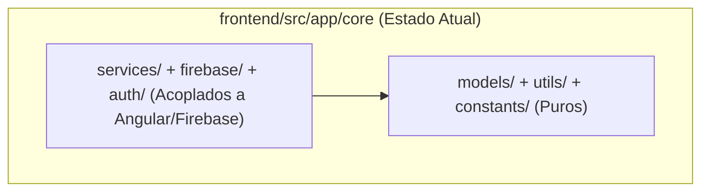

<!--
================================================================================
LOG DE MANUTENÇÃO DE DOCUMENTAÇÃO
--------------------------------------------------------------------------------
Data       | Autor         | Descrição
--------------------------------------------------------------------------------
2026-11-09 | Matheus Diniz | Criação da ADR 0003 registrando dívida técnica do contrato de camadas JS/TS (ARCH-04).
2026-11-10 | Matheus Diniz | Ativação do dependency-cruiser (.dependency-cruiser.js) escopado aos módulos puros (ARCH-04 ✅).
================================================================================
-->

# ADR 0003: Registrar dívida técnica do contrato estrito de camadas JS/TS (dependency-cruiser)

| Metadado | Detalhe |
| :--- | :--- |
| **Status** | **Aceita** (2026-11-09) |
| **Decisores** | Matheus Diniz |
| **Tags** | `architecture`, `clean-code`, `dependency-cruiser`, `tech-debt` |
| **Impacto Sistêmico** | Médio (`frontend/src/` e `functions/src/`) |
| **ADRs Relacionadas** | Complementa ADR-0002 |

## Contexto

A heurística `ARCH-04` do guia `arquitetura-clean-code` preconiza o uso de `dependency-cruiser` para impedir que módulos de domínio (`src/domain` ou `src/core`) importem diretamente frameworks, adaptadores de infraestrutura ou clientes HTTP. Em avaliação de pre-flight neste monorepo brownfield:

1. No **frontend Angular (`frontend/src/app/core/`)**, o diretório `core/` segue a convenção histórica do Angular CLI (Core Module / Singleton Services), contendo serviços injetáveis que dependem diretamente de `@angular/core`, `@angular/common/http`, `@angular/platform-browser` e `firebase/*`.
2. No **backend serverless (`functions/src/services/`)**, os serviços enxutos (`ddd-pragmatico`, ver ADR-0002) consomem diretamente `firebase-admin` e `fetch` nativo sem camada intermediária de portas/adaptadores.

### Imports Violadores Identificados no Pre-Flight

- `frontend/src/app/core/auth/auth.service.ts` -> `@angular/core`, `firebase/auth`
- `frontend/src/app/core/firebase/firebase.service.ts` -> `@angular/core`, `firebase/app`, `firebase/firestore`, `firebase/auth`, `firebase/storage`
- `frontend/src/app/core/seo/seo.service.ts` -> `@angular/core`, `@angular/common`, `@angular/platform-browser`, `@angular/router`
- `frontend/src/app/core/services/admin-cms.service.ts` -> `@angular/core`, `firebase/firestore`, `firebase/storage`
- `frontend/src/app/core/services/admin-cronograma.service.ts` -> `@angular/core`, `firebase/firestore`
- `frontend/src/app/core/services/bible.service.ts` -> `@angular/core`, `@angular/common/http`
- `frontend/src/app/core/services/content.service.ts` -> `@angular/core`, `firebase/firestore`
- `frontend/src/app/core/services/global-semantic-search.service.ts` -> `@angular/core`, `@tensorflow/tfjs`, `@tensorflow-models/universal-sentence-encoder`
- `frontend/src/app/core/services/pg-recommender.service.ts` -> `@angular/core`, `@tensorflow/tfjs`, `@tensorflow-models/universal-sentence-encoder`
- `frontend/src/app/core/services/story-canvas.service.ts` -> `@angular/core`
- `frontend/src/app/core/services/verse-ai.service.ts` -> `@angular/core`, `@angular/common/http`
- `frontend/src/app/core/services/youtube.service.ts` -> `@angular/core`, `@angular/common/http`
- `functions/src/services/forms.service.ts` -> `firebase-admin`
- `functions/src/services/youtube.service.ts` -> `fast-xml-parser`

## 1. Fundamentação Jurídica & Fontes Normativas Diretas

Não há obrigação legal direta; a decisão atende à governança arquitetural interna (`.agents/ai-guides/guides/architecture/guia-arquitetura-software-design-clean-code.md`, §5.3 e heurística `ARCH-04`).

## 2. Decisão de Arquitetura

Seguindo a regra de segurança de CI para projetos em produção (`ARCH-04`), **não ativamos `lint:deps` bloqueante no CI neste momento**, mantendo `ARCH-04` com status `⚠️` documentado até que:

1. No `frontend/`, os modelos e regras puras (`src/app/core/models/`, `src/app/core/utils/`, `src/app/core/constants/`) sejam formalmente separados dos serviços de infraestrutura Angular (`src/app/core/services/`, `src/app/core/firebase/`).
2. O contrato do `dependency-cruiser` possa ser escopado apenas aos subdiretórios puros (`models`, `utils`, `constants`) sem gerar falsos positivos nos serviços Angular injetáveis.

### Matriz de Avaliação de Alternativas

| Critério | Ativar `depcruise` bloqueante agora | Registrar ADR de dívida e manter ⚠️ (eleito) | Refatorar todo `src/app/core/` agora |
| :--- | :--- | :--- | :--- |
| **Estabilidade do CI** | Quebra imediata | Preservada (100% verde) | Risco alto de regressão em 45 specs |
| **Rastreabilidade** | Baixa | Alta (imports mapeados) | Alta |
| **Custo / Esforço** | Baixo | Baixo | Alto |

## 3. Matriz de Implementação Técnica (*IN-CODE*)

### 3.1. Backend / API Gateway

- `functions/src/` mantém o estilo enxuto documentado na ADR-0002, sem contrato bloqueante de camadas puristas.

### 3.2. Frontend / Client

- Novos utilitários e regras de cálculo puro devem residir em `frontend/src/app/core/utils/` e `frontend/src/app/core/models/`, livres de imports de `@angular/*` ou `firebase/*`.

### 3.3. Persistência e Banco de Dados

- Sem alterações na camada de persistência Firestore.

## 4. Matriz de Governança & Ações Institucionais (*OFF-CODE*)

| Ref | Ação | Responsável | Evidência |
| :--- | :--- | :--- | :--- |
| OFF-01 | Manter `frontend/src/app/core/utils/` e `models/` isentos de dependências de framework em code reviews. | Engenharia | Revisão de PR e `.agents/rules/arquitetura-clean-code.md` |

## 5. Prazos Legais de Guarda e Políticas de Retenção

Não aplicável a contratos estáticos de arquitetura.

## 6. Matriz de Conformidade e Mitigação de Riscos

| Risco | Impacto | Mitigação |
| :--- | :--- | :--- |
| Infiltração de dependências de UI/HTTP em `models/` e `utils/` | Médio | Testes unitários rápidos e isolados para `utils/` e `models/` sem `TestBed` do Angular. |

## 7. Consequências e Resultados

### Positivas

- O pipeline de CI permanece íntegro e verde sem falsos positivos decorrentes da convenção `app/core/` do Angular.
- Todos os pontos de acoplamento entre `core/` e Angular/Firebase ficam inventariados para futura extração incremental.

### Mitigações e Desafios Gerenciados

- A heurística `ARCH-04` permanece sinalizada como `⚠️` no relatório de `/setup`, apontando diretamente para esta ADR.
