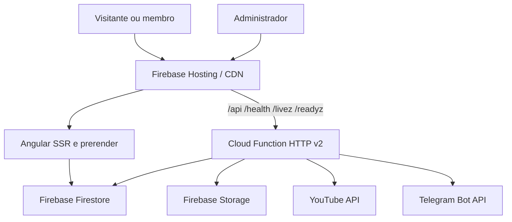

# System Design: Plataforma IASD Mangueiras

<!-- Fonte canônica: templates/architecture/system-design.md (guia-system-design-sistemas-distribuidos.md §1, The 4-Step Blueprint) — instalado por SYSD-02 -->

> Documento vivo. As seções 1 e 2 refletem o estado conhecido em 2026-10-17; as demais evoluem com ADRs em `docs/adrs/`.

## 1. Escopo e Requisitos

### 1.1. Requisitos Funcionais Essenciais
- Servir páginas públicas institucionais e conteúdo comunitário por Angular SSR/prerender.
- Disponibilizar autenticação e painel administrativo para gestão de eventos, comunicados, pequenos grupos, pedidos de oração e horários.
- Persistir dados administrativos e comunitários no Firebase Firestore e Storage, protegidos por regras de segurança.
- Expor uma API HTTP serverless em Firebase Cloud Functions para formulários, notificações Telegram e integração com playlists/transmissões do YouTube.
- Servir a API e o frontend pelo Firebase Hosting, com rewrite de `/api/**`, `/health`, `/livez` e `/readyz` para a função `api` na região `southamerica-east1`.

### 1.2. Fora do Escopo (explicitamente descartado)
- Backend Python/FastAPI, Scalar e banco relacional: não há implementação ativa correspondente neste monorepo.
- Processamento assíncrono dedicado com filas, workers ou brokers externos: não há componente implantado para isso.
- Metas de escala, disponibilidade e latência de produção: não há telemetria ou SLO formal versionado; devem ser definidos antes de uma decisão de escala.
- Multi-tenant genérico: o sistema atende a uma única comunidade institucional.

### 1.3. Requisitos Não-Funcionais (QARs)
| Atributo | Meta | Como medir |
| :--- | :--- | :--- |
| Disponibilidade | Não definida; Firebase Hosting/Functions/Firestore são dependências críticas | Métricas do Firebase e alertas de erro da função `api` |
| Latência | Não definida; endpoints devem responder sem trabalho externo em `/livez` | Logs e métricas de latência do Cloud Functions/Firebase Hosting |
| Consistência | CP para regras administrativas e gravações no Firestore; eventual para cache em memória e conteúdo externo do YouTube | Testes de regras Firestore, testes de integração e observação de cache |
| Durabilidade | Dados persistidos no Firestore dependem das garantias do Firebase; RPO/RTO do projeto ainda não definidos | Backups/exportações do Firestore e procedimento operacional documentado |

## 2. Estimativas de Ordem de Grandeza (Back-of-the-Envelope)
| Métrica | Estimativa (hoje) | Estimativa (5 anos) | Base de cálculo |
| :--- | :--- | :--- | :--- |
| Usuários ativos diários (DAU) | Não instrumentado | Não projetado | Medir acessos no Firebase Analytics/Hosting antes de projetar |
| QPS de leitura / escrita | Não instrumentado; pico configurado em até 10 instâncias da função `api` | Não projetado | Instrumentar requisições, duração e erros por rota |
| Storage total | Não inventariado; Firestore e Storage são provisionados pelo Firebase | Não projetado | Exportar métricas de uso e tamanho médio dos documentos |
| Largura de banda | Não instrumentada | Não projetada | Medir payloads do Hosting, SSR, API e mídia externa |
| Cache (RAM) | Cache em memória por instância; TTL padrão do YouTube: 1800 s | Não projetado | Medir taxa de acerto e memória por instância antes de dimensionar |

## 3. Arquitetura de Alto Nível (High-Level Design)

## 4. Deep Dive e Gargalos
### 4.1. Consistência de Dados (CAP / PACELC)
O Firestore é a fonte persistente para dados administrativos. Regras de segurança e operações de escrita devem privilegiar consistência e autorização; o cache em memória do YouTube é deliberadamente eventual por instância e pode divergir entre réplicas até o TTL expirar.

### 4.2. Camada de Borda e Roteamento
Firebase Hosting termina a entrada pública e encaminha `/api/**`, `/health`, `/livez` e `/readyz` para a Cloud Function `api` na região `southamerica-east1`. O frontend público restante usa prerender/SSR e fallback para `index.html` nas rotas configuradas.

### 4.3. Persistência e Sharding
A persistência usa Firestore e Storage gerenciados pelo Firebase. Não há shard key ou particionamento controlado pelo código; a evolução deve monitorar hot documents e padrões de acesso antes de introduzir agregações ou mudanças de modelagem.

### 4.4. Caching
A API mantém cache em memória por instância para dados do YouTube, com TTL configurável por `YOUTUBE_CACHE_TTL_SECONDS` e padrão de 1800 segundos. O cache não é compartilhado entre instâncias e não deve ser usado como fonte de verdade.

### 4.5. Assincronismo e Mensageria
As operações externas atuais são chamadas síncronas dentro da requisição HTTP, incluindo notificações Telegram e YouTube. Não há fila, Outbox ou DLQ implantados; endpoints que exigirem maior tolerância a falhas devem ganhar idempotência e processamento assíncrono em uma ADR própria.

### 4.6. Observabilidade
Há logs de execução da Cloud Function e logs de falha do readiness check. Métricas RED/USE, tracing distribuído e dashboards de negócio ainda não estão instrumentados.

## 5. Decisões Registradas
| ADR | Decisão |
| :--- | :--- |
| [docs/adrs/README.md] | Diretório canônico de ADRs e validação automatizada do projeto. |
