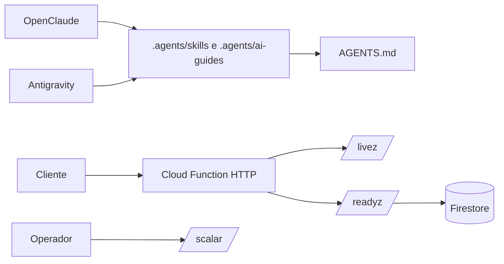

<!--
================================================================================
LOG DE MANUTENÇÃO DE DOCUMENTAÇÃO
--------------------------------------------------------------------------------
Data       | Autor         | Descrição
--------------------------------------------------------------------------------
2026-10-18 | Matheus Diniz | Registro consolidado da sessão de integração do harness.
================================================================================
-->

# Registro de Desenvolvimento — 2026-10-18

| Metadado | Detalhe |
| :--- | :--- |
| **Escopo Principal** | Integração do harness OpenClaude–Antigravity e endurecimento da plataforma |
| **Commits Gerados** | 6 |
| **Arquivos Modificados** | 747 |
| **ADRs Vinculadas / Geradas** | `docs/adrs/0001-api-health-scalar.md` |

## 1. Visão Geral das Alterações

A sessão materializou o runtime de guias e skills dentro do projeto, tornando a mesma árvore acessível ao OpenClaude e ao Antigravity por meio de symlinks locais e `AGENTS.md` como fonte única de instruções. Também foram configurados hooks, Graphify, memória, sandbox, CI, documentação e comandos canônicos do monorepo.

Na plataforma, foram adicionados thresholds de cobertura, typecheck e Stylelint ao frontend Angular, tokens semânticos de interface e health checks testados para as Cloud Functions. A API também ganhou uma referência interativa Scalar, com a decisão operacional registrada na ADR-0001.

## 2. Arquitetura Afetada & Decisões (ADRs)

- **Decisões Registradas:**
  - `docs/adrs/0001-api-health-scalar.md`: separa liveness de readiness dependente do Firestore e padroniza a referência Scalar da API.
- **Diretrizes de harness:**
  - `AGENTS.md` é a fonte única de instruções para os agentes.
  - `.claude/skills` e `.gemini/skills` apontam para `.agents/skills`.
  - O runtime permanece em `.agents/ai-guides/` para execução project-local e reversível.

## 3. Mapa de Arquivos Modificados

| Grupo | Arquivos principais | Camada técnica |
| :--- | :--- | :--- |
| Harness compartilhado | `.agents/`, `.claude/`, `.gemini/`, `.ai-jail`, `AGENTS.md`, `.github/` | Agentes, governança e CI |
| Projeto | `Makefile`, `.env.example`, `CHANGELOG.md`, `docs/` | Operação e documentação |
| Frontend | `frontend/angular.json`, `frontend/package.json`, `frontend/src/styles.css`, `frontend/src/tokens.css` | Angular, qualidade e design system |
| Backend | `functions/src/health.ts`, `functions/src/health.test.ts`, `functions/src/index.ts` | Cloud Functions, observabilidade e API |
| Dependências | `package-lock.json`, `frontend/package-lock.json`, `functions/package-lock.json` | Gerenciamento de pacotes |

## 4. Detalhamento por Commit

### `chore(harness): compartilhar skills com Antigravity`

- **Razão da alteração:** criar um ponto de entrada project-local para as skills e remover o alias legado `GEMINI.md`.
- **Comportamento atual:** OpenClaude e Antigravity podem resolver skills pela árvore compartilhada.
- **Arquivos envolvidos:** `.claude/skills`, `GEMINI.md`, `docs/adrs/TEMPLATE.md`.

### `chore(harness): materializar runtime compartilhado do projeto`

- **Razão da alteração:** tornar guias, regras e scripts disponíveis sem depender do runtime global.
- **Comportamento atual:** hooks, Graphify, memória, sandbox, proteção de segredos e workflows ficam configurados no repositório.
- **Arquivos envolvidos:** `.agents/`, `.claude/`, `.gemini/`, `.ai-jail`, `.github/`, `AGENTS.md`, `.gitignore` e `.graphifyignore`.

### `chore(project): configurar qualidade e documentação do monorepo`

- **Razão da alteração:** estabelecer comandos e estruturas canônicas para desenvolvimento, testes e documentação.
- **Comportamento atual:** `make typecheck` e `make lint` executam os checks no frontend; templates de docs, ADRs, domínio e produto ficam disponíveis.
- **Arquivos envolvidos:** `Makefile`, `.env.example`, `CHANGELOG.md`, `docs/`, configs Stylelint/Playwright e diretórios E2E.

### `feat(platform): adicionar qualidade frontend e health checks`

- **Razão da alteração:** automatizar qualidade do Angular e fornecer sinais operacionais confiáveis para a API.
- **Comportamento atual:** frontend executa cobertura/typecheck/Stylelint; Functions expõem `/livez`, `/readyz` e `/scalar`.
- **Arquivos envolvidos:** manifests e lockfiles, `frontend/src/tokens.css`, `frontend/src/styles.css`, `functions/src/health.ts`, `functions/src/health.test.ts` e `functions/src/index.ts`.

### `docs(adr): registrar health checks e Scalar da API`

- **Razão da alteração:** documentar a mudança de contrato operacional e a adoção de uma biblioteca central de API.
- **Comportamento atual:** a decisão, os trade-offs, os riscos e as ações operacionais estão rastreáveis na ADR-0001.
- **Arquivos envolvidos:** `docs/adrs/0001-api-health-scalar.md`.

## 5. Validações Executadas

- `npm test`: 45 arquivos e 270 testes aprovados.
- `npm --prefix functions test`: 3 testes aprovados.
- `npm --prefix frontend run typecheck`: aprovado.
- `npm --prefix frontend run lint:css`: aprovado.
- `make typecheck`: aprovado.
- `make lint`: aprovado.
- `npm run build`: aprovado.
- `python3 .agents/scripts/harness/verify_hooks.py`: 9 hooks executáveis.
- `python3 .agents/scripts/adr/validate_adrs.py`: ADRs em conformidade.

## 6. Dívida Técnica & Próximos Passos

- [ ] Versionar e manter uma especificação OpenAPI real em `/openapi.json`.
- [ ] Adicionar `openapi-diff` ao CI para detectar breaking changes.
- [ ] Completar a configuração ESLint Angular e auditoria `axe-core` dos fluxos E2E.
- [ ] Elevar gradualmente os thresholds de cobertura até 80% nos módulos críticos.
- [ ] Avaliar `dependency-cruiser`, métricas RED e tracing quando houver requisito operacional.

Nenhum commit foi enviado ao remoto durante esta sessão.
