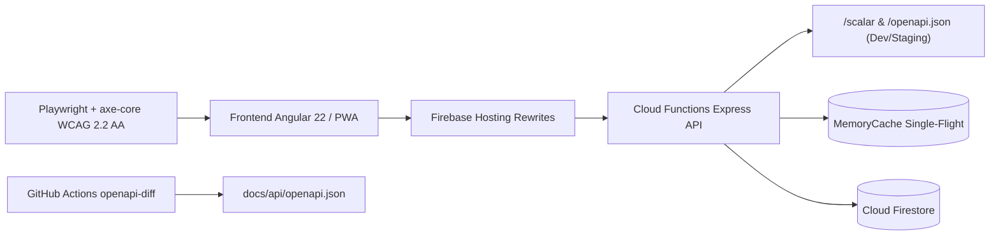

<!--
================================================================================
LOG DE MANUTENÇÃO DE DOCUMENTAÇÃO
--------------------------------------------------------------------------------
Data       | Autor          | Descrição
--------------------------------------------------------------------------------
2026-11-09 | Matheus Diniz  | Registro consolidado de desenvolvimento da sessão (setup incremental, OpenAPI 3.1, A11y E2E e ADRs 0002/0003).
================================================================================
-->

# Registro de Desenvolvimento — 2026-11-09

| Metadado | Detalhe |
| :--- | :--- |
| **Escopo Principal** | `setup-governanca-openapi-a11y` |
| **Commits Gerados** | `5` (incluindo este registro de sessão) |
| **Arquivos Modificados** | `233` |
| **ADRs Vinculadas / Geradas** | `docs/adrs/0002-adesao-ddd-pragmatico.md`, `docs/adrs/0003-debito-contrato-camadas-js.md` |

---

## 1. Visão Geral das Alterações

> Esta sessão concluiu a atualização determinística do `/setup` no monorepo fullstack (`frontend/` Angular 22 SSR e `functions/` Firebase Cloud Functions/Express), aprovando 28 guias normativos e 135 heurísticas com 0 falhas. Na camada de API e serviços, foram adicionados o contrato OpenAPI 3.1.0 versionado (`docs/api/openapi.json`), o suporte a erros padronizados RFC 9457 (`application/problem+json`) e a proteção *Single-Flight* contra *Cache Stampede* em `MemoryCache`. No frontend e infraestrutura, foram incorporados a suíte E2E de acessibilidade WCAG 2.2 AA com `@axe-core/playwright`, ícones PWA instaláveis/maskable, a suíte de observabilidade TUI em `mods/` e o pipeline CI `openapi-diff`.

---

## 2. Arquitetura Afetada & Decisões (ADRs)

- **Decisões Registradas:**
  - `docs/adrs/0002-adesao-ddd-pragmatico.md`: Formaliza o estilo arquitetural enxuto para o backend serverless (`functions/src/services/`), com divisão explícita de stores (`Firestore` documental e `MemoryCache` in-memory) sem camada artificial de Unit of Work.
  - `docs/adrs/0003-debito-contrato-camadas-js.md`: Registra a dívida técnica do contrato estrito de camadas JS/TS (`ARCH-04` / `dependency-cruiser`), mapeando os 14 módulos em `frontend/src/app/core/` e `functions/src/services/` que acoplam diretamente `@angular/*`, `firebase/*` e `firebase-admin`.
- **Diagrama de Relações e Fluxos:**

---

## 3. Mapa de Arquivos Modificados

| Arquivo | Camada Técnica | Resumo da Modificação |
| :--- | :--- | :--- |
| `functions/src/openapi.ts` | API / Contrato | Especificação OpenAPI 3.1.0 canônica com `securitySchemes.bearerAuth` |
| `functions/src/index.ts` | API / Gateway | Exposição condicional de `/scalar`, `/openapi.json` e handler de erros RFC 9457 |
| `functions/src/services/cache.service.ts` | Backend / Cache | Deduplicação concorrente `singleflight` contra Cache Stampede e TSDoc |
| `functions/src/services/youtube.service.ts` | Backend / Service | Rastreabilidade de leituras lock-free no cache de playlists e transmissões |
| `frontend/src/app/core/services/bible.service.ts` | Frontend / Core | Anotação de cache in-memory para versículos bíblicos |
| `frontend/src/app/core/services/pg-recommender.service.ts` | Frontend / Core | Anotação de cache in-memory de embeddings TensorFlow |
| `docs/api/openapi.json` | Documentação API | Artefato OpenAPI 3.1.0 exportado deterministicamente via `make openapi` |
| `e2e/a11y.spec.ts` | QA / E2E | Auditoria automatizada WCAG 2.2 AA nas 8 rotas públicas críticas |
| `frontend/public/manifest.webmanifest` | Frontend / PWA | Registro dos ícones `192x192` e `512x512` (`any` e `maskable`) |
| `firebase.json` / `storage.rules` | Infraestrutura Firebase | Rewrites para `/livez` e `/readyz`; expansão de pastas válidas no Storage |
| `docs/adrs/0002-adesao-ddd-pragmatico.md` | Governança / ADR | Decisão arquitetural sobre DDD pragmático e stores |
| `docs/adrs/0003-debito-contrato-camadas-js.md` | Governança / ADR | Inventário de acoplamento em `app/core/` e justificativa de `ARCH-04` |
| `.github/workflows/openapi-diff.yml` | CI/CD | Verificação automatizada de breaking changes no contrato OpenAPI |
| `mods/**` & `.claude/settings.json` | Harness / Observabilidade | Instalação da suíte de mods TUI e integração de hooks no OpenClaude |
| `docs/ai/setup-manifest.yaml` | Governança IA | Manifesto consolidado do `/setup` com 28 guias aprovados e 6 ignorados |

---

## 4. Detalhamento por Commit

### `feat(api): adicionar contrato OpenAPI 3.1, erros RFC 9457 e cache single-flight` (`474b107`)

- **Razão da alteração:** Atender às heurísticas `SCALAR-01..03`, `RESIL-06` e `DBENG-04`, garantindo documentação viva da API, padronização semântica de erros HTTP e proteção contra *Cache Stampede*.
- **Comportamento atual:** A API serve `/scalar` e `/openapi.json` fora de produção, responde com `application/problem+json` quando negociado ou em `/api/v2`, e deduplica chamadas simultâneas em `memoryCache.singleflight`.
- **Decisões técnicas & ADRs:** Alinhado às ADRs `0001` e `0002`.
- **Arquivos envolvidos:**
  - `functions/src/openapi.ts`: definição do schema OpenAPI 3.1.0 com `bearerAuth`.
  - `functions/src/index.ts`: rotas `/scalar`, `/openapi.json` e middleware de erro RFC 9457.
  - `functions/src/services/cache.service.ts`: método `singleflight<T>` e documentação TSDoc.
  - `functions/src/services/youtube.service.ts`, `frontend/src/app/core/services/bible.service.ts`, `frontend/src/app/core/services/pg-recommender.service.ts`: rastreabilidade de cache in-memory.
  - `docs/api/openapi.json`: especificação exportada.

### `feat(frontend): adicionar suite E2E WCAG 2.2 AA, icones PWA e regras de storage` (`73daa10`)

- **Razão da alteração:** Cumprir a heurística `UI-05` de acessibilidade automatizada e consolidar os ativos de PWA, SEO e regras de segurança do Firebase.
- **Comportamento atual:** O Playwright lista e executa 8 testes `axe-core` WCAG 2.2 AA sobre as rotas públicas; o `manifest.webmanifest` disponibiliza ícones `any` e `maskable`; `firebase.json` encaminha `/livez` e `/readyz`.
- **Decisões técnicas & ADRs:** Complementa a `ADR-0001` para probes de saúde no Firebase Hosting.
- **Arquivos envolvidos:**
  - `e2e/a11y.spec.ts`: suíte de acessibilidade com `@axe-core/playwright`.
  - `frontend/public/icons/*`, `frontend/public/manifest.webmanifest`, `frontend/src/index.html`, `frontend/public/sitemap.xml`: ativos PWA e metadados SEO.
  - `firebase.json`, `storage.rules`, `scripts/*`: rewrites de probes, regras de upload e utilitários operacionais.

### `docs(adr): registrar adesao ao DDD pragmatico e divida de camadas JS/TS` (`5650ae7`)

- **Razão da alteração:** Formalizar as decisões arquiteturais exigidas pelas heurísticas `DDDP-02` e `ARCH-04` em repositório brownfield.
- **Comportamento atual:** As ADRs `0002` e `0003` estão validadas por `.agents/scripts/adr/validate_adrs.py` e indexadas em `docs/adrs/README.md`.
- **Decisões técnicas & ADRs:** Cria `ADR-0002` e `ADR-0003`.
- **Arquivos envolvidos:**
  - `docs/adrs/0002-adesao-ddd-pragmatico.md`: registro do estilo enxuto e stores.
  - `docs/adrs/0003-debito-contrato-camadas-js.md`: inventário de imports violadores e plano de separação futura.
  - `docs/adrs/README.md`: índice atualizado de ADRs.

### `chore(harness): atualizar runtime ai-guides, mods de observabilidade e CI openapi-diff` (`48b2c9c`)

- **Razão da alteração:** Sincronizar o runtime `.agents/ai-guides/`, instalar os mods de observabilidade TUI (`MODS-01..05`), o job CI `openapi-diff` (`SCALAR-04`) e o manifesto final do `/setup`.
- **Comportamento atual:** Todos os 15 hooks (`.claude/settings.json` e `.gemini/settings.json`) passam em `verify_hooks.py`, `make openapi` exporta o contrato OpenAPI e `docs/ai/setup-manifest.yaml` reflete 28 guias aprovados.
- **Decisões técnicas & ADRs:** Governança de harness Nível 3.
- **Arquivos envolvidos:**
  - `.agents/**`, `AGENTS.md`, `Makefile`, `package.json`, `package-lock.json`, `.gitignore`: runtime, regras, scripts e dependências.
  - `mods/**`, `.claude/settings.json`: suíte de observabilidade TUI e hooks.
  - `.github/workflows/openapi-diff.yml`, `docs/ai/setup-manifest.yaml`, `docs/ai/plans/2026-10-18-melhorias-imediatas-pre-deploy.md`: esteira de contrato de API e artefatos de governança IA.

---

## 5. Dívida Técnica & Próximos Passos

- [ ] Extrair gradualmente modelos e regras puras de `frontend/src/app/core/services/` para `frontend/src/app/core/models/` e `utils/`, permitindo habilitar `dependency-cruiser` bloqueante (`ARCH-04`, conforme `ADR-0003`).
- [ ] Elevar progressivamente a cobertura unitária de `frontend/` do piso atual (`71% statements / 56% branches / 48% functions / 73% lines`) até a meta institucional de `≥ 80%`.
