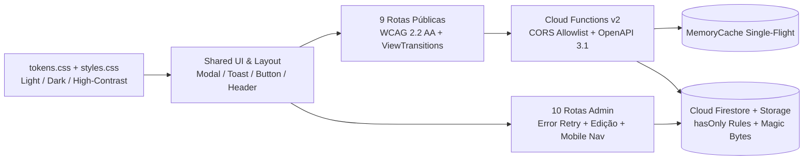

<!--
================================================================================
LOG DE MANUTENÇÃO DE DOCUMENTAÇÃO
--------------------------------------------------------------------------------
Data       | Autor          | Descrição
--------------------------------------------------------------------------------
2026-11-10 | Matheus Diniz  | Registro consolidado de desenvolvimento da sessão.
================================================================================
-->

# Registro de Desenvolvimento — 2026-11-10

| Metadado | Detalhe |
| :--- | :--- |
| **Escopo Principal** | `remediacao-360-e-revisao-design-rotas` |
| **Commits Gerados** | `7` |
| **Arquivos Modificados** | `85` |
| **ADRs Vinculadas / Geradas** | `docs/adrs/0003-debito-contrato-camadas-js.md` |

---

## 1. Visão Geral das Alterações
> Esta sessão concluiu a remediação integral dos 12 apontamentos da Auditoria 360° (`SEC-01..04`, `BUG-01..04`, `RISK-01..04`) e a Revisão Geral de Design, UI/UX, Mobile, Motion e Acessibilidade (WCAG 2.2 AA/AAA) em todas as **18 rotas** do portal público e do painel administrativo da IASD Mangueiras. Foram unificados os tokens multi-tema (`Light`, `Dark` e `High-Contrast AAA`), a escala semântica de camadas (`--z-*`), as transições nativas de rota (`withViewTransitions`), os alvos de toque mínimos de `44x44px`, os modais com Focus Trap e a integridade de persistência e cache nas Cloud Functions.

---

## 2. Arquitetura Afetada & Decisões (ADRs)
- **Decisões Registradas:**
  - `docs/adrs/0003-debito-contrato-camadas-js.md`: Homologação e implementação do `dependency-cruiser` nos workspaces (`root`, `frontend/`, `functions/`) integrado à esteira de CI/CD.
- **Diagrama de Relações e Fluxos:**

---

## 3. Mapa de Arquivos Modificados

| Arquivo | Camada Técnica | Resumo da Modificação |
| :--- | :--- | :--- |
| `.github/workflows/{ci,adr-lint,gitleaks,openapi-diff}.yml` | CI/CD & DevSecOps | Pinning SHA-256, `permissions: contents: read`, `timeout-minutes` e job `validate-functions`. |
| `firestore.rules` & `docs/database/database-schema.md` | Persistência & Segurança | Restrição `.keys().hasOnly(...)` em coleções públicas e documentação ER Mermaid das 15 coleções. |
| `functions/src/{config,index,openapi}.ts` | API / Cloud Functions | `appEnv` seguro por padrão (`K_SERVICE`), allowlist CORS estrita e contrato OpenAPI 3.1 completo. |
| `functions/src/services/{notification,youtube}.ts` | Domínio / Serviços | Propagação de erros do Firestore, `AbortSignal.timeout(5000)` no Telegram e `memoryCache.singleflight`. |
| `frontend/src/{tokens,styles}.css` & `tailwind.config.js` | Design System | Ponte semântica multi-tema (`.dark`, `.high-contrast`), keyframes `slideInRight`/`scaleUp`/`slideLeft` e `advent-blue-light`. |
| `frontend/src/app/shared/ui/**` & `layout/**` | Shared UI & Shell | Escala `--z-*`, Focus Trap em modais/busca, pausa de timer em toasts, touch targets `>= 44px` e `tabular-nums`. |
| `frontend/src/app/features/{home,horarios,ao-vivo,eventos,ministerios,estudos,sou-novo,contato,not-found}/**` | Rotas Públicas (1–9) | Correção de `routerLink` na 404, validação real de telefone, Google Calendar com data real, ARIA Tabs, `[inert]` em FAQs e migração Tailwind v4 -> v3. |
| `frontend/src/app/features/admin/**` | Rotas Admin (10–18) | Correção do menu mobile, remoção de dados falsos hardcoded, `try/catch/finally` com botão Retry, edição de comunicados e Focus Trap nos modais. |

---

## 4. Detalhamento por Commit

### `chore(ci): endurecer workflows com SHA pin, validate-functions e dependency-cruiser`
- **Razão da alteração:** Eliminar referências mutáveis em GitHub Actions, validar `functions/` na esteira principal e impor fronteiras arquiteturais via `dependency-cruiser`.
- **Comportamento atual:** Todos os 4 workflows operam com menor privilégio, actions pinadas por SHA de 40 caracteres e verificação estática de ciclos/camadas.
- **Decisões técnicas & ADRs:** Implementa a `ADR 0003`.
- **Arquivos envolvidos:**
  - `.github/workflows/ci.yml`, `adr-lint.yml`, `gitleaks.yml`, `openapi-diff.yml`
  - `.dependency-cruiser.js`, `frontend/.dependency-cruiser.js`, `functions/.dependency-cruiser.js`
  - `docs/adrs/0003-debito-contrato-camadas-js.md`

### `fix(database): restringir chaves publicas no firestore.rules e documentar schema`
- **Razão da alteração:** Impedir injeção de propriedades arbitrárias em formulários públicos (`SEC-03`) e documentar formalmente o banco NoSQL (`RISK-02`).
- **Comportamento atual:** `mensagens_contato`, `pedidos_oracao` e `pedidos_estudo` validam estritamente a lista de chaves permitidas.
- **Arquivos envolvidos:**
  - `firestore.rules`, `docs/database/database-schema.md`

### `fix(api): blindar CORS, propagar falhas do Firestore, aplicar singleflight e completar OpenAPI`
- **Razão da alteração:** Remediação de `SEC-01`, `SEC-02`, `BUG-01`, `BUG-02` e `RISK-01`.
- **Comportamento atual:** Ambiente Cloud Run assume `production` por padrão, falhas de gravação retornam HTTP 500/RFC 9457, chamadas concorrentes ao YouTube usam `singleflight` e `openapi.json` documenta 100% dos endpoints.
- **Arquivos envolvidos:**
  - `functions/src/config.ts`, `index.ts`, `openapi.ts`, `routes/forms.router.ts`, `services/notification.service.ts`, `services/youtube.service.ts`, `health.test.ts`
  - `docs/api/openapi.json`, `frontend/src/app/core/models/api-generated.d.ts`

### `feat(ui): unificar tokens multi-tema, escala z-index, view transitions e shared UI`
- **Razão da alteração:** Resolver o split-brain entre `tokens.css` e `tailwind.config.js`, corrigir inversão de z-index entre modais e toasts e garantir validação binária de uploads (`SEC-04`, `BUG-04`, `RISK-04`).
- **Comportamento atual:** Suporte real aos 3 temas (`Light`, `Dark`, `High-Contrast`), `withViewTransitions` ativo no roteador, validação de magic bytes em `AdminCmsService` e componentes base com touch targets `>= 44px`.
- **Arquivos envolvidos:**
  - `frontend/tailwind.config.js`, `src/styles.css`, `src/tokens.css`, `src/index.html`, `src/app/app.html`, `src/app/app.config.ts`
  - `frontend/src/app/core/services/admin-cms.service.ts`, `layout/**`, `shared/ui/**`

### `fix(frontend): remediar design, acessibilidade WCAG 2.2 AA e mobile nas 9 rotas publicas`
- **Razão da alteração:** Corrigir bugs funcionais e desvios de UX/acessibilidade detectados na auditoria das 9 rotas públicas.
- **Comportamento atual:** Navegação SPA na 404, máscara e validação exata de telefone em `/contato`, datas reais no Google Calendar em `/eventos`, loading skeleton conectado em `/ao-vivo`, `[inert]` nos FAQs colapsados e classes Tailwind v3 padronizadas.
- **Arquivos envolvidos:**
  - `frontend/src/app/features/{home,horarios,ao-vivo,eventos,ministerios,estudos,sou-novo,contato,not-found}/**`

### `fix(admin): corrigir layout mobile, remover dados falsos, adicionar edicao de comunicados e retry`
- **Razão da alteração:** Corrigir o menu mobile do Admin, remover dados falsos hardcoded em produção e adicionar tratamento de erros e edição de comunicados nas 10 rotas administrativas.
- **Comportamento atual:** Menu mobile fecha ao navegar e recolhe o rodapé do usuário, `/admin/oracoes` e `/admin` exibem estados reais sem dados fictícios, `/admin/comunicados` permite editar registros existentes e todos os carregamentos possuem `try/catch/finally` com botão Retry.
- **Arquivos envolvidos:**
  - `frontend/src/app/features/admin/**`

---

## 5. Dívida Técnica & Próximos Passos

- [ ] Avaliar evolução opcional para Data Tables com seleção em lote (Abordagem C) caso o volume de registros administrativos ultrapasse 100 itens por coleção.
- [ ] Executar a suíte E2E Playwright (`npm --prefix frontend run e2e`) contra o servidor de preview antes do corte de release.
