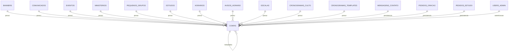

# Documentação de Schema de Banco de Dados

## 1. Visão Geral
Esta API utiliza Cloud Firestore (NoSQL) em `southamerica-east1` para persistência de dados. A arquitetura de cache L1 in-memory com *single-flight* é aplicada nas Cloud Functions para reduzir latência e custos de leitura.

## 2. Diagrama Entidade-Relacionamento

## 3. Dicionário de Dados
| Coleção | Campos | Restrições | Confiança |
| :--- | :--- | :--- | :--- |
| `eventos` | `titulo`, `data`, `descricao`, `imagemUrl`, `ativo`, `criadoEm` | `.keys().hasOnly([...])` | 🟢 Alta |
| `comunicados` | `titulo`, `texto`, `data`, `ativo`, `criadoEm` | `.keys().hasOnly([...])` | 🟢 Alta |
| `ministerios` | `nome`, `descricao`, `lider`, `imagemUrl`, `ativo`, `criadoEm` | `.keys().hasOnly([...])` | 🟢 Alta |
| `avisos_horarios` | `titulo`, `mensagem`, `dataInicio`, `dataFim`, `ativo`, `criadoEm` | `.keys().hasOnly([...])` | 🟢 Alta |
| `configuracoes` | `chave`, `valor`, `atualizadoEm` | `.keys().hasOnly([...])` | 🟢 Alta |
| `pequenos_grupos` | `nome`, `lider`, `diaSemana`, `horario`, `local`, `ativo`, `criadoEm` | `.keys().hasOnly([...])` | 🟢 Alta |
| `licoes` | `titulo`, `trimestre`, `ano`, `ativo`, `criadoEm` | `.keys().hasOnly([...])` | 🟢 Alta |
| `horarios_regulares` | `nome`, `horario`, `ordem`, `ativo`, `criadoEm` | `.keys().hasOnly([...])` | 🟢 Alta |
| `escalas` | `departamento`, `data`, `membros`, `criadoEm` | `.keys().hasOnly([...])` | 🟢 Alta |
| `cronogramas_culto` | `data`, `itens`, `ativo`, `criadoEm` | `.keys().hasOnly([...])` | 🟢 Alta |
| `cronogramas_templates` | `nome`, `itens`, `criadoEm` | `.keys().hasOnly([...])` | 🟢 Alta |
| `mensagens_contato` | `nome`, `email`, `telefone`, `assunto`, `mensagem`, `criadoEm`, `lido` | `.keys().hasOnly([...])` | 🟢 Alta |
| `pedidos_oracao` | `nome`, `email`, `telefone`, `pedido`, `privado`, `confidencial`, `criadoEm`, `orado`, `atendido`, `oracoesCount` | `.keys().hasOnly([...])` | 🟢 Alta |
| `pedidos_estudo` | `acao`, `estudoId`, `estudoTitulo`, `categoria`, `criadoEm`, `origem`, `nome`, `telefone`, `email` | `.keys().hasOnly([...])` | 🟢 Alta |
| `usuarios_admin` | `email`, `nome`, `nivel`, `ultimoAcesso` | `.keys().hasOnly([...])` | 🟢 Alta |

## 4. Matriz RBAC
- **Público**: `read` em conteúdos públicos; `create` em mensagens/pedidos com validação estrita.
- **Admin**: `read`/`write` em todas as coleções.
